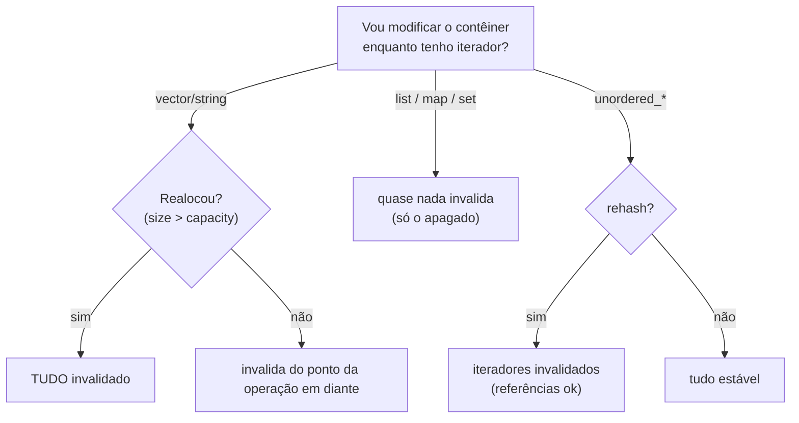

# Complexidade e invalidação de iteradores

## Complexidade por contêiner

| Operação | `vector` | `deque` | `list` | `map/set` | `unordered_*` |
|---|---|---|---|---|---|
| Acesso por índice | O(1) | O(1) | — | — | — |
| Inserir no fim | O(1)* | O(1) | O(1) | O(log n) | O(1)* |
| Inserir no início | O(n) | O(1) | O(1) | O(log n) | O(1)* |
| Inserir/remover no meio | O(n) | O(n) | **O(1)** (com iterador) | O(log n) | O(1)* |
| Buscar por valor/chave | O(n) | O(n) | O(n) | O(log n) | O(1)* |
| Iterar em ordem | Rápida | Média | Lenta | Média (ordem de chaves) | Média (sem ordem) |

\* amortizado ou médio.

## Invalidação de iteradores, ponteiros e referências

| Contêiner | Inserção | Remoção |
|---|---|---|
| `vector` | Se **realoca**: todos invalidam. Senão: do ponto de inserção em diante (e `end()`) | Do ponto removido em diante (e `end()`) |
| `deque` | Meio: tudo. Pontas: **iteradores** invalidam, **referências não** | Meio: tudo. Pontas: só o removido (e `end()`) |
| `list`, `forward_list` | **Nenhum** | Só o removido |
| `map`, `set` (e multi) | **Nenhum** | Só o removido |
| `unordered_*` | Se **rehash**: iteradores invalidam (referências **não**) | Só o removido |
| `string` | Como `vector` (cuidado com SSO) | Idem |
| `flat_map/flat_set` | Qualquer inserção pode invalidar tudo | Idem |



## O padrão correto de remoção durante a iteração

```cpp
// g++ -std=c++20 -Wall -Wextra
#include <iostream>
#include <list>
#include <map>
#include <vector>

int main() {
    // Contêineres de nós: erase retorna o próximo iterador
    std::map<int, char> m{{1, 'a'}, {2, 'b'}, {3, 'c'}, {4, 'd'}};
    for (auto it = m.begin(); it != m.end();) {
        if (it->first % 2 == 0) it = m.erase(it);     // atualiza 'it' com o retorno
        else ++it;
    }
    std::cout << m.size() << '\n';                     // 2

    // vector: use erase-remove (ou erase_if em C++20)
    std::vector<int> v{1, 2, 3, 4, 5, 6};
    std::erase_if(v, [](int x) { return x % 2 == 0; });
    for (int x : v) std::cout << x << ' ';
    std::cout << '\n';                                  // 1 3 5
}
```

> [!bug] Exemplo inválido proposital: invalidação silenciosa
> ```cpp
> std::vector<int> v{1, 2, 3};
> for (int x : v) {
>     if (x == 2) v.push_back(99);     // pode realocar no meio do range-for: UB
> }
> ```
> **Correção:** colete as alterações e aplique **depois** do laço, ou itere por **índice**.

> [!danger] Referências para elementos de `vector`
> `int& r = v[0]; v.push_back(1); r = 5;` é UB se `push_back` realocar. Se precisa de estabilidade, use `reserve`, `std::deque`/`std::list`, ou guarde **índices** em vez de iteradores/ponteiros.

> [!tip] Ferramentas
> `-D_GLIBCXX_DEBUG` (libstdc++), o modo de depuração do MSVC (`_ITERATOR_DEBUG_LEVEL`) e o AddressSanitizer detectam muitos usos de iteradores inválidos em testes.

## Veja também

- [[vector]]
- [[list e forward_list]]
- [[map e set]]
- [[unordered_map e unordered_set]]
- [[Vazamentos e Dangling Pointers]]

## Exercício

1. Escreva um laço que remova de um `std::unordered_set<int>` todos os múltiplos de 3, sem invalidar o iterador.
2. Reproduza uma invalidação em `vector` e capture-a com `-fsanitize=address` ou `-D_GLIBCXX_DEBUG`.
