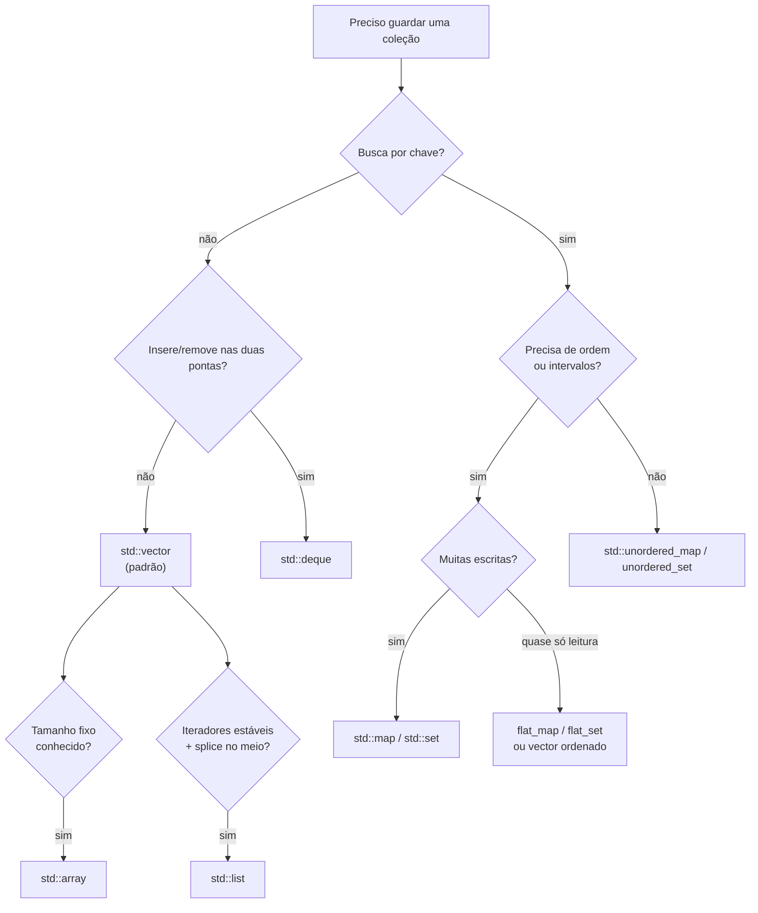

# Escolhendo um contêiner

## Fluxograma de decisão



## Tabela-resumo

| Necessidade | Contêiner |
|---|---|
| **Padrão** para sequências | `vector` |
| Tamanho fixo em compilação | `array` |
| `push_front` eficiente | `deque` |
| Iteradores/referências estáveis, `splice` | `list` |
| Chave → valor ordenado, intervalos | `map` |
| Chave → valor, só lookup | `unordered_map` |
| Conjunto sem duplicatas | `set` / `unordered_set` |
| Leitura intensa, escrita rara | `flat_map`, `flat_set` ou `vector` ordenado |
| Pilha / fila / prioridade | `stack` / `queue` / `priority_queue` |
| Bits | `bitset` (tamanho fixo), `vector<bool>` (dinâmico, especial) |
| Visão sobre dados contíguos | `span` |
| Capacidade fixa sem heap (C++26) | `inplace_vector` |

## Princípios

1. **Comece com `vector`.** Hardware moderno favorece memória contígua: muitas vezes o `vector` vence estruturas "teoricamente melhores".
2. **Meça**, não suponha: use `Google Benchmark` (seção de testes e qualidade).
3. **Reserve** (`reserve`) quando souber o tamanho.
4. Prefira **iterar** a buscar repetidamente.
5. Pense em **invalidação** e **posse** ao guardar iteradores/ponteiros ([[Complexidade e Invalidação de Iteradores]]).

> [!warning] "Mas `list` tem O(1) no meio!"
> A constante e os *cache misses* fazem `list` perder para `vector` em quase todos os cenários práticos de tamanho pequeno a médio. Só escolha `list` pelos seus **contratos** (estabilidade, `splice`), não pela complexidade assintótica.

## Exemplo: o mesmo problema com três contêineres

```cpp
// g++ -std=c++20 -Wall -Wextra
#include <algorithm>
#include <iostream>
#include <set>
#include <unordered_set>
#include <vector>

int main() {
    std::vector<int> entrada{5, 3, 5, 1, 3, 9, 1};

    // 1) vector + sort + unique: O(n log n), contíguo, resultado ordenado
    auto v = entrada;
    std::ranges::sort(v);
    v.erase(std::unique(v.begin(), v.end()), v.end());

    // 2) set: O(n log n), ordenado, nós separados
    std::set<int> s(entrada.begin(), entrada.end());

    // 3) unordered_set: O(n) médio, sem ordem
    std::unordered_set<int> u(entrada.begin(), entrada.end());

    std::cout << v.size() << s.size() << u.size() << '\n';   // 444
}
```

## Veja também

- [[Visão Geral da STL]]
- [[vector]]
- [[map e set]]
- [[unordered_map e unordered_set]]
- [[Complexidade e Invalidação de Iteradores]]

## Exercício

1. Para cada cenário, escolha o contêiner e justifique: (a) fila de pedidos FIFO; (b) dicionário de 10 milhões de palavras só para consulta; (c) cache LRU.
2. Meça o tempo de `contains` em `set`, `unordered_set` e `vector` ordenado + `binary_search` para 100, 10 mil e 1 milhão de elementos.
