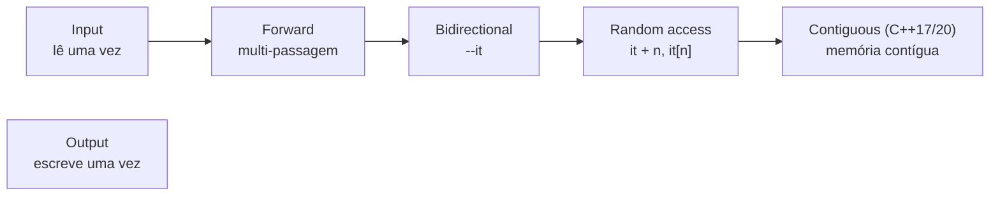

# Iteradores e categorias

Um **iterador** é uma abstração de "posição em uma sequência" que generaliza ponteiros. Algoritmos operam sobre **pares de iteradores** `[first, last)` — intervalo **semiaberto**: `first` incluído, `last` **excluído**.

## Operações básicas

| Expressão | Significado |
|---|---|
| `*it` | Elemento atual |
| `++it` | Avança |
| `it == fim` | Comparação |
| `c.begin()` / `c.end()` | Início / um-além-do-fim |
| `c.cbegin()` / `c.cend()` | Versões `const` |
| `c.rbegin()` / `c.rend()` | Reversos |

```cpp
// g++ -std=c++20 -Wall -Wextra
#include <iostream>
#include <iterator>
#include <list>
#include <vector>

int main() {
    std::vector<int> v{10, 20, 30, 40};

    for (auto it = v.begin(); it != v.end(); ++it) std::cout << *it << ' ';
    std::cout << '\n';

    for (auto it = v.rbegin(); it != v.rend(); ++it) std::cout << *it << ' ';   // reverso
    std::cout << '\n';

    auto it = v.begin();
    std::advance(it, 2);                            // avança 2 (O(1) em acesso aleatório)
    std::cout << *it << ' ' << std::distance(v.begin(), it) << '\n';   // 30 2
    std::cout << *std::next(it) << *std::prev(it) << '\n';              // 4020

    std::list<int> l{1, 2, 3};                      // iterador bidirecional: advance é O(n)
    auto lit = std::next(l.begin(), 2);
    std::cout << *lit << '\n';                      // 3

    // Iteradores de inserção: adaptam algoritmos para "inserir" em vez de "sobrescrever"
    std::vector<int> destino;
    std::copy(v.begin(), v.end(), std::back_inserter(destino));
    std::cout << destino.size() << '\n';            // 4
}
```

## Categorias

Cada categoria **acrescenta** capacidades à anterior:



| Categoria | Operações extras | Exemplos |
|---|---|---|
| **Input** | `*it` (leitura), `++` | `std::istream_iterator` |
| **Output** | `*it = x`, `++` | `std::ostream_iterator`, `back_inserter` |
| **Forward** | Várias passagens | `forward_list`, `unordered_*` |
| **Bidirectional** | `--it` | `list`, `map`, `set` |
| **Random access** | `it + n`, `it - it`, `<`, `[]` | `deque`, `vector`, `array`, `string` |
| **Contiguous** | Elementos adjacentes (`std::to_address`) | `vector`, `array`, `string`, ponteiros |

Por que importa: `std::sort` exige **random access**; por isso `std::list` tem `list::sort`. Algoritmos escolhem a implementação conforme a categoria (`std::advance` em O(1) ou O(n)).

## Iteradores de fluxo

```cpp
// g++ -std=c++20 -Wall -Wextra
#include <algorithm>
#include <iostream>
#include <iterator>
#include <sstream>
#include <vector>

int main() {
    std::istringstream entrada{"3 1 4 1 5"};
    std::vector<int> v{std::istream_iterator<int>(entrada), std::istream_iterator<int>()};   // lê tudo
    std::sort(v.begin(), v.end());
    std::copy(v.begin(), v.end(), std::ostream_iterator<int>(std::cout, " "));   // 1 1 3 4 5
    std::cout << '\n';
}
```

## Iteradores e concepts (C++20)

Os requisitos viraram **concepts**: `std::input_iterator`, `std::forward_iterator`, `std::random_access_iterator`, `std::contiguous_iterator`, e `std::sentinel_for` (o fim pode ter **tipo diferente** do início — base dos ranges).

> [!warning] Armadilhas
> - `end()` **não pode** ser desreferenciado.
> - Iteradores podem **invalidar** após modificações ([[Complexidade e Invalidação de Iteradores]]).
> - Misturar iteradores de **contêineres diferentes** é UB.
> - Comparar iteradores de intervalos distintos é UB.

## Veja também

- [[Algoritmos da STL]]
- [[Ranges e Views]]
- [[Complexidade e Invalidação de Iteradores]]
- [[Aritmética de Ponteiros]]

## Exercício

1. Implemente `meu_find(first, last, valor)` genérico com iteradores e teste em `vector`, `list` e `istream_iterator`.
2. Por que `std::sort(l.begin(), l.end())` não compila para `std::list`?
