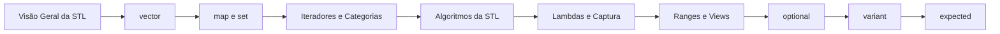

# MOC — STL e Ranges

A biblioteca padrão de contêineres, iteradores, algoritmos e (C++20) ranges, além dos tipos "de vocabulário" (`optional`, `variant`, `expected`...).

## Visão geral

- [[Visão Geral da STL]]
- [[Escolhendo um Contêiner]]
- [[Complexidade e Invalidação de Iteradores]]

## Contêineres sequenciais

- [[vector]]
- [[deque]]
- [[list e forward_list]]
- [[Arrays e std array]] (seção de básico)
- [[span]]
- [[bitset]]

## Contêineres associativos

- [[map e set]]
- [[unordered_map e unordered_set]]
- [[flat_map e flat_set]]

## Adaptadores

- [[Adaptadores de Contêiner]]

## Iteradores, algoritmos e ranges

- [[Iteradores e Categorias]]
- [[Algoritmos da STL]]
- [[Ranges e Views]]

## Chamáveis

- [[Lambdas e Captura]]
- [[std function e Functors]]

## Tipos de vocabulário

- [[optional]]
- [[variant]]
- [[std any]]
- [[expected]]
- [[tuple e pair]]

## Ordem de leitura sugerida

## Veja também

- [[Home - Cpp]]
- [[MOC - Templates e Concepts]]
- [[MOC - Erros e Exceções]]
