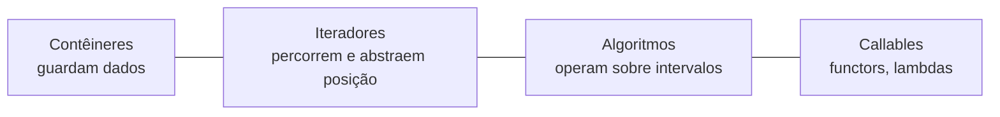

# Visão geral da STL

A **STL** (*Standard Template Library*), hoje parte da biblioteca padrão, é construída sobre **três pilares** que se combinam por templates:



- **Contêineres**: `vector`, `map`, `set`...
- **Iteradores**: generalização de ponteiros (`begin()`, `end()`).
- **Algoritmos**: `sort`, `find`, `transform`... funcionam com **qualquer** contêiner via iteradores.
- Desde o C++20: **Ranges** e **views** compõem algoritmos de forma declarativa ([[Ranges e Views]]).

## Famílias de contêineres

| Família | Tipos | Característica |
|---|---|---|
| **Sequenciais** | `vector`, `deque`, `list`, `forward_list`, `array` | Ordem de inserção/posição |
| **Associativos ordenados** | `set`, `multiset`, `map`, `multimap` | Árvore balanceada; ordenados por chave; busca O(log n) |
| **Associativos não ordenados** | `unordered_set`, `unordered_map` (+ `multi`) | Tabela hash; busca média O(1) |
| **Adaptadores** | `stack`, `queue`, `priority_queue` | Interface restrita sobre outro contêiner |
| **Visões** | `span`, `string_view`, `mdspan` (C++23) | Não possuem os dados |
| **Associativos "planos"** (C++23) | `flat_map`, `flat_set` | Vetores ordenados |

## Exemplo introdutório

```cpp
// g++ -std=c++20 -Wall -Wextra
#include <algorithm>
#include <iostream>
#include <map>
#include <string>
#include <vector>

int main() {
    std::vector<std::string> palavras{"banana", "maçã", "kiwi", "maçã", "banana", "maçã"};

    std::map<std::string, int> freq;                  // contêiner associativo
    for (const auto& p : palavras) ++freq[p];         // operator[] cria a chave com 0 se não existir

    std::vector<std::pair<std::string, int>> v(freq.begin(), freq.end());   // iteradores constroem o vetor
    std::ranges::sort(v, [](const auto& a, const auto& b) { return a.second > b.second; });   // algoritmo + lambda

    for (const auto& [nome, n] : v) std::cout << nome << ": " << n << '\n';
}
```

## Requisitos comuns dos elementos

Para guardar `T` em contêineres, `T` normalmente precisa ser **destrutível**, e conforme a operação: copiável ou **movível** ([[Semântica de Movimento]]), e **comparável** (ordenados) ou **hasheável** (não ordenados). `std::vector<std::unique_ptr<T>>` funciona porque `unique_ptr` é movível.

## Cabeçalhos

| Cabeçalho | Conteúdo |
|---|---|
| `<vector> <deque> <list> <forward_list> <array>` | Sequenciais |
| `<map> <set> <unordered_map> <unordered_set>` | Associativos |
| `<stack> <queue>` | Adaptadores |
| `<span> <mdspan> <flat_map> <flat_set>` | Visões e planos |
| `<algorithm> <numeric>` | Algoritmos |
| `<iterator> <ranges>` | Iteradores e ranges |
| `<functional>` | `std::function`, `std::bind`, functors |

> [!tip] Padrão de escolha
> **Use `std::vector` por padrão.** Troque só quando a análise de acesso e as medições justificarem ([[Escolhendo um Contêiner]]).

## Veja também

- [[Escolhendo um Contêiner]]
- [[vector]]
- [[Complexidade e Invalidação de Iteradores]]
- [[MOC - STL e Ranges]]
- [[Templates de Classe]]

## Exercício

1. Conte a frequência de palavras de um texto lido de `std::cin` usando `std::map` e depois `std::unordered_map`. Compare a ordem de saída.
2. Explique por que algoritmos como `std::sort` não são métodos dos contêineres.
