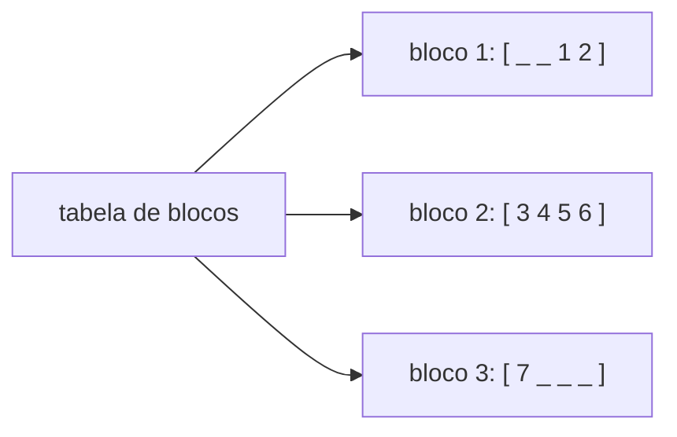

# `std::deque`

*Double-ended queue*: sequência com inserção e remoção **eficientes nas duas pontas** e acesso aleatório por índice.

```cpp
// g++ -std=c++20 -Wall -Wextra
#include <deque>
#include <iostream>

int main() {
    std::deque<int> d{3, 4};
    d.push_front(2);              // O(1) no início
    d.push_back(5);               // O(1) no fim
    d.emplace_front(1);

    std::cout << d[0] << d[1] << d.back() << '\n';   // 125 (acesso aleatório)
    d.pop_front();
    d.pop_back();

    for (int x : d) std::cout << x << ' ';           // 2 3 4
    std::cout << '\n';
}
```

## Estrutura

Não é um bloco contíguo único: é uma coleção de **blocos de tamanho fixo** apontados por uma tabela.



## Comparação com `vector`

| | `vector` | `deque` |
|---|---|---|
| Memória | **Contígua** | Fragmentada em blocos |
| `push_front` | O(n) | **O(1)** |
| `push_back` | O(1) amortizado | O(1) |
| Acesso `[i]` | O(1), mais rápido | O(1), um pouco mais lento |
| Invalidação ao inserir nas pontas | Realocação invalida tudo | Iteradores invalidam, **referências/ponteiros não** |
| Compatível com `data()` / API C | Sim | **Não** |

> [!info] Invalidação
> Inserções nas pontas **invalidam iteradores**, mas **não** referências a elementos existentes. Inserção/remoção no meio invalida tudo. Detalhes em [[Complexidade e Invalidação de Iteradores]].

## Quando usar

- Fila/janela deslizante com push/pop em ambos os lados.
- Base padrão de `std::stack` e `std::queue` ([[Adaptadores de Contêiner]]).
- Quando a estabilidade de **referências** após `push_back` importa.

> [!tip] Para filas com muito volume, considere um *ring buffer*
> `std::deque` aloca blocos continuamente; um buffer circular de capacidade fixa tem desempenho mais previsível (seção de avançado).

## Veja também

- [[vector]]
- [[list e forward_list]]
- [[Adaptadores de Contêiner]]
- [[Escolhendo um Contêiner]]

## Exercício

1. Implemente uma janela deslizante de tamanho k (média móvel) usando `std::deque<double>`.
2. Prove que referências para elementos de um `deque` sobrevivem a `push_back`, mas não a `insert` no meio.
