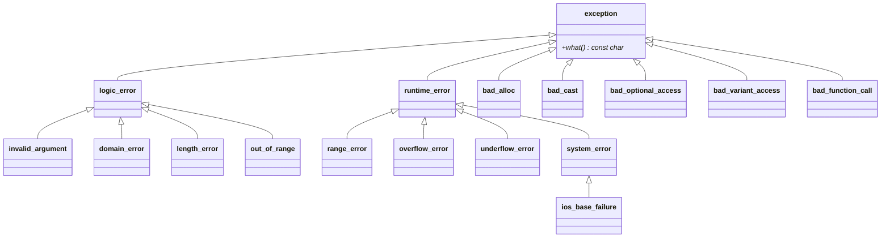

# Hierarquia de exceções

Todas as exceções da biblioteca padrão derivam de **`std::exception`** (`<exception>`), cujo método virtual `what()` devolve uma descrição.



## Quando usar cada uma

| Exceção | Significado | Exemplo |
|---|---|---|
| `std::logic_error` | Erro de **lógica do programa**, evitável pelo chamador | Base das abaixo |
| `std::invalid_argument` | Argumento inválido | `std::stoi("abc")` |
| `std::out_of_range` | Índice/chave fora do intervalo | `vector::at`, `map::at` |
| `std::length_error` | Excede tamanho máximo | `string::resize` enorme |
| `std::domain_error` | Fora do domínio matemático | Raiz de negativo (se escolher lançar) |
| `std::runtime_error` | Erro só detectável **em execução** | Falha de rede, arquivo ausente |
| `std::overflow_error`/`underflow_error`/`range_error` | Erros numéricos | Aritmética verificada |
| `std::system_error` | Erro do SO com `std::error_code` | Falha de thread/mutex ([[Códigos de Erro e error_code]]) |
| `std::bad_alloc` | Falta de memória | `new` falhou |
| `std::bad_cast` / `bad_typeid` | `dynamic_cast` de referência falhou | |
| `std::bad_optional_access` / `bad_variant_access` / `bad_expected_access` | Acesso inválido | `optional::value()` |
| `std::bad_function_call` | `std::function` vazia chamada | |

> [!info] `logic_error` vs `runtime_error`
> A divisão é convencional e por vezes subjetiva. `logic_error` ≈ "bug do chamador (pré-condição violada)"; `runtime_error` ≈ "falha do ambiente". Muitos projetos usam apenas `runtime_error` e tipos próprios.

## Criando suas próprias exceções

Herde de `std::exception` (ou de uma classe mais específica) e sobrescreva `what()`; guarde dados úteis.

```cpp
// g++ -std=c++20 -Wall -Wextra
#include <iostream>
#include <stdexcept>
#include <string>

class ErroDeArquivo : public std::runtime_error {
public:
    ErroDeArquivo(const std::string& caminho, const std::string& motivo)
        : std::runtime_error("arquivo '" + caminho + "': " + motivo),   // what() construído uma vez
          caminho_(caminho) {}
    const std::string& caminho() const noexcept { return caminho_; }
private:
    std::string caminho_;
};

class ArquivoNaoEncontrado final : public ErroDeArquivo {
public:
    explicit ArquivoNaoEncontrado(const std::string& caminho)
        : ErroDeArquivo(caminho, "não encontrado") {}
};

void abre(const std::string& p) { throw ArquivoNaoEncontrado(p); }

int main() {
    try { abre("/tmp/naoexiste.txt"); }
    catch (const ArquivoNaoEncontrado& e) { std::cout << "específico: " << e.what() << '\n'; }
    catch (const ErroDeArquivo& e)        { std::cout << "geral: " << e.caminho() << '\n'; }
    catch (const std::exception& e)       { std::cout << "std: " << e.what() << '\n'; }
}
```

## Boas práticas de projeto

- Crie uma **base por biblioteca/módulo** (`class MeuErro : public std::runtime_error`) para permitir `catch (const MeuErro&)`.
- Mensagens **informativas** e em inglês técnico ou no idioma do projeto, mas **consistentes**.
- Evite alocar memória ao **construir** a exceção em situações de falta de memória (`bad_alloc`).
- Não crie hierarquias profundas: poucos tipos, bem documentados.
- Não use exceções para **fluxo normal** (iteração, "chave não encontrada" esperada).

> [!warning] `what()` retorna `const char*` com tempo de vida ligado à exceção
> Não guarde o ponteiro depois que a exceção for destruída; copie para `std::string`.

## Veja também

- [[Exceções try catch throw]]
- [[Segurança de Exceções]]
- [[Códigos de Erro e error_code]]
- [[Boas Práticas e Custo das Exceções]]
- [[Herança]]

## Exercício

1. Crie `ErroDeConfiguracao` e `ErroDeRede` derivando de uma base `ErroDaAplicacao` e escreva um `main` que trate cada um diferentemente.
2. Liste três exceções da biblioteca padrão que o `vector` e o `map` podem lançar e em quais operações.
