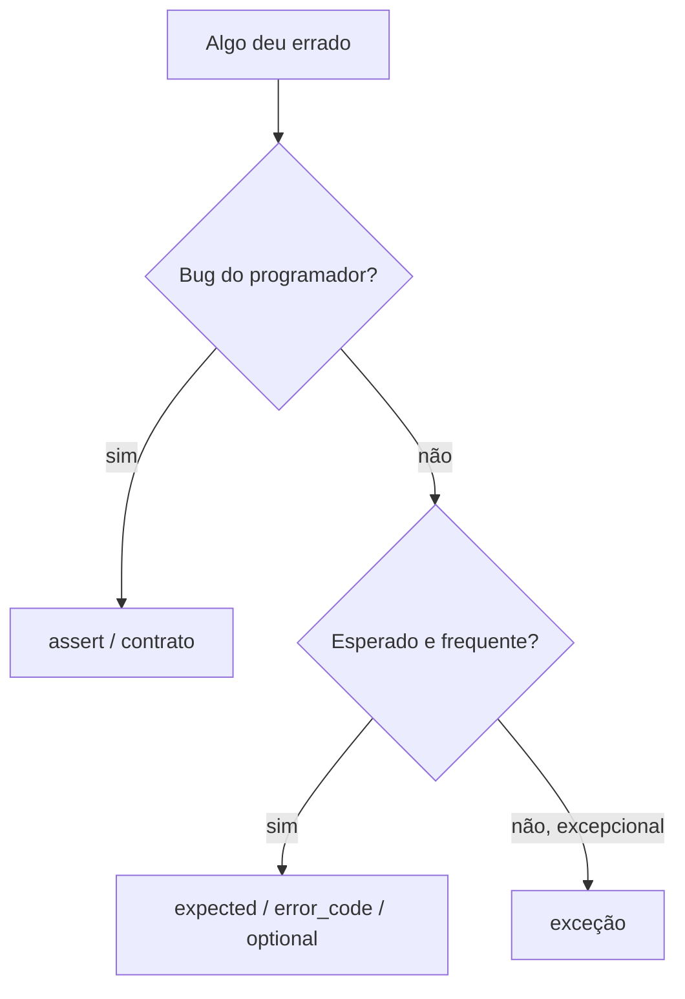

# MOC — Erros e Exceções

Como detectar, sinalizar e tratar falhas: exceções, códigos de erro, `expected`, asserts e contratos.

## Exceções

- [[Exceções try catch throw]]
- [[Hierarquia de Exceções]]
- [[Segurança de Exceções]]
- [[Boas Práticas e Custo das Exceções]]

## Alternativas às exceções

- [[Códigos de Erro e error_code]]
- [[expected]] (tipo, na seção de STL)
- [[Tratamento de Erros com expected]]
- [[optional]] (ausência sem motivo)

## Bugs de programação

- [[Asserts e Contratos]]
- [[static_assert e Type Traits]]

## Mapa de decisão

## Veja também

- [[Home - Cpp]]
- [[MOC - STL e Ranges]]
- [[RAII]]
- [[noexcept e Movimento]]
