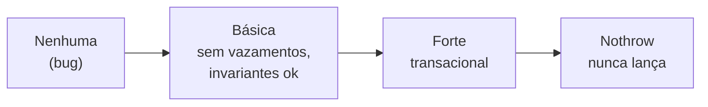

# Segurança de exceções

Uma operação é **segura contra exceções** quando, se uma exceção ocorrer no meio dela, o programa **continua em estado consistente**. Existem níveis (garantias de Abrahams):

| Garantia | Promessa | Exemplo |
|---|---|---|
| **Nothrow** (`noexcept`) | Nunca lança | `swap`, destrutores, movimentos de `vector` |
| **Forte** (*commit or rollback*) | Se lançar, **nada muda** (estado original) | `vector::push_back` (se movimento é `noexcept` ou tipo copiável) |
| **Básica** | Se lançar, **sem vazamentos** e **invariantes preservadas**, mas o estado pode ter mudado | A maioria das operações da STL |
| **Nenhuma** | Pode vazar/corromper | **Inaceitável** |



## Como obter a garantia básica

Use **RAII** em tudo: se cada recurso tem dono, a limpeza ocorre no desenrolamento da pilha.

```cpp
// g++ -std=c++20 -Wall -Wextra
#include <memory>
#include <stdexcept>
#include <vector>

struct Recurso { Recurso() = default; };
void pode_lancar(bool b) { if (b) throw std::runtime_error("falha"); }

// SEM garantia: vaza se pode_lancar lançar
void ruim(bool b) {
    Recurso* r = new Recurso;
    pode_lancar(b);
    delete r;
}

// Garantia básica: unique_ptr libera sempre
void boa(bool b) {
    auto r = std::make_unique<Recurso>();
    pode_lancar(b);
}

int main() {
    try { boa(true); } catch (...) {}
}
```

## Como obter a garantia forte: *copy-and-swap*

Faça o trabalho que pode falhar **numa cópia**; só no final faça uma troca **`noexcept`**.

```cpp
// g++ -std=c++20 -Wall -Wextra
#include <iostream>
#include <stdexcept>
#include <string>
#include <utility>
#include <vector>

class Agenda {
public:
    // Garantia FORTE: se qualquer passo lançar, 'contatos_' fica intocado
    void importa(const std::vector<std::string>& novos) {
        std::vector<std::string> copia = contatos_;       // 1) trabalha numa cópia
        for (const auto& c : novos) {
            if (c.empty()) throw std::invalid_argument("contato vazio");   // pode falhar
            copia.push_back(c);                           // pode lançar bad_alloc
        }
        contatos_.swap(copia);                            // 2) "commit" sem exceção
    }
    std::size_t tamanho() const { return contatos_.size(); }
private:
    std::vector<std::string> contatos_;
};

int main() {
    Agenda a;
    a.importa({"Ana", "Bia"});
    try { a.importa({"Caio", ""}); } catch (const std::exception&) {}
    std::cout << a.tamanho() << '\n';    // 2: a importação falha foi revertida por completo
}
```

## Pontos críticos

| Tópico | Regra |
|---|---|
| Destrutores | `noexcept` sempre; **nunca** lancem |
| `swap` | `noexcept`; é o bloco de construção das garantias fortes |
| Movimentos | `noexcept` quando possível — a STL só os usa se forem (veja [[noexcept e Movimento]]) |
| Alocação | Qualquer `new`/crescimento pode lançar `bad_alloc` |
| Ordem das operações | Faça primeiro o que **pode falhar**, depois o que **não falha** |
| Contêineres e `emplace` | A garantia forte de `push_back` depende de `noexcept` no movimento |

> [!danger] O risco do "estado meio-feito"
> ```cpp
> void transfere(Conta& a, Conta& b, int v) {
>     a.saldo -= v;                 // sucesso
>     b.deposita(v);                // pode lançar: dinheiro "sumiu" de a e não chegou em b
> }
> ```
> **Correção:** faça a operação que pode falhar **primeiro** ou use *rollback* (RAII com compensação/`scope_fail`), ou o idioma de cópia + troca.

> [!tip] Documente a garantia
> Em APIs públicas, escreva qual garantia cada função oferece (como faz a documentação da STL).

## Veja também

- [[Exceções try catch throw]]
- [[RAII]]
- [[Construtores de Cópia e Atribuição]]
- [[noexcept e Movimento]]
- [[Boas Práticas e Custo das Exceções]]

## Exercício

1. Reescreva a atribuição de uma classe com `std::string` e `std::vector` usando *copy-and-swap* e discuta a garantia obtida.
2. Em `transfere`, qual a garantia atual? Proponha uma versão com garantia forte.
