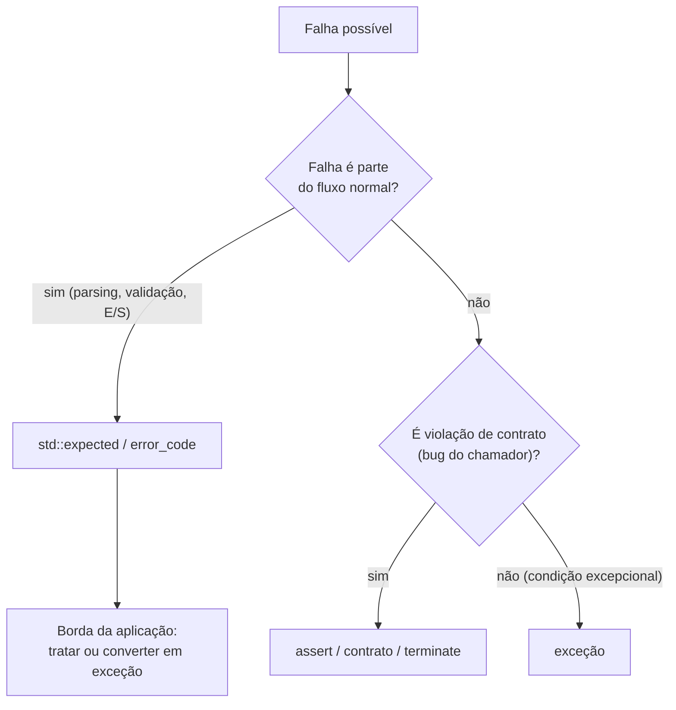

# Tratamento de erros com `expected`

Esta nota mostra **como estruturar um programa** em torno de `std::expected` (ver tipo em [[expected]]) e quando combinar com exceções.

## Padrão: a função devolve valor **ou** erro; o chamador decide

```cpp
// g++ -std=c++23 -Wall -Wextra
#include <expected>
#include <iostream>
#include <string>
#include <string_view>
#include <vector>

struct Erro { std::string mensagem; };
template <typename T> using Resultado = std::expected<T, Erro>;

Resultado<int> parse(std::string_view s) {
    try {
        std::size_t usados{};
        int v = std::stoi(std::string(s), &usados);
        if (usados != s.size()) return std::unexpected(Erro{"lixo após o número: " + std::string(s)});
        return v;
    } catch (const std::exception&) {
        return std::unexpected(Erro{"não é número: " + std::string(s)});
    }
}

Resultado<int> idade_valida(int v) {
    if (v < 0 || v > 150) return std::unexpected(Erro{"idade fora do intervalo: " + std::to_string(v)});
    return v;
}

Resultado<int> le_idade(std::string_view s) {
    auto n = parse(s);
    if (!n) return std::unexpected(n.error());          // propaga o erro
    return idade_valida(*n);
}

int main() {
    for (std::string_view entrada : {"42", "abc", "200", "7x"}) {
        if (auto r = le_idade(entrada)) std::cout << "ok " << *r << '\n';
        else std::cout << "erro: " << r.error().mensagem << '\n';
    }
}
```

## Propagação ergonômica

C++ **não tem** o operador `?` de Rust. Opções:

| Técnica | Comentário |
|---|---|
| `if (!r) return std::unexpected(r.error());` | Explícito, verboso |
| `and_then` / `transform` / `or_else` | Pipelines (C++23, GCC 13+) |
| Macros `TRY(...)` (extensão GNU *statement expressions*) | Usado em projetos como SerenityOS; **não portável** |
| Exceções na borda | Converta `expected` em exceção com `r.value()` quando o erro é "fatal" |

```cpp
// [nv] g++ -std=c++23 -Wall -Wextra   (monádicas: GCC 13+)
#include <expected>
#include <string>

struct Erro { std::string m; };

std::expected<int, Erro> a(int x) { return x + 1; }
std::expected<int, Erro> b(int x) { if (x > 5) return std::unexpected(Erro{"grande"}); return x * 2; }

int main() {
    auto r = a(1).and_then(b).and_then(b);   // curto-circuita no primeiro erro
    return r ? 0 : 1;
}
```

## Estratégia recomendada em projetos



| Camada | Estratégia comum |
|---|---|
| Biblioteca de baixo nível, E/S, parsing | `expected` ou `error_code` |
| Lógica de aplicação | Exceções para falhas inesperadas |
| Violações de pré-condição | `assert`/contratos (C++26) |
| `main`/ponto de entrada | `try { ... } catch (...) { log; return 1; }` |

> [!warning] Não misture sem convenção
> Decida por módulo: "esta biblioteca **não lança**; usa `expected`". Misturar sem regra faz o chamador tratar duas formas de erro.

> [!tip] `[[nodiscard]]`
> Marque funções que devolvem `expected`/`error_code` com `[[nodiscard]]` para o compilador avisar quando o erro for ignorado.

## Veja também

- [[expected]]
- [[Códigos de Erro e error_code]]
- [[Exceções try catch throw]]
- [[Asserts e Contratos]]
- [[Boas Práticas e Custo das Exceções]]

## Exercício

1. Implemente um leitor de configuração `chave=valor` retornando `Resultado<Config>` com mensagens que incluam o número da linha.
2. Converta a função `le_idade` para lançar exceções e compare o tamanho e a clareza do código.
