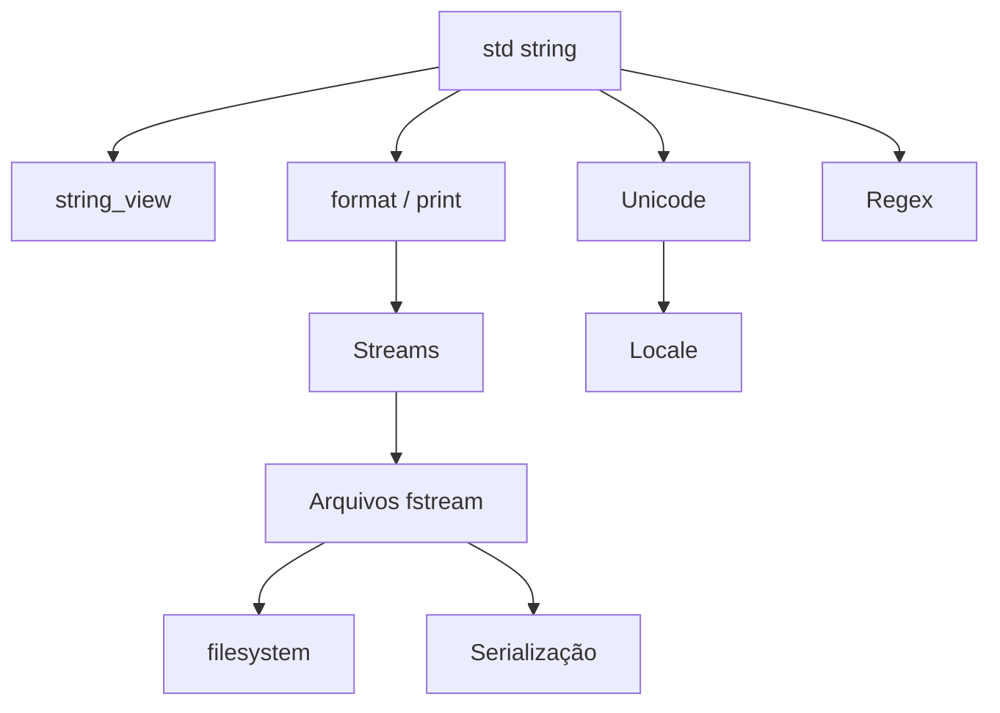

# MOC — Strings e IO

Texto, streams, formatação, arquivos e dados em formato externo.

## Texto

- [[Strings C e std string]] — introdução (seção 02)
- [[string_view]] — visão não proprietária (seção 02)
- [[std string em Profundidade]]
- [[Unicode e Codificações]]
- [[Expressões Regulares std regex e Alternativas]]
- [[Locale]]

## Entrada e saída

- [[Entrada e Saída Básica]] — introdução (seção 02)
- [[Streams e iostream]]
- [[Formatação std format e std print]]
- [[Arquivos fstream]]
- [[std filesystem]]
- [[Serialização]]

## Ordem sugerida

1. [[std string em Profundidade]] → 2. [[Streams e iostream]] → 3. [[Formatação std format e std print]] → 4. [[Arquivos fstream]] → 5. [[std filesystem]] → 6. [[Unicode e Codificações]] → 7. [[Serialização]]

## Veja também

- [[Home - Cpp]]
- [[MOC - STL e Ranges]]
- [[MOC - Erros e Exceções]]
- [[MOC - Módulos e Organização]]
