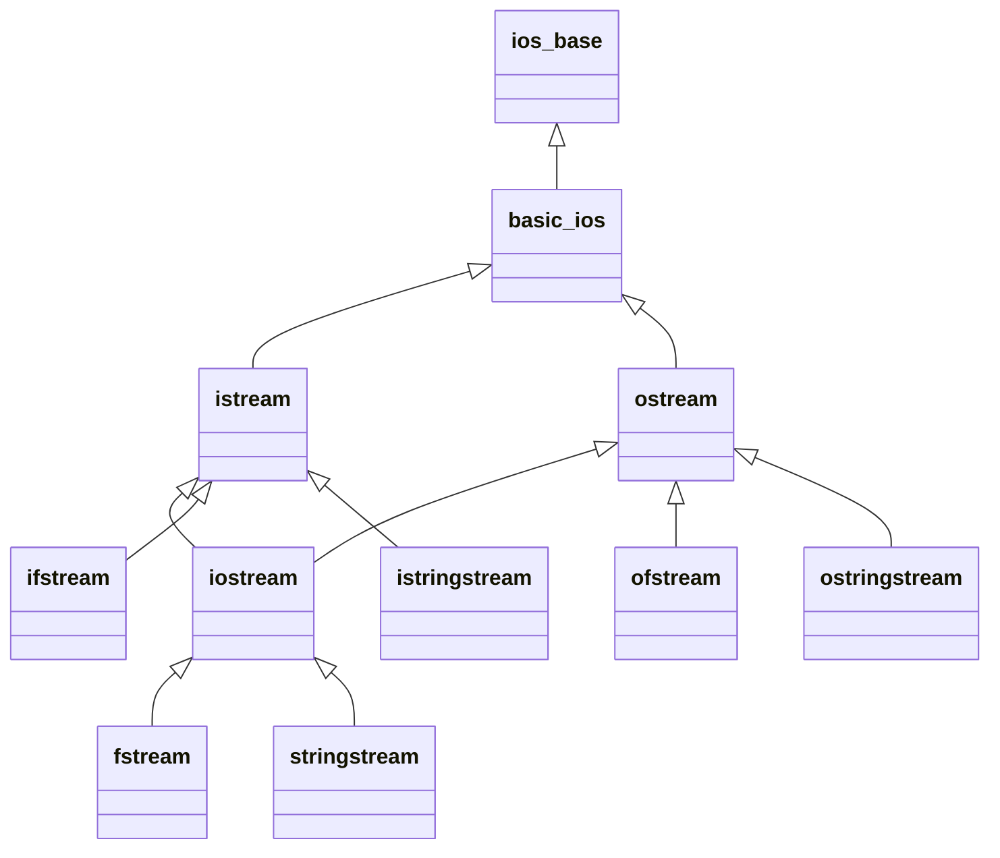

# Streams e `iostream` em profundidade

Uma **stream** é uma abstração de fluxo de bytes/caracteres com formatação. A hierarquia padrão:



| Família | Cabeçalho | Destino |
|---|---|---|
| `cin`/`cout`/`cerr`/`clog` | `<iostream>` | Terminal |
| `ifstream`/`ofstream`/`fstream` | `<fstream>` | Arquivos ([[Arquivos fstream]]) |
| `istringstream`/`ostringstream`/`stringstream` | `<sstream>` | `std::string` em memória |

## Estado da stream

Cada stream tem *flags* de estado: `good()`, `eof()`, `fail()`, `bad()`. Operações que falham **deixam a stream em erro** até `clear()`.

```cpp
// g++ -std=c++20 -Wall -Wextra
#include <iostream>
#include <limits>
#include <sstream>
#include <string>

int main() {
    std::istringstream entrada{"10 20 abc 30"};
    int x, soma = 0;
    while (entrada >> x) soma += x;                   // para no primeiro erro de conversão ("abc")
    std::cout << soma << ' ' << entrada.fail() << ' ' << entrada.eof() << '\n';   // 30 1 0

    entrada.clear();                                  // limpa as flags de erro
    entrada.ignore(std::numeric_limits<std::streamsize>::max(), ' ');   // descarta "abc"
    entrada >> x;
    std::cout << x << '\n';                           // 30

    // Leitura robusta de um inteiro do teclado (padrão)
    std::istringstream teclado{"abc\n42\n"};
    int n;
    std::string linha;
    while (std::getline(teclado, linha)) {            // lê LINHA, depois converte: mais robusto
        std::istringstream conv{linha};
        if (conv >> n && conv.eof()) { std::cout << "válido: " << n << '\n'; break; }
        std::cout << "inválido: " << linha << '\n';
    }
}
```

## Formatação

```cpp
// g++ -std=c++20 -Wall -Wextra
#include <iomanip>
#include <iostream>
#include <sstream>

int main() {
    std::cout << std::boolalpha << true << ' ' << std::noboolalpha << true << '\n';   // true 1
    std::cout << std::hex << 255 << ' ' << std::oct << 8 << ' ' << std::dec << 42 << '\n';   // ff 10 42
    std::cout << std::showbase << std::hex << 255 << std::dec << std::noshowbase << '\n';    // 0xff
    std::cout << std::fixed << std::setprecision(3) << 3.14159 << '\n';                       // 3.142
    std::cout << std::scientific << 12345.678 << std::defaultfloat << '\n';
    std::cout << '[' << std::setw(6) << std::right << 42 << ']'
              << '[' << std::setw(6) << std::left << 42 << ']'
              << '[' << std::setfill('0') << std::setw(6) << 42 << "]\n";                     // [    42][42    ][000042]

    std::ostringstream os;                                          // construir texto em memória
    os << "total=" << 12 << ";x=" << 1.5;
    std::cout << os.str() << '\n';
}
```

> [!warning] Estado "pegajoso"
> `std::hex`, `std::fixed`, `std::setprecision`, `std::setfill` **permanecem** na stream até serem trocados. Restaure com `std::dec`, `std::defaultfloat`, ou salve/restaure com `os.flags()`/`os.precision()`.

## Operadores de stream para tipos próprios

```cpp
// g++ -std=c++20 -Wall -Wextra
#include <iostream>
#include <sstream>
#include <string>

struct Ponto { int x, y; };

std::ostream& operator<<(std::ostream& os, const Ponto& p) { return os << '(' << p.x << ", " << p.y << ')'; }

std::istream& operator>>(std::istream& is, Ponto& p) {
    char a, b, c;
    int x, y;
    if (is >> a >> x >> b >> y >> c && a == '(' && b == ',' && c == ')') p = {x, y};
    else is.setstate(std::ios::failbit);                              // sinaliza erro de formato
    return is;
}

int main() {
    std::istringstream in{"(3,4)"};
    Ponto p;
    if (in >> p) std::cout << p << '\n';                              // (3, 4)
}
```

## Desempenho

- `std::endl` descarrega o buffer: use `'\n'`.
- Desativar a sincronização com C: `std::ios::sync_with_stdio(false);` (antes de qualquer I/O) e `std::cin.tie(nullptr);`.
- Para formatação intensiva, prefira `std::format`/`std::print` ([[Formatação std format e std print]]) ou `std::to_chars`/`from_chars`.
- Para leitura binária ou grandes volumes: [[Arquivos fstream]] com `read`/`write` ou `mmap`.

## Veja também

- [[Entrada e Saída Básica]]
- [[Arquivos fstream]]
- [[Formatação std format e std print]]
- [[Sobrecarga de Operadores - Cpp]]
- [[Locale]]

## Exercício

1. Implemente `operator<<` e `operator>>` para uma classe `Fracao` no formato `n/d`.
2. Leia um arquivo CSV simples usando `getline` com delimitador `','` e `istringstream`.
