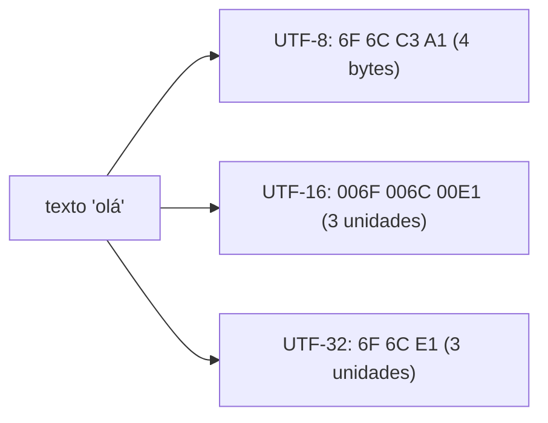

# Unicode e codificações

O C++ **não tem tipo "texto Unicode"** na biblioteca padrão. Há tipos de caractere e literais para cada codificação, e quase tudo mais fica por conta de bibliotecas (ICU, Boost.Locale, utf8cpp, `{fmt}`).

## Conceitos

| Termo | Significado |
|---|---|
| **Code point** | Número Unicode (U+0041, U+00E1, U+1F600) |
| **Unidade de código** | Elemento da codificação (byte em UTF-8, 16 bits em UTF-16) |
| **Grafema** | O que o usuário vê como "um caractere" (pode ter vários code points: `é` = `e` + acento combinante) |
| **UTF-8** | 1–4 bytes por code point; compatível com ASCII |

## Tipos e literais

| Tipo | Literal | Padrão | Observação |
|---|---|---|---|
| `char` | `"..."` | — | Codificação de execução (geralmente UTF-8 em Linux/macOS) |
| `wchar_t` | `L"..."` | — | 16 bits no Windows, 32 bits no Linux: **não portátil** |
| `char8_t` | `u8"..."` | **C++20** | Unidade UTF-8; tipo **distinto** de `char` |
| `char16_t` | `u"..."` | C++11 | UTF-16 |
| `char32_t` | `U"..."` | C++11 | UTF-32 (um code point por elemento) |



```cpp
// g++ -std=c++20 -Wall -Wextra
#include <iostream>
#include <string>
#include <string_view>

int main() {
    std::string s = "olá";                            // se o arquivo-fonte e a execução são UTF-8
    std::u8string u8 = u8"olá";                       // C++20: char8_t, tipo distinto
    std::u32string u32 = U"olá";                      // um elemento por code point

    std::cout << s.size() << ' ' << u8.size() << ' ' << u32.size() << '\n';   // 4 4 3

    // Contar code points em UTF-8: ignorar bytes de continuação (10xxxxxx)
    std::size_t pontos = 0;
    for (unsigned char c : s) if ((c & 0xC0) != 0x80) ++pontos;
    std::cout << pontos << '\n';                       // 3
}
```

> [!warning] `char8_t` quebra código antigo
> Em C++20, `u8"..."` deixou de ser `const char[]`: `std::string s = u8"x";` **não compila**. Opções: usar `std::u8string`, converter explicitamente, ou compilar com `-fno-char8_t` (GCC/Clang) / `/Zc:char8_t-` (MSVC).

> [!bug] Armadilhas comuns
> - `s.size()`, `s[i]`, `s.substr`, `toupper` operam em **bytes**: cortar no meio de um code point gera UTF-8 inválido.
> - `std::toupper`/`std::tolower` não tratam Unicode (`'á'` não vira `'Á'`).
> - Ordenar/comparar com `<` não é ordenação linguística (use ICU/collation).
> - No Windows, o console e a *code page* podem não ser UTF-8: use `/utf-8` no MSVC e `SetConsoleOutputCP(CP_UTF8)`.

## Boas práticas

1. **Use UTF-8 em todo lugar** (arquivos, rede, `std::string`) e converta apenas nas bordas (APIs `wchar_t` do Windows).
2. Compile com `/utf-8` (MSVC) ou `-finput-charset=UTF-8 -fexec-charset=UTF-8` (GCC/Clang, geralmente padrão).
3. Para operações Unicode reais (normalização, segmentação, case-mapping) use uma biblioteca: **ICU**, **Boost.Locale**, **utfcpp**, **libgrapheme**.
4. `std::format` e `std::print` (C++23) já tratam UTF-8 em *width* de campos — veja [[Formatação std format e std print]].

> [!question] Verificar na documentação oficial
> As facetas `<codecvt>` (`std::wstring_convert`, `codecvt_utf8`) foram **depreciadas no C++17** e ainda existem; confirme o estado atual e as alternativas na cppreference. C++26 trouxe mais suporte a Unicode no formatter; verifique a tabela de suporte do seu compilador.

## Veja também

- [[std string em Profundidade]]
- [[Locale]]
- [[Formatação std format e std print]]
- [[Expressões Regulares std regex e Alternativas]]

## Exercício

1. Escreva `contar_codepoints(std::string_view)` e `inverter_utf8` (invertendo por code point, não por byte).
2. Valide se uma sequência de bytes é UTF-8 bem formado.
