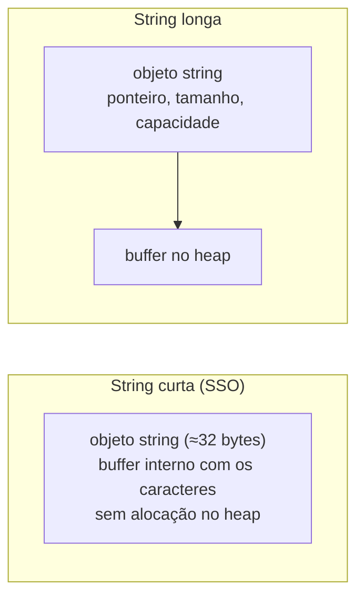

# `std::string` em profundidade

`std::string` é `std::basic_string<char>`: uma sequência **dinâmica e contígua** de `char`, com gerenciamento automático de memória (RAII). Para uma introdução comparando com strings C, veja [[Strings C e std string]].

## Operações essenciais

```cpp
// g++ -std=c++20 -Wall -Wextra
#include <algorithm>
#include <iostream>
#include <string>

int main() {
    std::string s = "Olá, mundo";
    s += "!";                                         // concatenação
    s.append(" C++").push_back('!');                  // append retorna a string; push_back é void (por isso o final)

    std::cout << s.size() << ' ' << s.length() << ' ' << s.empty() << '\n';
    std::cout << s.front() << s.back() << s[1] << s.at(2) << '\n';   // at() verifica limites

    // Busca
    auto pos = s.find("mundo");                       // índice ou std::string::npos
    if (pos != std::string::npos) std::cout << "achou em " << pos << '\n';
    std::cout << s.find('z') << ' ' << (s.find('z') == std::string::npos) << '\n';
    std::cout << s.rfind('!') << ' ' << s.find_first_of("aeiou") << '\n';

    // Substring e modificação
    std::string sub = s.substr(5, 5);                 // (posição, tamanho): "mundo"
    s.replace(0, 3, "Oi");                            // troca os 3 primeiros caracteres
    s.insert(0, ">> ");
    s.erase(s.size() - 1);                            // remove o último
    std::cout << sub << '|' << s << '\n';

    // Comparação (lexicográfica) e C++20
    std::cout << (std::string("a") < std::string("b")) << s.starts_with(">>") << s.ends_with("C++") << (s.find("mundo") != std::string::npos) << '\n';   // contains() só existe a partir do C++23

    // Conversões numéricas
    int n = std::stoi("42");                          // lança std::invalid_argument / out_of_range
    double d = std::stod("3.14");
    std::string txt = std::to_string(n) + "/" + std::to_string(d);
    std::cout << txt << '\n';

    // Algoritmos
    std::string t = "Hello";
    std::transform(t.begin(), t.end(), t.begin(), [](unsigned char c) { return std::toupper(c); });
    std::reverse(t.begin(), t.end());
    std::cout << t << '\n';                           // OLLEH
}
```

## Dentro da string: capacidade e SSO



**SSO** (*Small String Optimization*): strings curtas (≈15 caracteres em libstdc++ de 64 bits, 22 em libc++) ficam **dentro do próprio objeto**, sem alocar no heap. Consequências:

- Copiar/criar strings curtas é muito barato.
- **Referências e iteradores** para os caracteres podem invalidar mesmo em operações como `swap`/movimento.
- `sizeof(std::string)` é maior que um ponteiro (tipicamente 32 bytes em libstdc++).

| Operação | Complexidade |
|---|---|
| `s[i]`, `size()` | O(1) |
| `+=` / `push_back` | O(1) amortizado |
| `find`, `compare` | O(n·m) / O(n) |
| `insert`/`erase` no meio | O(n) |
| Cópia | O(n) |

> [!tip] Evite alocações repetidas
> `s.reserve(n)` antes de concatenar muito; prefira `+=`/`append` a `s = s + x` (que cria temporários). Para montar texto com vários pedaços use `std::format`/`std::ostringstream`.

## Armadilhas

> [!danger] `std::string` a partir de ponteiro nulo é UB
> `std::string s(nullptr);` (C++23 deleta esse construtor; antes é UB) e `std::string s = fn_que_retorna_char_ptr_nulo();` travam. Teste `if (p)` antes.

> [!warning] `+` com literais de string
> `"abc" + "def"` **não compila** (soma de ponteiros). Faça `std::string("abc") + "def"` ou use `"abc"s + "def"` (literal `s` de `<string>`, com `using namespace std::string_literals`).

> [!bug] `std::string` não é Unicode
> `size()` conta **bytes** (`char`), não "letras". Em UTF-8, `"olá".size()` é 4. Veja [[Unicode e Codificações]].

```cpp
// g++ -std=c++20 -Wall -Wextra
#include <iostream>
#include <string>

using namespace std::string_literals;

int main() {
    auto s = "abc"s + "def";                          // literal ""s cria std::string
    std::cout << s << ' ' << "olá"s.size() << '\n';   // abcdef 4 (UTF-8: 'á' ocupa 2 bytes)
}
```

## Passagem de parâmetros

| Parâmetro | Uso |
|---|---|
| `const std::string&` | Leitura, quando o chamador **já tem** `std::string` |
| `std::string_view` | Leitura geral (aceita literais, `string`, `char*`) — [[string_view]] |
| `std::string` por valor + `std::move` | Quando a função **guarda** a string |
| `std::string&` | Modificar o argumento do chamador |

## Veja também

- [[Strings C e std string]]
- [[string_view]]
- [[Unicode e Codificações]]
- [[Formatação std format e std print]]
- [[Streams e iostream]]

## Exercício

1. Escreva `split(std::string_view, char)` retornando `std::vector<std::string>` e `join`.
2. Verifique experimentalmente o limite da SSO no seu compilador comparando `capacity()` de `std::string{}`.
