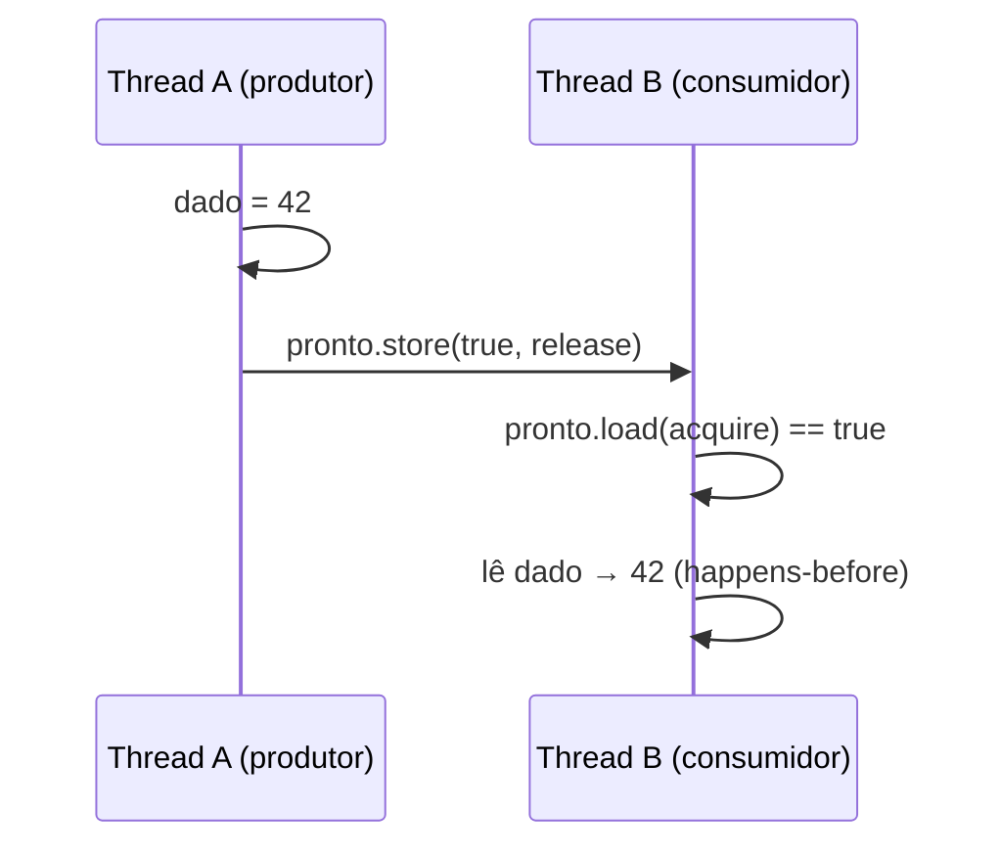

# Atomics e modelo de memória

`std::atomic<T>` (`<atomic>`, C++11) garante operações **indivisíveis** e define como as escritas de uma thread se tornam visíveis para outras. Sem isso, o compilador e a CPU podem **reordenar** acessos e o acesso concorrente não sincronizado é uma **data race** (UB — [[Data Races e Deadlocks]]).

```cpp
// g++ -std=c++20 -Wall -Wextra -pthread
#include <atomic>
#include <iostream>
#include <thread>
#include <vector>

int main() {
    std::atomic<int> contador{0};
    {
        std::vector<std::jthread> ts;
        for (int i = 0; i < 4; ++i)
            ts.emplace_back([&] { for (int j = 0; j < 100000; ++j) contador.fetch_add(1, std::memory_order_relaxed); });
    }
    std::cout << contador.load() << '\n';                  // 400000, sempre

    std::atomic<bool> pronto{false};
    int dado = 0;                                           // não atômico, protegido por release/acquire
    std::jthread produtor{[&] { dado = 42; pronto.store(true, std::memory_order_release); }};
    while (!pronto.load(std::memory_order_acquire)) std::this_thread::yield();
    std::cout << dado << '\n';                              // 42 garantido

    // compare_exchange: base de estruturas lock-free
    std::atomic<int> v{10};
    int esperado = 10;
    bool ok = v.compare_exchange_strong(esperado, 20);      // se v==esperado, v=20
    std::cout << ok << ' ' << v << '\n';                    // 1 20
}
```

## Ordenações de memória

| `memory_order` | Garantia | Custo |
|---|---|---|
| `relaxed` | Apenas atomicidade, **sem** ordenação | Mínimo (contadores, estatísticas) |
| `acquire` (load) | Leituras/escritas seguintes não sobem antes dele | Médio |
| `release` (store) | Escritas anteriores não descem depois dele | Médio |
| `acq_rel` | Ambos (operações RMW) | Médio |
| `seq_cst` (**padrão**) | Ordem total global | Maior |
| `consume` | Desencorajado; na prática tratado como `acquire` | — |



## Outros recursos

- `std::atomic_flag` (único tipo sempre lock-free); `test_and_set`, e `wait/notify` (C++20).
- `std::atomic<std::shared_ptr<T>>` (C++20); `std::atomic_ref<T>` (C++20) torna um objeto comum temporariamente atômico.
- `is_lock_free()`: verifica se usa instruções atômicas em vez de lock interno.
- `std::atomic_thread_fence` para barreiras independentes.

> [!danger] Armadilhas
> - **ABA problem** em estruturas lock-free com `compare_exchange` (use contadores de versão/hazard pointers).
> - `std::atomic<double>` é permitido, mas operações como `fetch_add` em ponto flutuante só existem a partir do C++20.
> - Dois `atomic`s separados **não** são atômicos em conjunto; invariantes entre variáveis exigem mutex.
> - `volatile` **não** serve para sincronização em C++.

> [!tip] Regra prática
> Comece com `mutex`. Use `atomic` com `seq_cst` (padrão) para flags e contadores. Só relaxe a ordenação com medições e provas; escreva testes com **ThreadSanitizer** (`-fsanitize=thread`).

## Veja também

- [[Mutex e Locks]]
- [[Data Races e Deadlocks]]
- [[latch barrier e semaphore]]
- [[Comportamento Indefinido e Não Especificado]]

## Exercício

1. Implemente um *spinlock* com `std::atomic_flag` e compare com `std::mutex`.
2. Implemente uma pilha lock-free (Treiber stack) e discuta o problema ABA.
