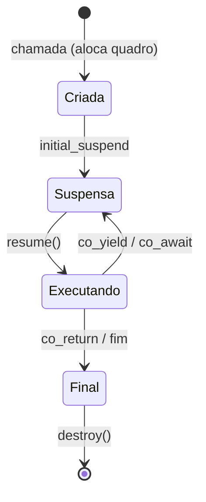

# Corrotinas (C++20)

> [!info] Introdução e suporte
> **C++20**: GCC 10+ (`-fcoroutines`; ativado por padrão em `-std=c++20` a partir do GCC 11), Clang 5+/17+ (libc++), MSVC 2019. `std::generator` é **C++23** (`<generator>`, GCC 14+, MSVC 17.? — confirmar). O C++20 oferece só o **mecanismo**; não traz tipos prontos como `Task`.
> [!question] Verificar na documentação oficial
> Confirme o suporte a `std::generator` e a versão mínima do seu compilador em cppreference.

Uma **corrotina** é uma função que pode **suspender** e **retomar**, preservando seu estado (*stackless*: o quadro vive no heap, normalmente). Uma função é corrotina se usa `co_await`, `co_yield` ou `co_return`.

| Palavra-chave | Efeito |
|---|---|
| `co_yield v` | Entrega `v` e suspende (geradores) |
| `co_await a` | Suspende até `a` estar pronto (assíncrono) |
| `co_return v` | Finaliza com resultado |



## Gerador mínimo

```cpp
// g++ -std=c++20 -Wall -Wextra
#include <coroutine>
#include <exception>
#include <iostream>
#include <utility>

template <typename T>
class Gerador {
public:
    struct promise_type {
        T valor{};
        Gerador get_return_object() { return Gerador{std::coroutine_handle<promise_type>::from_promise(*this)}; }
        std::suspend_always initial_suspend() noexcept { return {}; }   // começa suspensa
        std::suspend_always final_suspend() noexcept { return {}; }
        std::suspend_always yield_value(T v) { valor = std::move(v); return {}; }
        void return_void() {}
        void unhandled_exception() { std::terminate(); }
    };

    explicit Gerador(std::coroutine_handle<promise_type> h) : h_{h} {}
    Gerador(Gerador&& o) noexcept : h_{std::exchange(o.h_, {})} {}
    Gerador(const Gerador&) = delete;
    ~Gerador() { if (h_) h_.destroy(); }                       // RAII: libera o quadro

    bool proximo() { h_.resume(); return !h_.done(); }
    const T& valor() const { return h_.promise().valor; }

private:
    std::coroutine_handle<promise_type> h_;
};

Gerador<int> fibonacci(int n) {
    int a = 0, b = 1;
    for (int i = 0; i < n; ++i) {
        co_yield a;                                              // suspende e entrega 'a'
        int t = a + b; a = b; b = t;
    }
}

int main() {
    auto g = fibonacci(10);
    while (g.proximo()) std::cout << g.valor() << ' ';           // 0 1 1 2 3 5 8 13 21 34
    std::cout << '\n';
}
```

## Peças do mecanismo

| Peça | Função |
|---|---|
| `promise_type` | Define comportamento: `get_return_object`, `initial/final_suspend`, `yield_value`, `return_value/void`, `unhandled_exception` |
| `std::coroutine_handle<>` | "Ponteiro" para o quadro: `resume()`, `done()`, `destroy()` |
| **Awaitable** | Objeto com `await_ready`, `await_suspend`, `await_resume` |
| `std::suspend_always` / `suspend_never` | Awaitables triviais |

## Usos

- **Geradores** preguiçosos (`std::generator`, C++23, integra com [[Ranges e Views]]).
- **Tarefas assíncronas** (`Task<T>`): I/O sem callbacks — bibliotecas: **cppcoro**, **Boost.Asio** (`awaitable`), **libcoro**, folly::coro.
- **Máquinas de estado** e parsers incrementais.

> [!danger] Tempo de vida
> Parâmetros de corrotina por **referência** podem pendurar (*dangling*) depois da primeira suspensão. Prefira passar **por valor**. Capturas de lambda corrotina têm armadilha semelhante: o objeto lambda pode ser destruído enquanto o quadro vive.

> [!warning] Observações
> - Alocação do quadro pode ser otimizada (HALO), mas não conte com isso.
> - `final_suspend` deve ser `noexcept`.
> - Corrotinas **não** criam threads: rodam onde forem retomadas.

## Veja também

- [[future promise e async]]
- [[stop_token e Cancelamento]]
- [[Ranges e Views]]
- [[std execution Senders e Receivers]]
- [[RAII]]

## Exercício

1. Implemente `Gerador<int> iota(int a, int b)` e use-o em um `for`.
2. Escreva um `Task<int>` com `co_await` em um awaitable que retoma em outra thread.
