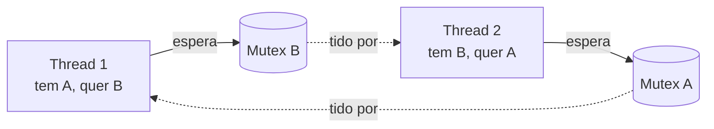

# Data races e deadlocks

## Data race

Duas threads acessam o **mesmo local de memória**, ao menos uma **escreve**, e **sem sincronização** (mutex, atomic, join...). No C++ isso é **comportamento indefinido** — não apenas "valor errado": o compilador pode assumir que isso não acontece.

> [!danger] UB
> Um `int` global incrementado por duas threads sem proteção pode perder incrementos, travar em *loops* otimizados (`while (!flag)` lido do registrador) e variar entre compiladores/níveis de otimização. Veja [[Comportamento Indefinido e Não Especificado]].

```cpp
// ERRO INTENCIONAL (data race): contador não atômico.
// Correção: std::atomic<int> ou proteger com std::mutex.
int contador = 0;
void f() { for (int i = 0; i < 100000; ++i) ++contador; }   // duas threads chamando f → UB
```

## Deadlock

Threads esperam umas pelas outras indefinidamente. Condições (Coffman): exclusão mútua, posse-e-espera, sem preempção, **espera circular**. Quebre uma delas.

```cpp
// g++ -std=c++20 -Wall -Wextra -pthread
#include <iostream>
#include <mutex>
#include <thread>

std::mutex a, b;
int x = 0, y = 0;

void t1() { std::scoped_lock g{a, b}; ++x; ++y; }          // trava a e b sem deadlock
void t2() { std::scoped_lock g{b, a}; --x; --y; }          // mesma coleção, ordem diferente: seguro com scoped_lock

int main() {
    {
        std::jthread j1{t1}, j2{t2};
    }
    std::cout << x << ' ' << y << '\n';                     // 0 0
}
```



## Prevenção

| Técnica | Como |
|---|---|
| Ordem global de travamento | Sempre trave A antes de B |
| `std::scoped_lock` / `std::lock` | Algoritmo que evita deadlock ao travar vários |
| Seção crítica mínima | Sem chamar código desconhecido com o lock |
| `try_lock` / timeout | Falha e tenta de novo |
| Evitar compartilhamento | Passagem de mensagens, imutabilidade, `thread_local` |
| Menos locks | Estruturas por thread e redução no fim |

## Outros problemas

- **Livelock**: threads mudam de estado sem progresso.
- **Starvation**: uma thread nunca consegue o recurso.
- **Inversão de prioridade**, **false sharing** (variáveis distintas na mesma linha de cache — veja Avançado e Performance).

## Ferramentas

```bash
g++ -std=c++20 -g -O1 -fsanitize=thread -pthread prog.cpp -o prog && ./prog   # ThreadSanitizer
valgrind --tool=helgrind ./prog                                                  # alternativa (mais lenta)
```

> [!tip] Testes de concorrência
> Bugs de concorrência são **não determinísticos**. Rode muitas vezes, com TSan, com cargas variadas e em CPUs com múltiplos núcleos.

## Veja também

- [[Mutex e Locks]]
- [[Atomics e Modelo de Memória]]
- [[condition_variable]]
- [[Comportamento Indefinido e Não Especificado]]

## Exercício

1. Escreva um programa com data race, detecte com `-fsanitize=thread` e corrija de duas formas (mutex e atomic).
2. Reproduza o problema dos filósofos jantando e resolva com `scoped_lock`.
