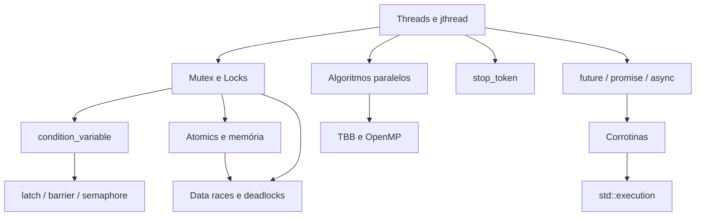

# MOC — Concorrência e Corrotinas

## Fundamentos de threads

- [[Threads e jthread]]
- [[Mutex e Locks]]
- [[condition_variable]]
- [[future promise e async]]
- [[stop_token e Cancelamento]]
- [[latch barrier e semaphore]]

## Memória e correção

- [[Atomics e Modelo de Memória]]
- [[Data Races e Deadlocks]]

## Paralelismo e assincronia

- [[Algoritmos Paralelos]]
- [[TBB e OpenMP]]
- [[Corrotinas Cpp20]]
- [[std execution Senders e Receivers]]

## Ordem sugerida

[[Threads e jthread]] → [[Mutex e Locks]] → [[Data Races e Deadlocks]] → [[condition_variable]] → [[future promise e async]] → [[Atomics e Modelo de Memória]] → [[stop_token e Cancelamento]] → [[latch barrier e semaphore]] → [[Algoritmos Paralelos]] → [[TBB e OpenMP]] → [[Corrotinas Cpp20]] → [[std execution Senders e Receivers]]

> [!tip] Ferramentas
> Use `-fsanitize=thread` e [[Comportamento Indefinido e Não Especificado|conhecimento de UB]] como rede de segurança.

## Veja também

- [[Home - Cpp]]
- [[MOC - RAII e Move]]
- [[MOC - STL e Ranges]]
- [[MOC - Strings e IO]]
