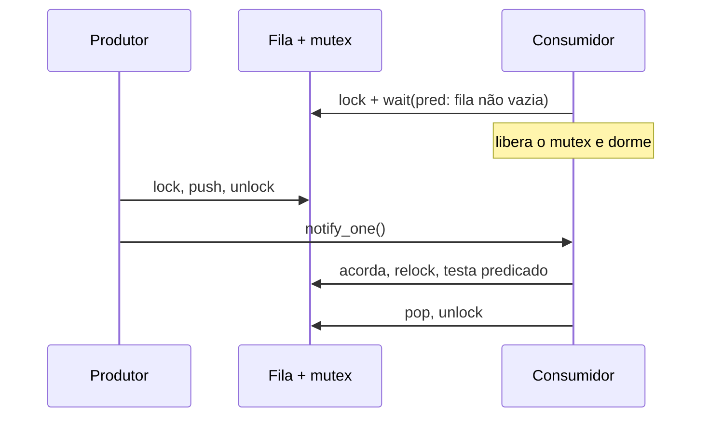

# `std::condition_variable`

Permite a uma thread **dormir até que uma condição seja verdadeira**, sem *busy-waiting*. Sempre acompanha um [[Mutex e Locks|mutex]] e um **predicado** (estado protegido pelo mutex).



```cpp
// g++ -std=c++20 -Wall -Wextra -pthread
#include <condition_variable>
#include <iostream>
#include <mutex>
#include <queue>
#include <thread>

template <typename T>
class FilaBloqueante {
public:
    void push(T v) {
        { std::lock_guard g{m_}; q_.push(std::move(v)); }
        cv_.notify_one();                                  // notificar fora do lock é válido e evita acordar à toa
    }
    T pop() {
        std::unique_lock lk{m_};
        cv_.wait(lk, [this] { return !q_.empty(); });      // predicado trata spurious wakeups
        T v = std::move(q_.front());
        q_.pop();
        return v;
    }
private:
    std::mutex m_;
    std::condition_variable cv_;
    std::queue<T> q_;
};

int main() {
    FilaBloqueante<int> fila;
    std::jthread produtor{[&] { for (int i = 1; i <= 5; ++i) fila.push(i); fila.push(-1); }};   // -1 = fim

    int soma = 0;
    for (int v; (v = fila.pop()) != -1;) soma += v;
    std::cout << soma << '\n';                             // 15
}
```

> [!bug] Erros clássicos
> - **Esquecer o predicado**: `wait(lk)` sem predicado sofre com *spurious wakeups* e **lost wakeups** (notificação antes do `wait`).
> - **Modificar a condição sem o mutex**: mesmo uma variável atômica deve ser alterada sob o mutex que o `wait` usa, senão há perda de notificação.
> - Usar `lock_guard` com `wait`: precisa de `std::unique_lock`.

## Com cancelamento (C++20)

`std::condition_variable_any::wait(lock, stop_token, pred)` acorda quando há pedido de parada — veja [[stop_token e Cancelamento]].

> [!tip] Alternativas
> Para sinalizar eventos únicos: [[future promise e async]] ou `std::latch`. Para limitar acesso concorrente: `std::counting_semaphore` ([[latch barrier e semaphore]]).

## Veja também

- [[Mutex e Locks]]
- [[Threads e jthread]]
- [[latch barrier e semaphore]]
- [[stop_token e Cancelamento]]

## Exercício

1. Implemente um *thread pool* simples com fila de tarefas e `condition_variable`.
2. Transforme a `FilaBloqueante` em uma fila **limitada** (produtor bloqueia quando cheia).
