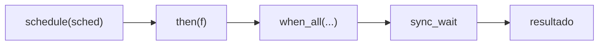

# `std::execution`: senders e receivers (C++26)

> [!info] Introdução
> **C++26** (P2300, aprovado no padrão; trabalho técnico concluído em março de 2026 segundo a pesquisa deste vault). Biblioteca de referência: **stdexec** (NVIDIA) e `beman.execution`. Suporte em compiladores/bibliotecas padrão ainda é parcial.
> [!question] Verificar na documentação oficial
> Confirme em cppreference e nas notas de versão da sua biblioteca padrão antes de depender de `<execution>` com senders.

## Motivação

`std::future` é pesado (alocação, sincronização) e não compõe bem. O modelo **sender/receiver** descreve **trabalho assíncrono como valor**, composto de forma preguiçosa e sem alocações obrigatórias, funcionando em CPU, thread pools e GPUs.

| Conceito | Papel |
|---|---|
| **Scheduler** | Onde executar (thread pool, GPU, loop de eventos) |
| **Sender** | **Descrição** de trabalho (preguiçosa): ainda não executou |
| **Receiver** | Callbacks: `set_value`, `set_error`, `set_stopped` |
| **Operation state** | Resultado de `connect(sender, receiver)`; `start()` inicia |
| **Algoritmos** | `then`, `let_value`, `when_all`, `bulk`, `sync_wait`, `on`... |



```cpp
// [nv] g++ -std=c++26 -Wall -Wextra   (ilustrativo; com a biblioteca stdexec: #include <stdexec/execution.hpp>, namespace stdexec)
#include <execution>
#include <iostream>

namespace ex = std::execution;

int main() {
    ex::run_loop loop;                                         // um scheduler simples
    auto trabalho = ex::schedule(loop.get_scheduler())
                  | ex::then([] { return 21; })
                  | ex::then([](int x) { return x * 2; });     // pipeline preguiçoso: nada executou ainda

    // sync_wait inicia a operação e bloqueia
    // auto [r] = std::this_thread::sync_wait(std::move(trabalho)).value();
    // std::cout << r << '\n';   // 42
    (void)trabalho;
}
```

> [!warning] Estado da arte
> A API exata (`std::this_thread::sync_wait`, nomes de algoritmos) pode diferir entre implementações. Use o exemplo como ilustração do **modelo**.

## Relação com outras ferramentas

| | `std::future`/`async` | Corrotinas | Senders/receivers |
|---|---|---|---|
| Preguiçoso | Não | Depende do tipo | **Sim** |
| Composição | Fraca | `co_await` | Algoritmos (`then`, `when_all`) |
| Cancelamento | Não | Manual | **Integrado** (`stop_token`) |
| Alocação | Estado compartilhado | Quadro da corrotina | Pode ser **zero** |

Senders são *awaitable* em corrotinas e vice-versa: os dois modelos se complementam.

## Veja também

- [[Corrotinas Cpp20]]
- [[future promise e async]]
- [[stop_token e Cancelamento]]
- [[TBB e OpenMP]]
- [[Cpp26 Visão Geral]]

## Exercício

1. Com stdexec, componha `when_all` de duas computações e imprima a soma.
2. Compare a mesma lógica com `std::async` e discuta alocações e cancelamento.
