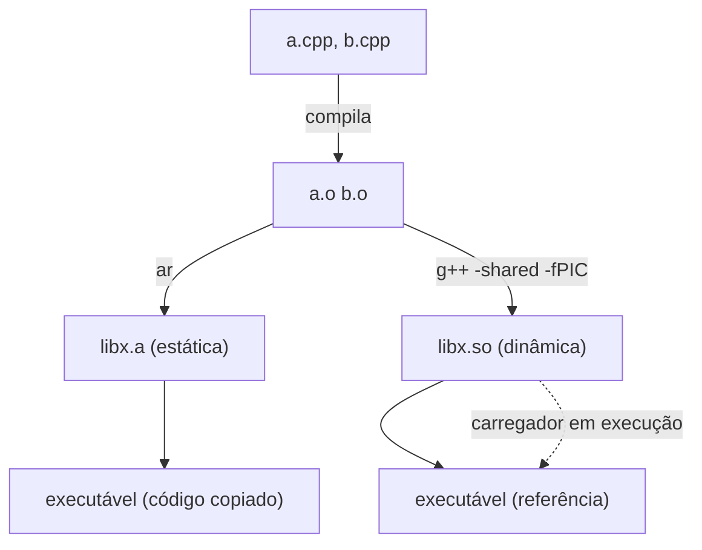

# Bibliotecas estáticas e dinâmicas

| | Estática | Dinâmica (compartilhada) |
|---|---|---|
| Extensão | `.a` (Unix), `.lib` (Windows) | `.so` (Linux), `.dylib` (macOS), `.dll` (Windows) |
| Quando é ligada | Em **tempo de link**: cópia no executável | Em **carregamento/execução** |
| Tamanho do executável | Maior | Menor |
| Atualização | Recompilar/relink | Substituir a biblioteca (se a [[ABI]] for compatível) |
| Memória | Cada processo tem sua cópia | Código compartilhado entre processos |
| Implantação | Um arquivo | Precisa distribuir/encontrar as libs |



## Construindo com GCC/Clang

```bash
g++ -std=c++20 -c -fPIC lib/soma.cpp -o soma.o

# Estática
ar rcs libsoma.a soma.o
g++ main.cpp -L. -lsoma -o app_estatico

# Dinâmica
g++ -shared -o libsoma.so soma.o
g++ main.cpp -L. -lsoma -Wl,-rpath,'$ORIGIN' -o app_dinamico   # rpath: onde procurar a .so
ldd app_dinamico                                                 # lista dependências dinâmicas
```

## Com CMake

```cmake
add_library(soma STATIC src/soma.cpp)     # ou SHARED; sem tipo, depende de BUILD_SHARED_LIBS
target_include_directories(soma PUBLIC include)

add_executable(app src/main.cpp)
target_link_libraries(app PRIVATE soma)

set_target_properties(soma PROPERTIES CXX_VISIBILITY_PRESET hidden VISIBILITY_INLINES_HIDDEN ON)
```

## Exportando símbolos

No Windows, símbolos de uma DLL **precisam** ser exportados explicitamente (`__declspec(dllexport)` / `dllimport`). No Linux/macOS o padrão exporta tudo, mas boa prática é esconder (`-fvisibility=hidden`) e exportar apenas a API.

```cpp
// arquivo: soma_export.hpp
#pragma once

#if defined(_WIN32)
  #ifdef SOMA_BUILD
    #define SOMA_API __declspec(dllexport)
  #else
    #define SOMA_API __declspec(dllimport)
  #endif
#else
  #define SOMA_API __attribute__((visibility("default")))
#endif

SOMA_API int soma(int a, int b);
```

> [!warning] Armadilhas de bibliotecas dinâmicas
> - **Ordem de link** com bibliotecas estáticas importa (dependentes antes das dependências, a menos que se use `--start-group`).
> - **Duas cópias** de um objeto global/singleton (estático em duas libs) quebram a identidade do estado.
> - Passar `std::string`, `std::vector` ou lançar exceções entre binários compilados com **compiladores/versões/runtimes diferentes** é perigoso — [[ABI]].
> - Alocar em uma DLL e liberar em outra (com *runtimes* distintos) corrompe a memória.

> [!tip] API estável
> Para fronteiras entre binários, exponha uma API em `extern "C"` com tipos simples (veja [[ABI]]).

## Veja também

- [[Linkage]]
- [[ABI]]
- [[Estrutura de Projetos]]
- [[Declaração vs Definição e ODR]]

## Exercício

1. Gere `libsoma.a` e `libsoma.so` da mesma fonte e compare os tamanhos de `app_estatico` e `app_dinamico`.
2. Use `nm -D libsoma.so` para listar os símbolos exportados e reduza com `-fvisibility=hidden`.
