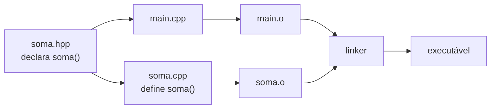

# Headers vs Sources

O C++ compila **unidades de tradução** (*translation units*, TU): cada `.cpp` com todos os `#include` expandidos pelo pré-processador. O **linker** depois une os objetos ([[Pipeline de Compilação - Cpp]]).

- **Header** (`.hpp`, `.h`): **declarações** — a interface (o que existe).
- **Source** (`.cpp`): **definições** — a implementação (como funciona).



## Exemplo em três arquivos

```cpp
// arquivo: soma.hpp
#pragma once

int soma(int a, int b);                // declaração
```

```cpp
// arquivo: soma.cpp
#include "soma.hpp"

int soma(int a, int b) { return a + b; }   // definição
```

```cpp
// arquivo: main.cpp
#include <iostream>
#include "soma.hpp"

int main() { std::cout << soma(2, 3) << '\n'; }
```

```bash
# Compilar e ligar (separado, como um sistema de build faz)
g++ -std=c++20 -Wall -Wextra -c soma.cpp -o soma.o
g++ -std=c++20 -Wall -Wextra -c main.cpp -o main.o
g++ soma.o main.o -o app && ./app       # 5
```

## O que vai em cada arquivo

| No header | No `.cpp` |
|---|---|
| Declarações de funções e classes | Definições de funções e métodos |
| `inline`, `constexpr`, `template` (definições completas) | Dados privados de implementação |
| `extern` de variáveis globais | Definição das variáveis globais |
| Aliases, enums, constantes `inline constexpr` | Funções internas em namespace anônimo |

> [!tip] Includes
> `#include <...>` para cabeçalhos do sistema/bibliotecas; `#include "..."` para os do projeto. Inclua **o que usa** (*include what you use*) e ordene: próprio header primeiro (verifica que ele é autossuficiente), depois do projeto, depois de terceiros, depois da biblioteca padrão.

> [!warning] Templates no header
> O compilador precisa ver a definição completa do template ao instanciar; por isso `template` costuma ficar **inteiro no header** (ou com instanciação explícita — veja [[Templates de Função]]).

> [!info] Custo
> Cada TU re-processa todos os headers. Reduza com **forward declarations** ([[Forward Declarations]]), *pimpl*, cabeçalhos pré-compilados (PCH), *unity builds* ou **módulos** ([[Módulos Cpp20]]).

## Veja também

- [[Include Guards e pragma once]]
- [[Declaração vs Definição e ODR]]
- [[Forward Declarations]]
- [[Pipeline de Compilação - Cpp]]
- [[MOC - Módulos e Organização]]

## Exercício

1. Separe uma classe `Contador` em `contador.hpp`/`contador.cpp` e compile em duas etapas.
2. Rode `g++ -E main.cpp | wc -l` e observe quantas linhas o `#include <iostream>` adiciona.
