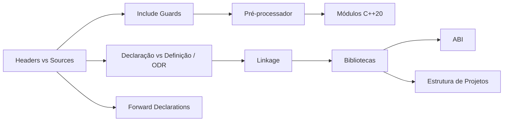

# MOC — Módulos e Organização

Como dividir um programa em arquivos, o que o compilador e o linker fazem com eles, e como empacotar o resultado.

## Notas

- [[Headers vs Sources]]
- [[Include Guards e pragma once]]
- [[Declaração vs Definição e ODR]]
- [[Linkage]]
- [[Forward Declarations]]
- [[Pré-processador e Macros]]
- [[Módulos Cpp20]]
- [[Estrutura de Projetos]]
- [[Bibliotecas Estáticas e Dinâmicas]]
- [[ABI]]

## Ordem sugerida

[[Headers vs Sources]] → [[Include Guards e pragma once]] → [[Declaração vs Definição e ODR]] → [[Linkage]] → [[Forward Declarations]] → [[Pré-processador e Macros]] → [[Estrutura de Projetos]] → [[Bibliotecas Estáticas e Dinâmicas]] → [[ABI]] → [[Módulos Cpp20]]

## Veja também

- [[Home - Cpp]]
- [[MOC - Strings e IO]]
- [[MOC - Templates e Concepts]]
- [[Pipeline de Compilação - Cpp]]
