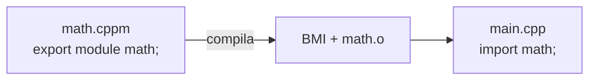

# Módulos (C++20)

> [!info] Introdução e suporte
> Introduzidos no **C++20** (`export module`, `import`); `import std;` e `import std.compat;` chegaram no **C++23**. Suporte real varia: MSVC é o mais completo; Clang e GCC avançaram bastante (GCC com `-fmodules`, ainda descrito como experimental na pesquisa deste vault em 2026-10-24); CMake oferece suporte com **Ninja** e CMake recente (3.28+ para módulos, estável em versões novas).
> [!question] Verificar na documentação oficial
> Confirme a maturidade de módulos no seu compilador, na versão do CMake e do gerador (Ninja/MSBuild) em cppreference (*Compiler support*) e na documentação do CMake.

## Problema que resolvem

Headers são **cópia textual**: lentos, vulneráveis a macros e a ordem de includes. Um módulo é compilado **uma vez** em uma interface binária e importado de modo **isolado**.

| Header | Módulo |
|---|---|
| Texto reprocessado em cada TU | Compilado uma vez (BMI) |
| Macros vazam | Macros **não** atravessam `import` |
| Ordem de `#include` importa | `import` independe de ordem |
| Tudo é visível | Só o que é `export` |
| Guardas de inclusão | Desnecessários |



## Exemplo

```cpp
// arquivo: math.cppm   (unidade de interface do módulo)
export module math;                         // declara o módulo

export int soma(int a, int b) { return a + b; }   // exportada

int segredo() { return 42; }                // não exportada: invisível fora do módulo
```

```cpp
// arquivo: main.cpp
import math;
import <iostream>;                          // header unit (suporte variável); alternativa: #include
// com C++23: import std;

int main() { std::cout << soma(2, 3) << '\n'; }
```

```bash
# Clang (exemplo ilustrativo; flags mudam entre versões — verifique a documentação)
clang++ -std=c++20 --precompile math.cppm -o math.pcm
clang++ -std=c++20 -fmodule-file=math=math.pcm main.cpp math.pcm -o app
```

```cmake
# CMake (>= 3.28) com gerador Ninja
cmake_minimum_required(VERSION 3.28)
project(demo CXX)
set(CMAKE_CXX_STANDARD 20)
add_executable(app main.cpp)
target_sources(app PRIVATE FILE_SET CXX_MODULES FILES math.cppm)
```

## Partes de um módulo

- **Interface**: `export module nome;` (um por módulo).
- **Implementação**: `module nome;` (sem `export`) em outros arquivos.
- **Partições**: `export module nome:parte;` e `export import :parte;`.
- **Fragmento global**: `module;` antes de `export module` permite `#include` de headers legados.

> [!warning] Limitações práticas
> - Ferramentas (CMake, IDEs, clang-tidy, ccache) ainda amadurecem.
> - Misturar `#include` e `import` da biblioteca padrão exige cuidado.
> - Bibliotecas de terceiros ainda são, em geral, headers: continue dominando [[Headers vs Sources]].

## Veja também

- [[Headers vs Sources]]
- [[Pré-processador e Macros]]
- [[Suporte dos Compiladores aos Padrões]]
- [[Estrutura de Projetos]]

## Exercício

1. Converta uma biblioteca de funções matemáticas pequena para módulo e compile com Clang ou MSVC.
2. Experimente `import std;` (C++23) no seu compilador e anote a versão necessária.
