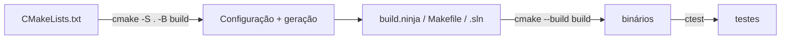

# CMake moderno e presets

> [!info] Versões
> CMake é o **padrão de fato** para projetos C++. Versão mais recente consultada na pesquisa do vault: **4.4.3** (2026-08-25). CMake 4.x removeu compatibilidade com `cmake_minimum_required` anterior a 3.5. Presets: 3.19+. Módulos C++20: 3.28+.
> [!question] Verificar na documentação oficial
> Confirme a versão atual e recursos novos em cmake.org.

O CMake **não compila**: ele **gera** arquivos para um sistema de build (Ninja, Make, MSBuild, Xcode). Fluxo: *configurar* → *gerar* → *construir*.



## Mentalidade "moderna": **alvos** e propriedades

Pense em **targets** (executáveis/bibliotecas) que carregam suas próprias propriedades e as **propagam** por `PUBLIC`/`PRIVATE`/`INTERFACE`.

| Palavra | Quem usa a propriedade |
|---|---|
| `PRIVATE` | Só o próprio alvo |
| `PUBLIC` | O alvo **e** quem o liga |
| `INTERFACE` | Só quem o liga (típico de header-only) |

```cmake
cmake_minimum_required(VERSION 3.20)
project(demo VERSION 1.0 LANGUAGES CXX)

# Padrão por alvo é preferível; global como default do projeto:
set(CMAKE_CXX_STANDARD 20)
set(CMAKE_CXX_STANDARD_REQUIRED ON)
set(CMAKE_CXX_EXTENSIONS OFF)
set(CMAKE_EXPORT_COMPILE_COMMANDS ON)      # gera compile_commands.json (clangd, clang-tidy)

add_library(core src/core.cpp)
target_include_directories(core PUBLIC include)
target_compile_features(core PUBLIC cxx_std_20)
target_compile_options(core PRIVATE
    $<$<CXX_COMPILER_ID:GNU,Clang>:-Wall -Wextra -Wpedantic>
    $<$<CXX_COMPILER_ID:MSVC>:/W4>)

add_executable(app src/main.cpp)
target_link_libraries(app PRIVATE core)

include(FetchContent)                      # baixa dependências no configure
FetchContent_Declare(fmt GIT_REPOSITORY https://github.com/fmtlib/fmt GIT_TAG 11.0.2)
FetchContent_MakeAvailable(fmt)
target_link_libraries(core PUBLIC fmt::fmt)

enable_testing()
add_test(NAME smoke COMMAND app)
```

## Presets (`CMakePresets.json`)

Padronizam configurações (compilador, gerador, flags) para toda a equipe e para a CI.

```json
{
  "version": 6,
  "configurePresets": [
    {
      "name": "base",
      "hidden": true,
      "generator": "Ninja",
      "binaryDir": "${sourceDir}/build/${presetName}",
      "cacheVariables": { "CMAKE_EXPORT_COMPILE_COMMANDS": "ON" }
    },
    { "name": "debug", "inherits": "base", "cacheVariables": { "CMAKE_BUILD_TYPE": "Debug" } },
    { "name": "release", "inherits": "base", "cacheVariables": { "CMAKE_BUILD_TYPE": "Release" } },
    { "name": "asan", "inherits": "debug",
      "cacheVariables": { "CMAKE_CXX_FLAGS": "-fsanitize=address,undefined -fno-omit-frame-pointer" } }
  ],
  "buildPresets": [ { "name": "debug", "configurePreset": "debug" } ],
  "testPresets": [ { "name": "debug", "configurePreset": "debug" } ]
}
```

```bash
cmake --list-presets
cmake --preset release
cmake --build --preset debug      # ou: cmake --build build/release
ctest --preset debug
cmake --install build/release --prefix /opt/demo
```

## Boas práticas

- **Build fora da árvore** (`-B build`), nunca no diretório de fontes.
- Evite `include_directories`, `link_libraries`, `add_definitions` globais: use `target_*`.
- **Não** liste flags de compilador "mágicas" globais; use presets ou `target_compile_options`.
- Evite `file(GLOB ...)` para fontes (não detecta arquivos novos); liste explicitamente.
- `CMAKE_BUILD_TYPE`: `Debug`, `Release`, `RelWithDebInfo`, `MinSizeRel` (geradores multi-config usam `--config`).
- Exporte seu pacote com `install(TARGETS ... EXPORT ...)` e `find_package` consumível.

> [!bug] Armadilha comum
> Mudar `CMAKE_BUILD_TYPE` não reconfigura sozinho com geradores single-config se o cache já existe de outro tipo: use presets/pastas separadas por configuração.

## Veja também

- [[Estrutura de Projetos]]
- [[vcpkg e Conan]]
- [[Ninja e Make]]
- [[Sanitizers]]
- [[GoogleTest]]

## Exercício

1. Crie `CMakePresets.json` com presets `debug`, `release` e `asan` e rode os três.
2. Gere `compile_commands.json` e abra o projeto em um editor com clangd.
