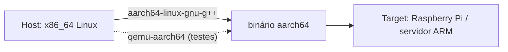

# Cross-compilation (compilação cruzada)

Compilar em uma máquina (**host**) para executar em outra (**target**): ARM de Raspberry Pi, microcontroladores, Android, Windows a partir de Linux, WebAssembly etc.

| Termo | Significado |
|---|---|
| **Host** | Onde o compilador roda |
| **Target** | Onde o binário roda |
| **Target triple** | `arquitetura-fornecedor-sistema[-ABI]`, p.ex. `aarch64-linux-gnu`, `x86_64-pc-windows-msvc`, `arm-none-eabi` |
| **Sysroot** | Diretório com headers e bibliotecas do **alvo** |
| **Toolchain** | Compilador + linker + bibliotecas para o alvo |



## Com GCC (toolchain prefixada)

```bash
sudo apt install g++-aarch64-linux-gnu qemu-user
aarch64-linux-gnu-g++ -std=c++20 -O2 prog.cpp -o prog_arm
qemu-aarch64 -L /usr/aarch64-linux-gnu ./prog_arm     # roda via emulação
```

## Com Clang

```bash
clang++ --target=aarch64-linux-gnu --sysroot=/opt/sysroot-aarch64 -std=c++20 prog.cpp -fuse-ld=lld -o prog_arm
```

## Com CMake: *toolchain file*

```cmake
# toolchains/aarch64.cmake
set(CMAKE_SYSTEM_NAME Linux)
set(CMAKE_SYSTEM_PROCESSOR aarch64)
set(CMAKE_C_COMPILER   aarch64-linux-gnu-gcc)
set(CMAKE_CXX_COMPILER aarch64-linux-gnu-g++)
set(CMAKE_SYSROOT /opt/sysroot-aarch64)
set(CMAKE_FIND_ROOT_PATH_MODE_PROGRAM NEVER)   # programas do HOST
set(CMAKE_FIND_ROOT_PATH_MODE_LIBRARY ONLY)    # bibliotecas do ALVO
set(CMAKE_FIND_ROOT_PATH_MODE_INCLUDE ONLY)
```

```bash
cmake -S . -B build-arm -G Ninja -DCMAKE_TOOLCHAIN_FILE=toolchains/aarch64.cmake
cmake --build build-arm
```

> [!warning] Armadilhas
> - Dependências também precisam ser compiladas para o alvo (vcpkg *triplets*, Conan *profiles* host/build).
> - Ferramentas geradas no build (geradores de código) devem rodar no **host**.
> - `-march=native` produz binários para a CPU do host — não use ao cruzar.
> - Bare-metal (`arm-none-eabi`): sem SO, geralmente sem exceções/RTTI (`-fno-exceptions -fno-rtti`), com `newlib`/`picolibc` — veja [[Cpp em Sistemas Embarcados]].
> - Diferenças de `char` com/sem sinal, endianness e `long` (LP64 vs LLP64) causam bugs sutis ([[Tipos Fundamentais]]).

> [!tip] Alternativas fáceis
> `zig c++` (cross-compila de graça), Docker `buildx` com QEMU, **Compiler Explorer** para olhar assembly de outras arquiteturas ([[Compiler Explorer]]).

## Veja também

- [[CMake Moderno e Presets]]
- [[Compiladores GCC Clang e MSVC]]
- [[Compiler Explorer]]
- [[Cpp em Sistemas Embarcados]]

## Exercício

1. Compile um "olá, mundo" para `aarch64` e execute com `qemu-aarch64`.
2. Escreva um *toolchain file* para outro alvo (por exemplo `arm-linux-gnueabihf`).
