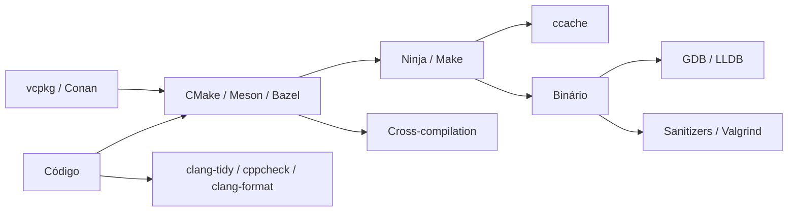

# MOC — Build e Ferramentas

## Sistemas de build e dependências

- [[CMake Moderno e Presets]]
- [[Ninja e Make]]
- [[Meson e Bazel]]
- [[vcpkg e Conan]]
- [[ccache]]
- [[Cross-compilation]]

## Depuração e análise

- [[Depuração com GDB LLDB e Visual Studio]]
- [[Sanitizers]]
- [[Valgrind]]
- [[clang-tidy e cppcheck]]
- [[clang-format]]
- [[Compiler Explorer]]

## Ordem sugerida

[[Ninja e Make]] → [[CMake Moderno e Presets]] → [[vcpkg e Conan]] → [[Depuração com GDB LLDB e Visual Studio]] → [[Sanitizers]] → [[Valgrind]] → [[clang-format]] → [[clang-tidy e cppcheck]] → [[ccache]] → [[Compiler Explorer]] → [[Cross-compilation]] → [[Meson e Bazel]]

## Veja também

- [[Home - Cpp]]
- [[MOC - Módulos e Organização]]
- [[MOC - Testes e Qualidade - Cpp]]
- [[Flags Essenciais do Compilador]]
