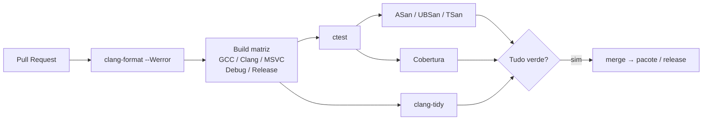

# CI/CD para C++

**Integração contínua** compila e testa cada *commit/PR* em ambientes limpos. Para C++, vale rodar uma **matriz**: sistemas operacionais × compiladores × tipos de build.



## Exemplo: GitHub Actions

```yaml
# .github/workflows/ci.yml
name: CI
on: [push, pull_request]

jobs:
  build:
    strategy:
      fail-fast: false
      matrix:
        os: [ubuntu-latest, windows-latest, macos-latest]
        build_type: [Debug, Release]
        include:
          - os: ubuntu-latest
            cxx: g++
          - os: ubuntu-latest
            cxx: clang++
    runs-on: ${{ matrix.os }}
    steps:
      - uses: actions/checkout@v4
      - uses: hendrikmuhs/ccache-action@v1.2          # cache de compilação
      - name: Configurar
        run: cmake -S . -B build -G Ninja -DCMAKE_BUILD_TYPE=${{ matrix.build_type }} -DCMAKE_CXX_COMPILER_LAUNCHER=ccache
      - name: Compilar
        run: cmake --build build
      - name: Testar
        run: ctest --test-dir build --output-on-failure

  sanitizers:
    runs-on: ubuntu-latest
    steps:
      - uses: actions/checkout@v4
      - run: |
          cmake -S . -B build -G Ninja -DCMAKE_BUILD_TYPE=Debug \
                -DCMAKE_CXX_FLAGS="-fsanitize=address,undefined -fno-omit-frame-pointer"
          cmake --build build && ctest --test-dir build --output-on-failure

  format:
    runs-on: ubuntu-latest
    steps:
      - uses: actions/checkout@v4
      - run: find src include tests -name '*.[ch]pp' | xargs clang-format --dry-run --Werror
```

> [!question] Verificar na documentação oficial
> Versões das *actions* (`@v4`...) e imagens de runner mudam com frequência; confirme na documentação do GitHub Actions.

## Boas práticas

| Prática | Motivo |
|---|---|
| Usar **presets** ([[CMake Moderno e Presets]]) | Mesma configuração local e na CI |
| Fixar versões de compilador/dependências | Builds reproduzíveis |
| Cachear (ccache/sccache, vcpkg binary cache) | Reduz minutos |
| Rodar sanitizers e `-Werror` em CI | Detecta regressões cedo |
| Testar com **vários compiladores** | Pega código não portável |
| Publicar artefatos (binários, relatórios) | Entrega contínua (CD) |
| Containers (Docker) para ambiente idêntico | Menos "funciona na minha máquina" |

> [!tip] CD (entrega)
> Em tags de versão, gere pacotes com **CPack** (`.deb`, `.zip`, `.msi`), publique em registros (vcpkg/Conan) e containers.

## Veja também

- [[CMake Moderno e Presets]]
- [[Sanitizers]]
- [[clang-format]]
- [[Cobertura com gcov e lcov]]
- [[ccache]]

## Exercício

1. Crie um workflow com matriz GCC/Clang/MSVC para um projeto seu.
2. Adicione um job com cobertura que publica o HTML como artefato.
