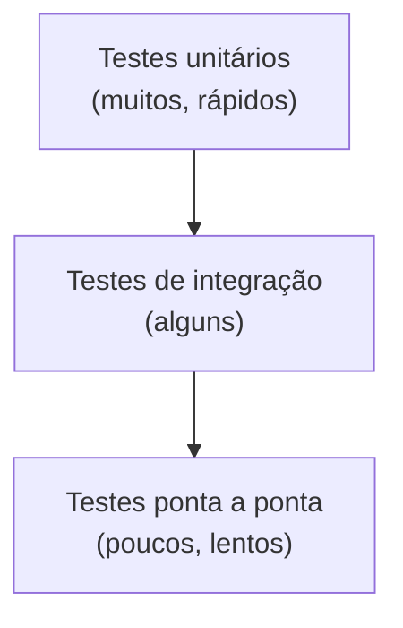

# Fundamentos de testes unitários

Um **teste unitário** verifica uma unidade pequena (função/classe) de forma **rápida, isolada e determinística**.



## Estrutura AAA

1. **Arrange** — prepara os dados/objetos.
2. **Act** — executa a operação.
3. **Assert** — verifica o resultado.

## Um mini-framework (para entender o mecanismo)

```cpp
// g++ -std=c++20 -Wall -Wextra
#include <functional>
#include <iostream>
#include <string>
#include <vector>

struct Caso { std::string nome; std::function<void()> corpo; };
std::vector<Caso>& registro() { static std::vector<Caso> r; return r; }

struct Registrar {
    Registrar(std::string nome, std::function<void()> f) { registro().push_back({std::move(nome), std::move(f)}); }
};

struct Falha { std::string msg; };
#define CHECK_EQ(a, b) do { if (!((a) == (b))) throw Falha{std::string(#a " != " #b " em linha ") + std::to_string(__LINE__)}; } while (0)
#define TESTE(nome) void nome(); static Registrar reg_##nome{#nome, nome}; void nome()

int soma(int a, int b) { return a + b; }

TESTE(soma_de_positivos) { CHECK_EQ(soma(2, 3), 5); }
TESTE(soma_com_zero)     { CHECK_EQ(soma(0, 7), 7); }
TESTE(soma_de_negativos) { CHECK_EQ(soma(-1, -1), -2); }

int main() {
    int falhas = 0;
    for (const auto& c : registro()) {
        try { c.corpo(); std::cout << "[ OK ] " << c.nome << '\n'; }
        catch (const Falha& f) { ++falhas; std::cout << "[FAIL] " << c.nome << ": " << f.msg << '\n'; }
    }
    return falhas;
}
```

Esse é o princípio de GoogleTest/Catch2: macros que **registram** testes em tempo de inicialização estática e um `main` que os executa.

## O que testar

| Bom | Cuidado |
|---|---|
| Casos típicos, **bordas** (vazio, zero, máximo) e erros | Testar detalhes de implementação (frágil) |
| Uma razão para falhar por teste | Testes que dependem de ordem, relógio, rede, aleatoriedade |
| Nomes descritivos (`conta_negativa_lanca_excecao`) | Muita lógica no teste |
| Projetar para **testabilidade** (injeção de dependências, [[Classes Abstratas e Interfaces|interfaces]]) | Singletons e globais |

> [!tip] TDD
> *Red → Green → Refactor*: escreva um teste que falha, faça passar com o mínimo, refatore. Ajuda a projetar APIs simples.

## Integração com CTest

```cmake
enable_testing()
add_executable(testes testes.cpp)
add_test(NAME unidade COMMAND testes)
```

```bash
cmake --build build && ctest --test-dir build --output-on-failure -j4
```

## Veja também

- [[GoogleTest]]
- [[Catch2 e doctest]]
- [[gMock e Dublês de Teste]]
- [[Cobertura com gcov e lcov]]
- [[Sanitizers]]

## Exercício

1. Estenda o mini-framework com `CHECK_THROWS`.
2. Escreva testes (antes do código) para uma função `eh_palindromo(std::string_view)`.
