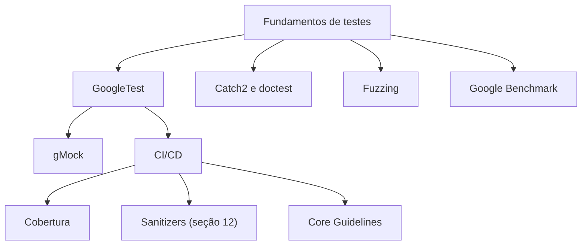

# MOC - Testes e Qualidade - Cpp

## Testes

- [[Fundamentos de Testes Unitários]]
- [[GoogleTest]]
- [[Catch2 e doctest]]
- [[gMock e Dublês de Teste]]
- [[Fuzzing]]
- [[Google Benchmark]]

## Qualidade

- [[Cobertura com gcov e lcov]]
- [[CI e CD para Cpp]]
- [[Core Guidelines]]

## Ordem sugerida

[[Fundamentos de Testes Unitários]] → [[GoogleTest]] → [[Catch2 e doctest]] → [[gMock e Dublês de Teste]] → [[Cobertura com gcov e lcov]] → [[CI e CD para Cpp]] → [[Fuzzing]] → [[Google Benchmark]] → [[Core Guidelines]]

## Veja também

- [[Home - Cpp]]
- [[MOC - Build e Ferramentas]]
- [[MOC - Erros e Exceções]]
- [[Sanitizers]]
