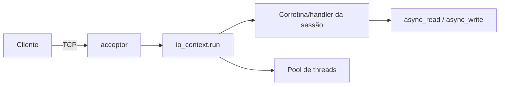

# Asio e rede

O C++ **não tem rede na biblioteca padrão**. **Asio** (Boost.Asio ou *standalone*) é a base de fato: I/O assíncrono multiplataforma (sockets, timers, sinais, serial, SSL), com `io_context`, callbacks, *futures* e **corrotinas C++20** (`co_await`). Serviu de base para a proposta de rede do padrão, hoje incorporada ao modelo de senders/receivers ([[std execution Senders e Receivers]]).



## Servidor *echo* com corrotinas

```cpp
// [nv] g++ -std=c++20 -Wall -Wextra -pthread   (requer Asio standalone ou Boost.Asio; indisponível no ambiente de teste do vault)
#include <asio.hpp>
#include <iostream>

using asio::ip::tcp;
using asio::awaitable;
using asio::detached;
using asio::use_awaitable;

awaitable<void> sessao(tcp::socket socket) {
    try {
        char dados[1024];
        for (;;) {
            std::size_t n = co_await socket.async_read_some(asio::buffer(dados), use_awaitable);
            co_await asio::async_write(socket, asio::buffer(dados, n), use_awaitable);   // devolve o que leu
        }
    } catch (const std::exception&) { /* conexão fechada */ }
}

awaitable<void> escutar(unsigned short porta) {
    auto executor = co_await asio::this_coro::executor;
    tcp::acceptor acceptor{executor, {tcp::v4(), porta}};
    for (;;) {
        tcp::socket socket = co_await acceptor.async_accept(use_awaitable);
        asio::co_spawn(executor, sessao(std::move(socket)), detached);   // uma corrotina por conexão
    }
}

int main() {
    asio::io_context io{1};
    asio::co_spawn(io, escutar(5555), detached);
    io.run();                                                             // laço de eventos
}
```

```cmake
find_package(asio CONFIG REQUIRED)
target_link_libraries(app PRIVATE asio::asio)
```

## Pontos de atenção

| Tema | Detalhe |
|---|---|
| Tempo de vida | Buffers e objetos usados por operações **assíncronas** devem sobreviver até a conclusão (`shared_from_this`, corrotinas) |
| Threads | `io_context::run()` em várias threads exige `strand` para serializar handlers do mesmo objeto |
| Cancelamento | `cancel()`, `cancellation_slot`, timers de timeout |
| HTTP | **Boost.Beast** (sobre Asio), **cpp-httplib** (simples), **Crow/Drogon/Oat++** (frameworks) |
| TLS | `asio::ssl` com OpenSSL |
| Segurança | Valide tamanhos, limite conexões/timeouts, trate dados como não confiáveis ([[Serialização]]) |

> [!question] Verificar na documentação oficial
> A API muda entre versões do Asio/Boost; confirme no site oficial (think-async.com) e na documentação do Boost.

## Veja também

- [[Boost]]
- [[Corrotinas Cpp20]]
- [[Threads e jthread]]
- [[gRPC e Protobuf]]

## Exercício

1. Implemente um servidor *echo* e teste com `nc localhost 5555`.
2. Adicione *timeout* de inatividade por sessão com `steady_timer`.
