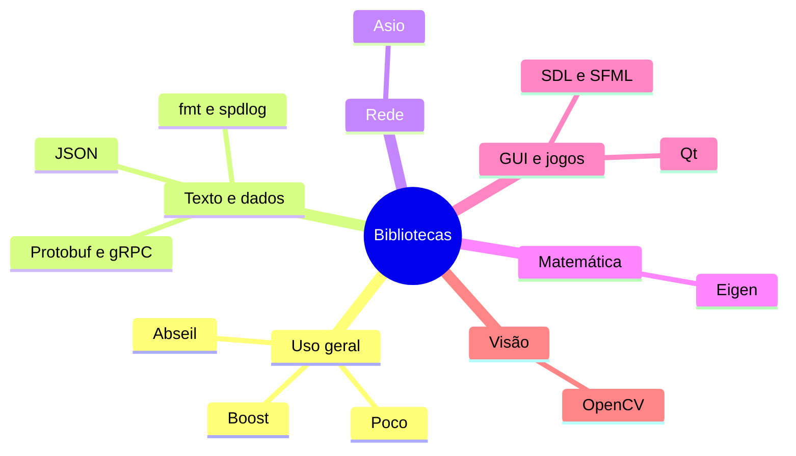

# MOC — Bibliotecas

## Visão geral

- [[Visão Geral das Bibliotecas]]

## Uso geral

- [[Boost]]
- [[range-v3 e Abseil]]
- [[Poco]]

## Texto, dados e rede

- [[fmt e spdlog]]
- [[nlohmann json e simdjson]]
- [[gRPC e Protobuf]]
- [[Asio e Rede]]

## Ciência, GUI, jogos e visão

- [[Eigen e Álgebra Linear]]
- [[Qt]]
- [[SDL e SFML]]
- [[OpenCV]]

## Veja também

- [[Home - Cpp]]
- [[MOC - STL e Ranges]]
- [[MOC - Build e Ferramentas]]
- [[MOC - Áreas de Aplicação - Cpp]]
