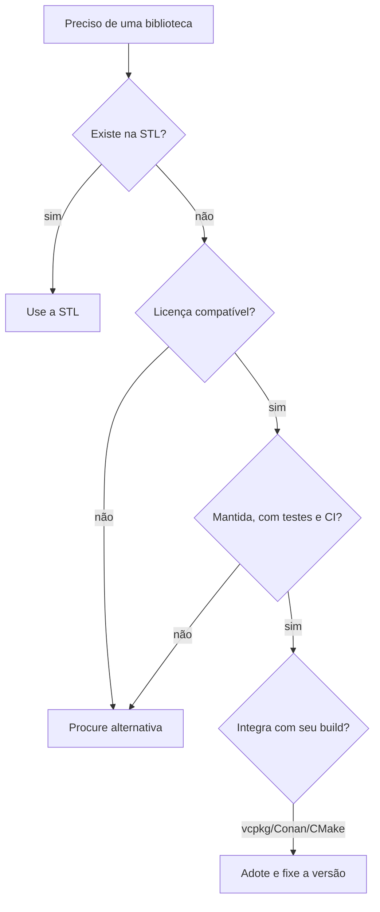

# Visão geral das bibliotecas

A biblioteca padrão cobre estruturas de dados, algoritmos, texto, concorrência e I/O de arquivos; **não** cobre rede, GUI, JSON, banco de dados, álgebra linear, etc. Para isso há um ecossistema rico de bibliotecas de terceiros.

| Área | Bibliotecas | Nota |
|---|---|---|
| Uso geral | [[Boost]], [[range-v3 e Abseil|Abseil]], Folly, Poco ([[Poco]]) | Complementam a STL |
| Formatação e log | [[fmt e spdlog]] | `fmt` virou `std::format` |
| JSON/serialização | [[nlohmann json e simdjson]], protobuf ([[gRPC e Protobuf]]) | |
| Rede e async | [[Asio e Rede]], gRPC, libcurl, cpp-httplib, Boost.Beast | |
| Matemática | [[Eigen e Álgebra Linear]], Armadillo, Blaze, xtensor, BLAS/LAPACK | |
| GUI | [[Qt]], Dear ImGui, wxWidgets, GTK (gtkmm), FLTK | |
| Jogos/multimídia | [[SDL e SFML]], raylib, Vulkan/OpenGL, OGRE | |
| Visão computacional | [[OpenCV]] | |
| Testes | [[GoogleTest]], [[Catch2 e doctest]] | Seção 13 |
| Ranges/funcional | [[range-v3 e Abseil]] | |
| Python interop | pybind11, nanobind | [[Interoperabilidade Cpp com Python e C]] |

## Como escolher

| Critério | Pergunta |
|---|---|
| Licença | MIT/BSD/Apache vs **LGPL/GPL** (Qt, em alguns módulos) vs comercial |
| Manutenção | Commits recentes, issues respondidas, releases |
| ABI | *Header-only* evita problemas de ABI ([[ABI]]) |
| Dependências | Quantas transitivas? |
| Padrão C++ exigido | Compatível com o seu `-std` |
| Tempo de compilação | Header-only pesado aumenta tempos |

> [!tip] Integração
> Use **vcpkg/Conan** ([[vcpkg e Conan]]) ou `FetchContent`, e consuma por **alvos CMake** (`fmt::fmt`), nunca por caminhos manuais.

> [!question] Verificar na documentação oficial
> Versões, licenças e requisitos de padrão mudam. Confirme no repositório/site de cada projeto antes de adotar.

## Veja também

- [[MOC - Bibliotecas]]
- [[vcpkg e Conan]]
- [[Visão Geral da STL]]
- [[Bibliotecas Estáticas e Dinâmicas]]

## Exercício

1. Para um projeto fictício (servidor HTTP com JSON e logs), escolha bibliotecas e justifique cada escolha pelos critérios acima.
2. Verifique a licença de três bibliotecas que você usa.
