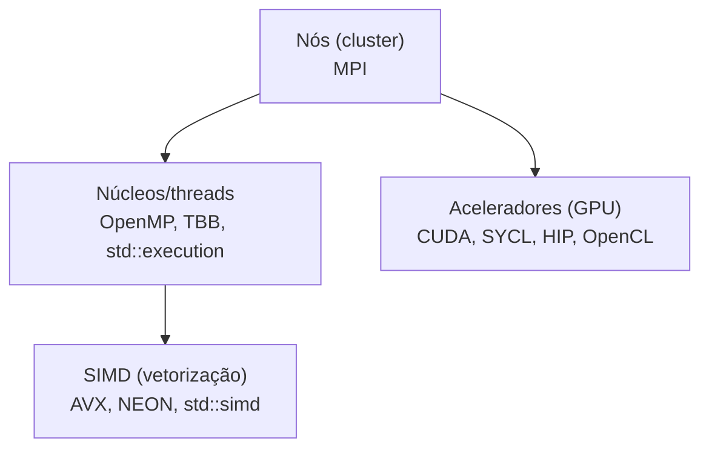

# C++ em HPC e GPU

**HPC** (computação de alto desempenho) usa C++ (e Fortran) em simulações científicas, IA, finanças quantitativas. O desempenho vem de **três níveis de paralelismo**:



## Modelos de programação

| Modelo | Escopo | Observação |
|---|---|---|
| **MPI** | Distribuído (vários nós) | OpenMPI, MPICH; troca de mensagens |
| **OpenMP** | Memória compartilhada (+ `target` para GPU) | [[TBB e OpenMP]] |
| **CUDA** | GPUs NVIDIA | *Kernels* `__global__`, ecossistema (cuBLAS, Thrust, cuDNN) |
| **HIP** | AMD (e NVIDIA) | Portátil a partir de CUDA |
| **SYCL** | Portátil (Intel oneAPI/DPC++, AdaptiveCpp) | C++ padrão com *queues* e *buffers*/USM |
| **OpenCL** | Portátil, API C | Mais verboso |
| **Kokkos / RAJA** | Camadas de portabilidade de desempenho | Código único para CPU/GPU |
| **`std::execution` (C++26)** | Padrão | [[std execution Senders e Receivers]] |
| **Thrust / oneDPL** | Algoritmos paralelos estilo STL | |

## CUDA (exemplo mínimo)

```cpp
// [nv] nvcc -std=c++17 -O2 soma.cu -o soma   (requer NVIDIA CUDA Toolkit e GPU; indisponível no ambiente de teste do vault)
#include <cstdio>
#include <cuda_runtime.h>

__global__ void soma(const float* a, const float* b, float* c, int n) {
    int i = blockIdx.x * blockDim.x + threadIdx.x;                  // índice global da thread
    if (i < n) c[i] = a[i] + b[i];
}

int main() {
    const int n = 1 << 20;
    float *a, *b, *c;
    cudaMallocManaged(&a, n * sizeof(float));                       // memória unificada
    cudaMallocManaged(&b, n * sizeof(float));
    cudaMallocManaged(&c, n * sizeof(float));
    for (int i = 0; i < n; ++i) { a[i] = 1.0f; b[i] = 2.0f; }

    int threads = 256, blocos = (n + threads - 1) / threads;
    soma<<<blocos, threads>>>(a, b, c, n);
    cudaDeviceSynchronize();
    std::printf("%f\n", c[0]);                                      // 3.000000
    cudaFree(a); cudaFree(b); cudaFree(c);
}
```

## SIMD e laços com OpenMP (compilável)

```cpp
// g++ -std=c++20 -O3 -fopenmp-simd -Wall -Wextra
#include <cstddef>
#include <iostream>
#include <vector>

int main() {
    const std::size_t n = 1 << 20;
    std::vector<float> a(n, 1.0f), b(n, 2.0f), c(n);

    #pragma omp simd                                                // pede vetorização ao compilador
    for (std::size_t i = 0; i < n; ++i) c[i] = a[i] * 2.0f + b[i];

    std::cout << c[0] << ' ' << c[n - 1] << '\n';                  // 4 4
}
```

> [!warning] Armadilhas
> - **Transferência de dados** CPU↔GPU costuma dominar: reduza cópias.
> - Divergência de *warps*, acessos não coalescidos e *occupancy* baixa limitam desempenho.
> - Reprodutibilidade numérica em ponto flutuante paralelo (ordem de soma) ([[Algoritmos Paralelos]]).
> - **Amdahl**: a parte serial limita o ganho; meça antes de paralelizar ([[Profiling e Benchmarking]]).

## Veja também

- [[TBB e OpenMP]]
- [[SIMD e Vetorização - Cpp]]
- [[Eigen e Álgebra Linear]]
- [[Algoritmos Paralelos]]
- [[MOC - Áreas de Aplicação - Cpp]]

## Exercício

1. Paralelize uma multiplicação de matrizes com OpenMP e depois escreva o *kernel* em CUDA/SYCL (se tiver GPU).
2. Calcule o *speedup* teórico pela Lei de Amdahl para 95% de código paralelizável em 16 núcleos.
