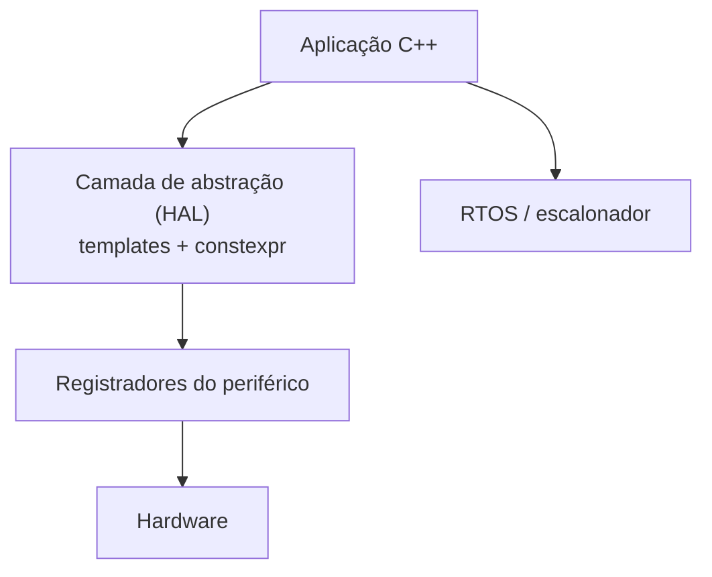

# C++ em sistemas embarcados

C++ é muito usado em **microcontroladores e firmware**: abstrações com **custo zero** (templates, `constexpr`) com controle de hardware próximo ao C.

| Característica | Realidade típica |
|---|---|
| Recursos | KB de RAM/flash, sem MMU |
| SO | Bare-metal ou **RTOS** (FreeRTOS, Zephyr, ThreadX, RIOT) |
| Toolchain | `arm-none-eabi-g++`, IAR, Keil, `clang` ([[Cross-compilation]]) |
| Biblioteca | newlib/picolibc; **freestanding** (C++23 amplia o subconjunto) |
| Restrições | Sem heap (ou heap proibido), sem exceções/RTTI (`-fno-exceptions -fno-rtti`) |
| Normas | **MISRA C++**, AUTOSAR C++14, CERT, JSF |



## Registradores com tipos e custo zero

```cpp
// g++ -std=c++20 -Wall -Wextra
// Simulação em PC: em hardware real, 'base' seria um endereço fixo (ex.: 0x40020014) e o ponteiro seria volatile.
#include <cstdint>
#include <iostream>

template <typename T, std::uintptr_t Base>
struct Registro {
    static volatile T& ref() { return *reinterpret_cast<volatile T*>(Base); }
};

std::uint32_t falso_gpio = 0;                                       // "periférico" simulado

class Pino {
public:
    constexpr Pino(volatile std::uint32_t* reg, unsigned bit) : reg_{reg}, mascara_{1u << bit} {}
    void ligar() const  { *reg_ = *reg_ | mascara_; }
    void desligar() const { *reg_ = *reg_ & ~mascara_; }
    bool lido() const { return (*reg_ & mascara_) != 0; }
private:
    volatile std::uint32_t* reg_;
    std::uint32_t mascara_;
};

int main() {
    Pino led{&falso_gpio, 5};
    led.ligar();
    std::cout << led.lido() << ' ' << falso_gpio << '\n';           // 1 32
    led.desligar();
    std::cout << led.lido() << '\n';                                // 0
}
```

## Boas práticas

- **Sem alocação dinâmica** após inicialização: `std::array`, buffers estáticos, `std::pmr` com buffers fixos ([[Alocadores Introdução]]), `etl::` (Embedded Template Library), `std::inplace_vector` (C++26).
- `constexpr`/`consteval` para tabelas e configuração em **compilação** ([[constexpr consteval constinit]]).
- `volatile` apenas para registradores de hardware (**não** para sincronização entre threads/ISRs: use atômicos, [[Atomics e Modelo de Memória]]).
- Cuidado com ordem de inicialização estática e tamanho de pilha; use `-fstack-usage`, `-Wl,--print-memory-usage`.
- Exceções e RTTI costumam ser desabilitadas: use códigos de erro ou `expected` ([[Tratamento de Erros com expected]]).
- Rodar testes no PC com *mocks* do hardware ([[gMock e Dublês de Teste]]).

> [!warning] ISR (rotinas de interrupção)
> Mantenha curtas, sem alocação, sem mutex bloqueante, e comunique por flags atômicas/filas *lock-free*.

> [!question] Verificar na documentação oficial
> Subconjunto *freestanding* exigido pelo padrão e suporte de `-fno-exceptions` na biblioteca do seu fornecedor mudam por versão e toolchain.

## Veja também

- [[Cross-compilation]]
- [[constexpr consteval constinit]]
- [[Alocadores Introdução]]
- [[Atomics e Modelo de Memória]]
- [[MOC - Áreas de Aplicação - Cpp]]

## Exercício

1. Escreva um tipo `Registrador<Endereço>` com `constexpr` e teste em PC com um endereço simulado.
2. Faça um buffer circular estático (sem heap) para dados de um UART.
