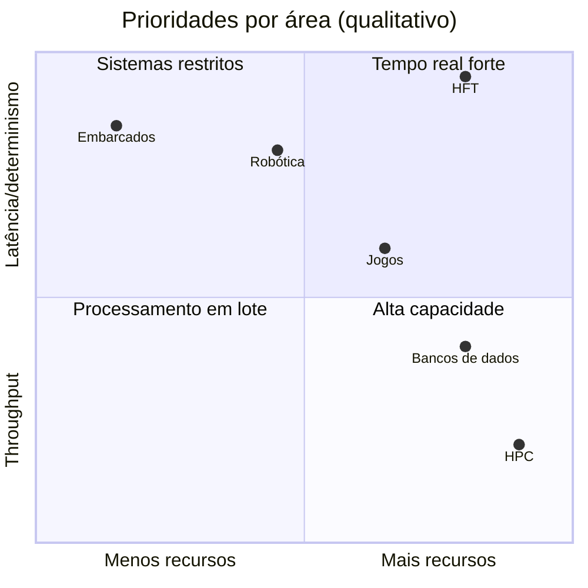

# MOC - Áreas de Aplicação - Cpp

Onde o C++ é usado e quais práticas cada área enfatiza.

| Área | Prioridade | Nota |
|---|---|---|
| Embarcados | Recursos mínimos, determinismo | [[Cpp em Sistemas Embarcados]] |
| Jogos | Orçamento de frame, cache | [[Cpp em Jogos]] |
| Finanças/HFT | Latência de cauda | [[Cpp em Finanças e Baixa Latência]] |
| HPC/GPU | Throughput, paralelismo | [[Cpp em HPC e GPU]] |
| Robótica | Tempo real, percepção | [[Cpp em Robótica]] |
| Sistemas/infra | Portabilidade, I/O | [[Cpp em Sistemas Operacionais e Infraestrutura]] |
| Navegadores/BDs | Segurança, escala | [[Cpp em Navegadores e Bancos de Dados]] |
| Web/Portabilidade | Wasm | [[WebAssembly com Cpp]] |
| Integração | Fronteira C/Python | [[Interoperabilidade Cpp com Python e C]] |

## Notas

- [[Cpp em Sistemas Embarcados]]
- [[Cpp em Jogos]]
- [[Cpp em Finanças e Baixa Latência]]
- [[Cpp em HPC e GPU]]
- [[Cpp em Robótica]]
- [[Cpp em Sistemas Operacionais e Infraestrutura]]
- [[Cpp em Navegadores e Bancos de Dados]]
- [[WebAssembly com Cpp]]
- [[Interoperabilidade Cpp com Python e C]]

## Veja também

- [[Home - Cpp]]
- [[Casos de Uso do Cpp]]
- [[MOC - Bibliotecas]]
- [[MOC - Avançado e Performance - Cpp]]
