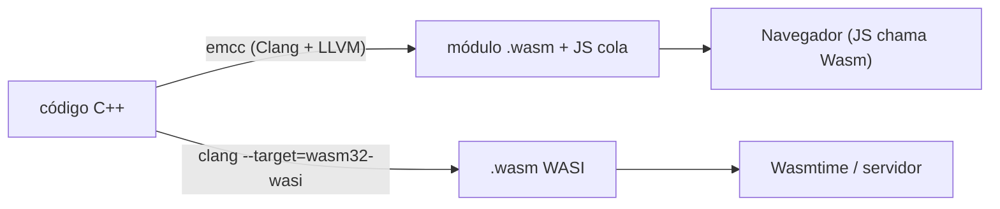

# WebAssembly com C++

**WebAssembly (Wasm)** é um formato binário portátil, rápido e isolado (*sandbox*), executado em navegadores e em *runtimes* fora deles (**WASI**: Wasmtime, Wasmer, WasmEdge). C++ é compilado para Wasm via **Emscripten** (Clang/LLVM) — um caso de [[Cross-compilation]].



## Emscripten

```cpp
// [nv] emcc -std=c++20 -O2 soma.cpp -o soma.js -sEXPORTED_FUNCTIONS=_soma -sEXPORTED_RUNTIME_METHODS=ccall   (requer o SDK Emscripten; indisponível no ambiente de teste do vault)
#include <emscripten/emscripten.h>
#include <emscripten/bind.h>
#include <string>

extern "C" {
EMSCRIPTEN_KEEPALIVE int soma(int a, int b) { return a + b; }       // exportada com nome C (sem mangling)
}

std::string saudacao(const std::string& nome) { return "Olá, " + nome + "!"; }

EMSCRIPTEN_BINDINGS(modulo) {                                        // embind: expõe funções/classes C++ ao JS
    emscripten::function("saudacao", &saudacao);
}
```

```html
<script src="soma.js"></script>
<script>
  Module.onRuntimeInitialized = () => {
    console.log(Module.ccall('soma', 'number', ['number','number'], [2, 3]));   // 5
    console.log(Module.saudacao("Ana"));
  };
</script>
```

```bash
emcc -std=c++20 -O2 app.cpp -o app.html -sALLOW_MEMORY_GROWTH -sASSERTIONS      # gera página de teste
emrun app.html
```

## O que considerar

| Tema | Detalhe |
|---|---|
| Memória | Memória linear contínua de 32 bits (4 GiB; *memory64* em evolução) |
| Threads | Exigem `SharedArrayBuffer` e cabeçalhos COOP/COEP (`-pthread`) |
| I/O | Sistema de arquivos virtual; `fetch` assíncrono |
| Exceções | Suportadas, com custo; opções `-fwasm-exceptions` |
| Tamanho | `-Oz`, `-flto`, `wasm-opt` (Binaryen) |
| Gráficos | SDL2/OpenGL ES → WebGL via Emscripten ([[SDL e SFML]]) |
| Casos de uso | Motores de jogo, editores (Figma), processamento de imagem/vídeo, bibliotecas científicas no navegador, *plugins* em *sandbox* |

> [!question] Verificar na documentação oficial
> Recursos de Wasm (threads, SIMD, GC, *memory64*, *component model*) evoluem; confira emscripten.org e a especificação em webassembly.org.

## Veja também

- [[Cross-compilation]]
- [[Interoperabilidade Cpp com Python e C]]
- [[Linkage]]
- [[ABI]]
- [[MOC - Áreas de Aplicação - Cpp]]

## Exercício

1. Compile uma função de processamento de imagem para Wasm e chame-a de uma página HTML.
2. Compare o tamanho do `.wasm` com `-O2` e `-Oz` + `wasm-opt`.
