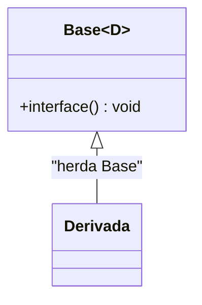

# CRTP e mixins

**CRTP** (*Curiously Recurring Template Pattern*): uma classe herda de uma **base template parametrizada por ela mesma** (`class D : public Base<D>`). A base conhece o tipo derivado em **tempo de compilação** e pode chamar seus métodos sem `virtual` — **polimorfismo estático**.



## Polimorfismo estático

```cpp
// g++ -std=c++20 -O2 -Wall -Wextra
#include <iostream>
#include <vector>

template <typename Derivada>
struct Forma {
    double area() const { return static_cast<const Derivada*>(this)->area_impl(); }   // despacho resolvido na compilação
    void descrever() const { std::cout << "área = " << area() << '\n'; }               // código comum reutilizado
};

struct Quadrado : Forma<Quadrado> {
    explicit Quadrado(double l) : lado{l} {}
    double area_impl() const { return lado * lado; }
    double lado;
};

struct Circulo : Forma<Circulo> {
    explicit Circulo(double r) : raio{r} {}
    double area_impl() const { return 3.141592653589793 * raio * raio; }
    double raio;
};

template <typename T>
void imprimir(const Forma<T>& f) { f.descrever(); }          // aceita qualquer forma; inline possível, sem vtable

int main() {
    imprimir(Quadrado{2.0});                                  // área = 4
    imprimir(Circulo{1.0});                                   // área = 3.14159
    // Não há contêiner heterogêneo: Forma<Quadrado> e Forma<Circulo> são tipos DIFERENTES.
}
```

| | Virtual | CRTP |
|---|---|---|
| Despacho | Em execução (vtable) | Em compilação |
| Inline | Difícil | **Sim** |
| Contêiner heterogêneo | **Sim** (`vector<unique_ptr<Base>>`) | Não (use [[Type Erasure]] ou `std::variant`) |
| Código no cabeçalho | Pode ficar no `.cpp` | Templates (cabeçalho) |
| Erros | Claros | Mensagens de template |

## Mixins: adicionar funcionalidade por herança

```cpp
// g++ -std=c++20 -Wall -Wextra
#include <iostream>
#include <string>

template <typename D>
struct Comparavel {                                           // gera os operadores a partir de operator<
    friend bool operator>(const D& a, const D& b) { return b < a; }
    friend bool operator<=(const D& a, const D& b) { return !(b < a); }
    friend bool operator>=(const D& a, const D& b) { return !(a < b); }
};

template <typename D>
struct Contador {                                             // conta instâncias vivas
    static inline int vivos = 0;
    Contador() { ++vivos; }
    Contador(const Contador&) { ++vivos; }
    ~Contador() { --vivos; }
};

struct Versao : Comparavel<Versao>, Contador<Versao> {
    int maior, menor;
    Versao(int a, int b) : maior{a}, menor{b} {}
    friend bool operator<(const Versao& a, const Versao& b) {
        return a.maior != b.maior ? a.maior < b.maior : a.menor < b.menor;
    }
};

int main() {
    Versao a{1, 2}, b{1, 3};
    std::cout << (a < b) << (a > b) << (a <= b) << ' ' << Contador<Versao>::vivos << '\n';   // 101 2
}
```

> [!tip] No C++20+
> Para comparações, prefira `operator<=>` (`= default`) em vez de CRTP ([[Sobrecarga de Operadores - Cpp]]).

## *Deducing this* (C++23)

Parâmetro explícito de objeto (`this auto&& self`) elimina muitos usos de CRTP: o tipo derivado é deduzido **sem herança de template**.

```cpp
// [nv] g++ -std=c++23 -Wall -Wextra   (requer GCC 14+ / Clang 18+ / MSVC 19.32+; indisponível no ambiente de teste do vault)
#include <iostream>

struct Base {
    void descrever(this const auto& self) { std::cout << "área = " << self.area() << '\n'; }   // 'self' é o tipo derivado
};

struct Quadrado : Base {
    double lado = 2.0;
    double area() const { return lado * lado; }
};

int main() { Quadrado{}.descrever(); }
```

## Armadilhas

> [!bug] Erros comuns
> - Passar o tipo errado: `struct B : Forma<A>` compila e quebra em execução (UB no `static_cast`). Proteja com construtor privado + `friend D`, ou `static_assert(std::is_base_of_v<Forma<D>, D>)`.
> - Usar membros de `Derivada` no corpo da base **fora de funções-membro** (tipo incompleto naquele ponto).
> - **`std::enable_shared_from_this<T>`** é um uso real de CRTP na biblioteca padrão ([[shared_ptr]]).

## Veja também

- [[Polimorfismo e Funções Virtuais]]
- [[Type Erasure]]
- [[Concepts e requires]]
- [[Sobrecarga de Operadores - Cpp]]
- [[Idiomas e Padrões de Projeto em Cpp]]

## Exercício

1. Implemente `Singleton<T>` e `Observavel<T>` como mixins CRTP.
2. Reescreva `Forma` com concepts: `template <typename F> concept TemArea = requires(const F& f) { f.area(); };`.
