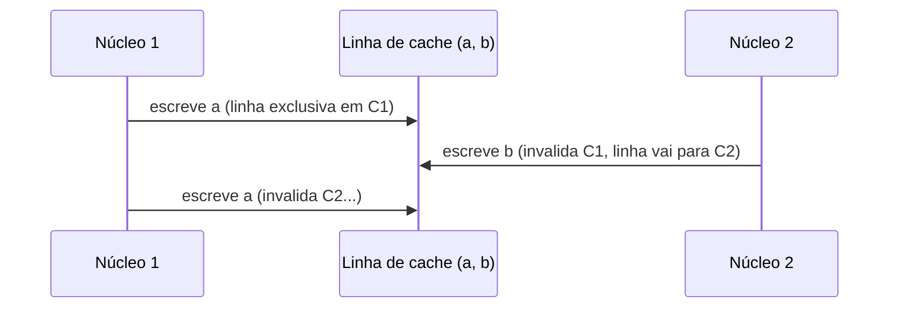

# False sharing

Duas threads escrevem em **variáveis diferentes** que estão na **mesma linha de cache** (64 B). O protocolo de coerência invalida a linha entre os núcleos a cada escrita ("ping-pong"), tornando o programa **muito mais lento** — sem nenhuma data race lógica.



## Demonstração

```cpp
// g++ -std=c++20 -O2 -Wall -Wextra -pthread
#include <atomic>
#include <chrono>
#include <iostream>
#include <thread>

struct Junto {                                   // a e b na mesma linha
    std::atomic<long> a{0};
    std::atomic<long> b{0};
};

struct Separado {                                // cada um em sua própria linha
    alignas(64) std::atomic<long> a{0};
    alignas(64) std::atomic<long> b{0};
};

template <typename T>
double teste() {
    T t;
    auto t0 = std::chrono::steady_clock::now();
    {
        std::jthread j1{[&] { for (int i = 0; i < 20'000'000; ++i) t.a.fetch_add(1, std::memory_order_relaxed); }};
        std::jthread j2{[&] { for (int i = 0; i < 20'000'000; ++i) t.b.fetch_add(1, std::memory_order_relaxed); }};
    }
    return std::chrono::duration<double, std::milli>(std::chrono::steady_clock::now() - t0).count();
}

int main() {
    std::cout << "junto:    " << teste<Junto>() << " ms\n";
    std::cout << "separado: " << teste<Separado>() << " ms\n";   // tipicamente várias vezes mais rápido
}
```

## Como evitar

| Técnica | Detalhe |
|---|---|
| `alignas(64)` | Alinha cada dado "quente" a uma linha |
| `std::hardware_destructive_interference_size` (C++17, `<new>`) | Valor portátil de **evitar** compartilhamento (o GCC avisa que depende de `-mtune`; verifique o suporte do seu compilador) |
| *Padding* manual | `char pad[64 - sizeof(x)]` |
| **Acumuladores locais** por thread | Some no final (redução) em vez de um contador compartilhado |
| Estruturas por thread (`thread_local`) | Sem compartilhamento |

> [!warning] Trade-offs
> `alignas(64)` aumenta o uso de memória. Aplique apenas em dados escritos por **threads diferentes** com alta frequência.

> [!question] Verificar na documentação oficial
> `std::hardware_destructive_interference_size`: disponibilidade e avisos de ABI variam por compilador e versão.

## Veja também

- [[Cache e Localidade de Dados]]
- [[Atomics e Modelo de Memória]]
- [[sizeof e alignof]]
- [[Cpp em Finanças e Baixa Latência]]

## Exercício

1. Execute o exemplo e registre a diferença de tempo.
2. Substitua o contador compartilhado por somas locais com redução final.
