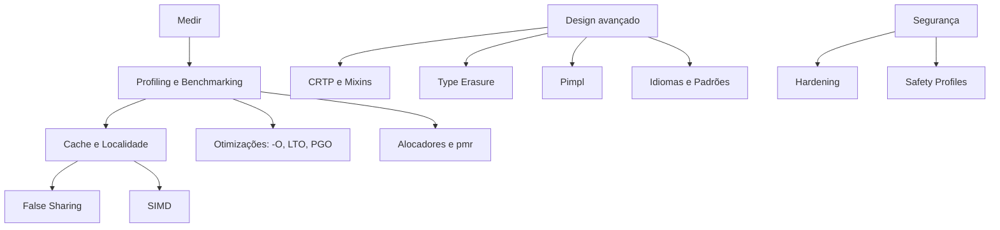

# MOC - Avançado e Performance - Cpp

## Desempenho

- [[Profiling e Benchmarking]]
- [[Cache e Localidade de Dados]]
- [[False Sharing]]
- [[SIMD e Vetorização - Cpp]]
- [[Alocadores e pmr]]
- [[Otimizações do Compilador LTO e PGO]]

## Design avançado

- [[CRTP e Mixins]]
- [[Type Erasure]]
- [[Pimpl]]
- [[Idiomas e Padrões de Projeto em Cpp]]

## Segurança

- [[Segurança e Hardening]]
- [[Safety Profiles e Memória Segura]]

## Ordem sugerida

[[Profiling e Benchmarking]] → [[Cache e Localidade de Dados]] → [[Otimizações do Compilador LTO e PGO]] → [[Alocadores e pmr]] → [[SIMD e Vetorização - Cpp]] → [[False Sharing]] → [[Pimpl]] → [[CRTP e Mixins]] → [[Type Erasure]] → [[Idiomas e Padrões de Projeto em Cpp]] → [[Segurança e Hardening]] → [[Safety Profiles e Memória Segura]]

## Veja também

- [[Home - Cpp]]
- [[MOC - Áreas de Aplicação - Cpp]]
- [[MOC - Classes e POO]]
- [[MOC - Concorrência e Corrotinas]]
