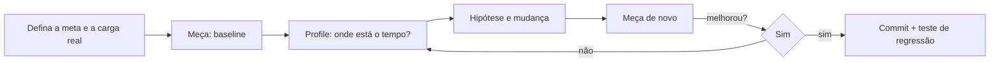

# Profiling e benchmarking

> [!quote] Regra de ouro
> *"Meça, não adivinhe."* Otimizar sem medir costuma melhorar o que não importa e piorar a clareza.

**Benchmark** responde "quão rápido é X?" (microbenchmarks — [[Google Benchmark]]). **Profiling** responde "**onde** o programa gasta tempo/memória?".



## Ferramentas

| Ferramenta | Plataforma | Tipo | Observação |
|---|---|---|---|
| **perf** | Linux | Amostragem (hardware counters) | Padrão; `perf record`, `perf report`, `perf stat` |
| **Flame graphs** (Brendan Gregg) | Todas | Visualização | Mostra pilhas agregadas |
| **Hotspot** | Linux | GUI para perf | |
| **Valgrind: callgrind/cachegrind** | Linux/macOS | Simulação | Mais lento, determinístico ([[Valgrind]]) |
| **Intel VTune** | Linux/Windows | Amostragem + microarquitetura | |
| **Visual Studio Profiler / PerfView / WPA** | Windows | | |
| **Instruments** | macOS | | |
| **Tracy**, **Optick**, **Superluminal** | Todas | Instrumentação em tempo real | Jogos e sistemas interativos |
| **heaptrack**, **massif** | Linux | Perfil de heap | |
| **gprof** | Unix | Instrumentação (`-pg`) | Antigo, impreciso para código otimizado |

```bash
# Compile com símbolos mas OTIMIZADO, e com frame pointers para boas pilhas
g++ -std=c++20 -O2 -g -fno-omit-frame-pointer prog.cpp -o prog

perf stat -e cycles,instructions,cache-misses,branch-misses ./prog      # contadores
perf record -F 999 -g ./prog                                             # amostragem com pilhas
perf report --stdio | head -40
perf script | stackcollapse-perf.pl | flamegraph.pl > flame.svg          # flame graph
```

## Instrumentação manual (compilável)

```cpp
// g++ -std=c++20 -O2 -Wall -Wextra
#include <chrono>
#include <iostream>
#include <string_view>

class Cronometro {
public:
    explicit Cronometro(std::string_view nome) : nome_{nome}, ini_{clock::now()} {}
    ~Cronometro() {
        auto us = std::chrono::duration_cast<std::chrono::microseconds>(clock::now() - ini_).count();
        std::cout << nome_ << ": " << us << " us\n";
    }
private:
    using clock = std::chrono::steady_clock;                       // monotônico: não use system_clock para medir
    std::string_view nome_;
    clock::time_point ini_;
};

long trabalho(int n) { long s = 0; for (int i = 0; i < n; ++i) s += i % 7; return s; }

int main() {
    Cronometro total{"main"};                                      // RAII: mede o escopo
    {
        Cronometro c{"trabalho"};
        volatile long r = trabalho(50'000'000);
        (void)r;                                                   // evita eliminar o cálculo
    }
}
```

## Armadilhas

| Problema | Cuidado |
|---|---|
| Medir em **Debug** | Sempre otimizado (`-O2`) |
| Uma única execução | Repita, use mediana e desvio padrão |
| Ruído do SO | Fixe CPU (`taskset`), desative *turbo*, use máquina ociosa |
| Eliminação de código | Consuma o resultado (`DoNotOptimize`) |
| **Amdahl** | Acelerar 10% do tempo não passa de 10% de ganho |
| Perfil não representativo | Use dados e carga de **produção** |

## Veja também

- [[Google Benchmark]]
- [[Valgrind]]
- [[Otimizações do Compilador LTO e PGO]]
- [[Cache e Localidade de Dados]]
- [[Compiler Explorer]]

## Exercício

1. Gere um flame graph de um programa seu e identifique a função mais quente.
2. Use `perf stat` para comparar `cache-misses` entre os dois laços da nota [[Cache e Localidade de Dados]].
