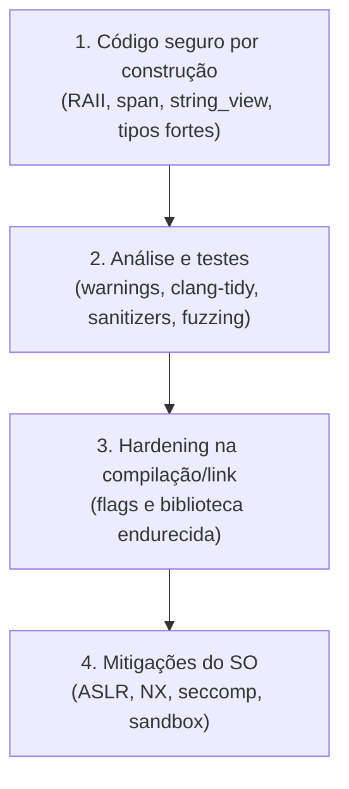

# Segurança e *hardening*

A maioria das vulnerabilidades graves em C++ vem de **violações de segurança de memória**: estouro de buffer, *use-after-free*, *double free*, leitura não inicializada, *type confusion*, corridas de dados. Todas são **UB** ([[Comportamento Indefinido e Não Especificado]]). Defesa em camadas:



## 1. Escreva código mais seguro

| Em vez de | Use |
|---|---|
| `new`/`delete`, `malloc` | `std::unique_ptr`, `std::vector` ([[RAII]]) |
| `char buf[N]`, `strcpy`, `sprintf` | `std::string`, `std::array`, `std::format` |
| `(ptr, tamanho)` | `std::span` |
| `v[i]` sem checagem | `v.at(i)` ou *hardened* (ver abaixo) |
| Conversões C (`(T)x`) | `static_cast`, `gsl::narrow`, `std::in_range` (C++20) |
| Ponteiros nulos silenciosos | `std::optional`, `not_null`, referências |
| Inteiros sem verificação | `std::add_sat`/`std::mul_overflow`-like (C++26 `<numeric>`), `__builtin_add_overflow` |
| Variáveis não inicializadas | Inicialização sempre (`T x{}`); em C++26, leitura é "comportamento errôneo" |

```cpp
// g++ -std=c++20 -Wall -Wextra
#include <cstddef>
#include <iostream>
#include <span>
#include <utility>
#include <vector>

// Interface segura: o tamanho viaja com o ponteiro
long soma_segura(std::span<const int> xs) {
    long s = 0;
    for (int x : xs) s += x;
    return s;
}

int main() {
    std::vector<int> v{1, 2, 3, 4};
    std::cout << soma_segura(v) << '\n';                              // 10

    long long grande = 3'000'000'000LL;
    std::cout << std::in_range<int>(grande) << '\n';                  // 0: valor não cabe em int

    int a = 2'000'000'000, b = 2'000'000'000, r;
    if (__builtin_add_overflow(a, b, &r)) std::cout << "overflow detectado\n";   // extensão GCC/Clang
}
```

## 3. Flags de hardening (GCC/Clang, Linux)

| Flag | Proteção |
|---|---|
| `-Wall -Wextra -Wformat=2 -Wconversion -Wshadow` | Avisos úteis |
| `-D_FORTIFY_SOURCE=2` (ou `3`) com `-O1+` | Checa tamanhos em `memcpy`, `strcpy`... |
| `-fstack-protector-strong` | Canários de pilha |
| `-fstack-clash-protection` | Defende contra saltos de pilha |
| `-fPIE -pie` | Executável independente de posição (ASLR efetivo) |
| `-Wl,-z,relro,-z,now` | RELRO completo (GOT somente leitura) |
| `-Wl,-z,noexecstack` | Pilha não executável |
| `-fcf-protection=full` (x86) / `-mbranch-protection=standard` (ARM) | Integridade de fluxo de controle por hardware |
| `-fsanitize=cfi` (Clang + LTO) | CFI: chamadas indiretas válidas |
| `-D_GLIBCXX_ASSERTIONS` | **libstdc++ endurecida**: `operator[]` de `vector`/`string`/`span` checa limites |
| `-D_LIBCPP_HARDENING_MODE=_LIBCPP_HARDENING_MODE_FAST` | **libc++ hardening** (modos `fast`, `extensive`, `debug`) |
| `-fsanitize=bounds,undefined` (com trap) | Em produção, com `-fsanitize-trap` |

```bash
g++ -std=c++20 -O2 -Wall -Wextra -D_FORTIFY_SOURCE=3 -D_GLIBCXX_ASSERTIONS \
    -fstack-protector-strong -fstack-clash-protection -fcf-protection=full \
    -fPIE -pie -Wl,-z,relro,-z,now prog.cpp -o prog
```

> [!info] C++26
> O C++26 padroniza uma **biblioteca padrão "hardened"** (P3471) com pré-condições verificadas em tempo de execução para `vector`, `span`, `string_view`, `optional`... e o **comportamento errôneo** para leituras não inicializadas (P2795) — resultado de pesquisa deste vault em 2026-10-24. Veja [[Cpp26 Visão Geral]] e [[Safety Profiles e Memória Segura]].

## Entradas não confiáveis

- Valide tamanhos **antes** de alocar/copiar ([[Serialização]]).
- **Fuzz** parsers e protocolos ([[Fuzzing]]).
- Princípio do menor privilégio: *sandbox*, `seccomp`, descartar privilégios.
- Dependências: mantenha atualizadas, use SBOM e análise de CVEs; `-Werror` em CI.
- Segredos: apague com `explicit_bzero`/`memset_s` (o `memset` simples pode ser eliminado pelo otimizador).

> [!warning] Hardening não é correção
> Mitigações aumentam o custo do ataque, mas **não eliminam** o bug. Combine com boas práticas, revisão e ferramentas.

## Veja também

- [[Sanitizers]]
- [[Fuzzing]]
- [[Safety Profiles e Memória Segura]]
- [[Core Guidelines]]
- [[Comportamento Indefinido e Não Especificado]]

## Exercício

1. Compile um programa com buffer overflow propositalmente com e sem `-D_FORTIFY_SOURCE=3 -fstack-protector-strong` e observe o resultado.
2. Habilite `_GLIBCXX_ASSERTIONS` e veja o que acontece com `v[10]` em um `vector` de 3 elementos.
