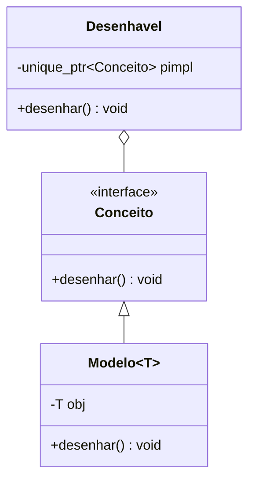

# *Type erasure* (apagamento de tipo)

Técnica que oferece **polimorfismo de valor** — uma interface uniforme sobre **tipos não relacionados**, sem exigir herança — escondendo o tipo concreto atrás de uma **interface virtual interna**. Exemplos na biblioteca padrão: `std::function`, `std::any`, `std::shared_ptr` (deleter), `std::move_only_function`.



## Padrão *Concept–Model*

```cpp
// g++ -std=c++20 -Wall -Wextra
#include <iostream>
#include <memory>
#include <string>
#include <utility>
#include <vector>

// Tipos NÃO relacionados — nenhuma herança comum, nenhum 'virtual'
struct Circulo { double r; void desenhar() const { std::cout << "círculo r=" << r << '\n'; } };
struct Texto   { std::string s; void desenhar() const { std::cout << "texto \"" << s << "\"\n"; } };

class Desenhavel {
public:
    template <typename T>
    Desenhavel(T obj) : p_{std::make_unique<Modelo<T>>(std::move(obj))} {}   // aceita qualquer T com desenhar()

    Desenhavel(const Desenhavel& o) : p_{o.p_->clonar()} {}                   // semântica de VALOR (cópia profunda)
    Desenhavel(Desenhavel&&) noexcept = default;
    Desenhavel& operator=(Desenhavel o) noexcept { p_ = std::move(o.p_); return *this; }

    void desenhar() const { p_->desenhar(); }

private:
    struct Conceito {                                                          // interface interna
        virtual ~Conceito() = default;
        virtual void desenhar() const = 0;
        virtual std::unique_ptr<Conceito> clonar() const = 0;
    };
    template <typename T>
    struct Modelo final : Conceito {                                           // "empacota" um T
        explicit Modelo(T o) : obj{std::move(o)} {}
        void desenhar() const override { obj.desenhar(); }
        std::unique_ptr<Conceito> clonar() const override { return std::make_unique<Modelo>(*this); }
        T obj;
    };

    std::unique_ptr<Conceito> p_;
};

int main() {
    std::vector<Desenhavel> cena;
    cena.emplace_back(Circulo{1.5});
    cena.emplace_back(Texto{"olá"});
    auto copia = cena;                                                         // cópia de valor, sem fatiamento
    for (const auto& d : copia) d.desenhar();
}
```

## Comparação com alternativas

| Abordagem | Vantagem | Desvantagem |
|---|---|---|
| Herança + `virtual` | Simples, contêineres heterogêneos | **Intrusivo** (tipos precisam herdar), semântica de referência |
| Templates / CRTP | Rápido (sem indireção) | Sem contêiner heterogêneo, código no cabeçalho |
| `std::variant` | Sem heap, rápido, `visit` | **Conjunto fechado** de tipos |
| **Type erasure** | Conjunto **aberto**, semântica de valor, não intrusivo | Alocação (mitigável com SBO), indireção virtual |

> [!tip] Small Buffer Optimization
> `std::function` e implementações maduras guardam objetos pequenos **dentro** do próprio wrapper, evitando alocação. Pode ser feito com *placement new* em buffer interno alinhado.

> [!warning] Cuidados
> - Sem *concepts*, o erro de um tipo sem `desenhar()` aparece dentro de `Modelo<T>` (mensagem longa): restrinja o construtor com `requires` ([[Concepts e requires]]).
> - `std::function` exige **copiável**; use `std::move_only_function` (C++23) para *callables* move-only ([[std function e Functors]]).
> - Há bibliotecas prontas: **Boost.TypeErasure**, **Folly::Poly**, **dyno**.

## Veja também

- [[std function e Functors]]
- [[std any]]
- [[Polimorfismo e Funções Virtuais]]
- [[CRTP e Mixins]]
- [[variant]]

## Exercício

1. Adicione `area()` ao conceito e implemente-o em `Circulo` e `Texto`.
2. Faça uma versão com *small buffer optimization* de 32 bytes.
