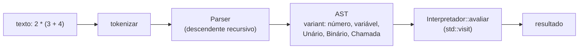

# Projeto 1 — Calculadora de expressões

Um interpretador interativo (REPL) que avalia expressões como `2 * (3 + 4) ^ 2`, define variáveis (`x = 5`) e chama funções (`sqrt(16)`, `max(2, 7)`). É o clássico exercício de **compiladores**: *lexer* → *parser* → **AST** → avaliação.

## Objetivos

- Implementar um analisador léxico e um **parser descendente recursivo** com precedência e associatividade corretas.
- Representar a árvore sintática com `std::variant` + `std::unique_ptr` e percorrê-la com `std::visit`.
- Tratar erros do usuário com exceções próprias, sem derrubar o programa.
- Escrever testes automatizados e integrá-los ao **CTest**.

## Conceitos praticados

- [[variant]] e `std::visit`
- [[unique_ptr]] e propriedade exclusiva de nós
- [[Lambdas e Captura]] e [[std function e Functors]] (tabela de funções)
- [[Exceções try catch throw]] e [[Hierarquia de Exceções]]
- [[string_view]] e [[Namespaces - Cpp]]
- [[CMake Moderno e Presets]] (biblioteca `INTERFACE`)

## Estrutura de pastas

```text
calculadora/
├── CMakeLists.txt
├── src/
│   ├── calc.hpp        # lexer + parser + AST + interpretador (header-only)
│   └── main.cpp        # REPL
└── tests/
    └── test_calc.cpp   # testes sem framework externo
```

## Arquitetura



**Gramática** (da menor para a maior precedência):

| Regra | Operadores | Associatividade |
|---|---|---|
| `expr` | `+` `-` | esquerda |
| `termo` | `*` `/` | esquerda |
| `pot` | `^` | **direita** (`2^3^2 = 512`) |
| `unario` | `-x` | prefixo |
| `primario` | número, identificador, chamada, `( expr )` | — |

Cada regra vira **uma função** do `Parser`; a precedência é a profundidade da cadeia de chamadas.

## `CMakeLists.txt`

```cmake
cmake_minimum_required(VERSION 3.20)
project(calculadora VERSION 1.0 LANGUAGES CXX)

set(CMAKE_CXX_STANDARD 20)
set(CMAKE_CXX_STANDARD_REQUIRED ON)
set(CMAKE_CXX_EXTENSIONS OFF)

# Biblioteca só de cabeçalho: o alvo INTERFACE propaga include e padrão
add_library(calc INTERFACE)
target_include_directories(calc INTERFACE src)
target_compile_features(calc INTERFACE cxx_std_20)

add_executable(calculadora src/main.cpp)
target_link_libraries(calculadora PRIVATE calc)
target_compile_options(calculadora PRIVATE -Wall -Wextra -Wpedantic)

enable_testing()
add_executable(test_calc tests/test_calc.cpp)
target_link_libraries(test_calc PRIVATE calc)
target_compile_options(test_calc PRIVATE -Wall -Wextra -Wpedantic)
add_test(NAME calc COMMAND test_calc)
```

## `src/calc.hpp`

Todo o núcleo. Repare em três decisões: (1) `No` guarda um `std::variant`, então cada tipo de nó é um *struct* simples; (2) os filhos são `unique_ptr<No>` (propriedade exclusiva, sem ciclos); (3) o `Visitante` é um *functor* com um `operator()` por alternativa — o compilador **obriga** a tratar todos os casos.

```cpp
// arquivo: src/calc.hpp
// calc.hpp — avaliador de expressões: lexer + parser descendente recursivo + AST + interpretador.
#pragma once

#include <cctype>
#include <cmath>
#include <cstddef>
#include <functional>
#include <map>
#include <memory>
#include <stdexcept>
#include <string>
#include <string_view>
#include <variant>
#include <vector>

namespace calc {

// Erro de sintaxe ou de avaliação, com mensagem legível para o usuário.
struct Erro : std::runtime_error {
    using std::runtime_error::runtime_error;
};

// ---------------------------------------------------------------- Lexer
enum class Tok { Num, Id, Mais, Menos, Vezes, Div, Pot, AbreP, FechaP, Virgula, Igual, Fim };

struct Token {
    Tok tipo;
    std::string texto{};
    double valor = 0.0;
};

inline std::vector<Token> tokenizar(std::string_view s) {
    std::vector<Token> out;
    std::size_t i = 0;
    while (i < s.size()) {
        const unsigned char c = static_cast<unsigned char>(s[i]);
        if (std::isspace(c)) { ++i; continue; }
        if (std::isdigit(c) || c == '.') {                       // número: 12, 3.14, .5
            std::size_t usados = 0;
            double v = 0;
            try { v = std::stod(std::string{s.substr(i)}, &usados); }
            catch (const std::exception&) { throw Erro{"número inválido na posição " + std::to_string(i)}; }
            out.push_back({Tok::Num, std::string{s.substr(i, usados)}, v});
            i += usados;
            continue;
        }
        if (std::isalpha(c) || c == '_') {                       // identificador
            std::size_t j = i;
            while (j < s.size() && (std::isalnum(static_cast<unsigned char>(s[j])) || s[j] == '_')) ++j;
            out.push_back({Tok::Id, std::string{s.substr(i, j - i)}});
            i = j;
            continue;
        }
        Tok t;
        switch (c) {
            case '+': t = Tok::Mais; break;
            case '-': t = Tok::Menos; break;
            case '*': t = Tok::Vezes; break;
            case '/': t = Tok::Div; break;
            case '^': t = Tok::Pot; break;
            case '(': t = Tok::AbreP; break;
            case ')': t = Tok::FechaP; break;
            case ',': t = Tok::Virgula; break;
            case '=': t = Tok::Igual; break;
            default: throw Erro{std::string{"caractere inesperado '"} + static_cast<char>(c) + "'"};
        }
        out.push_back({t, std::string(1, static_cast<char>(c))});
        ++i;
    }
    out.push_back({Tok::Fim});
    return out;
}

// ---------------------------------------------------------------- AST
struct No;
using NoPtr = std::unique_ptr<No>;

struct Unario  { char op; NoPtr operando; };
struct Binario { char op; NoPtr esq, dir; };
struct Chamada { std::string nome; std::vector<NoPtr> args; };

struct No {
    std::variant<double, std::string, Unario, Binario, Chamada> v;   // número | variável | ...
};

template <typename T>
NoPtr novo(T&& valor) { return std::make_unique<No>(No{std::forward<T>(valor)}); }

// ---------------------------------------------------------------- Parser
// Gramática:
//   expr   := termo (('+' | '-') termo)*
//   termo  := pot (('*' | '/') pot)*
//   pot    := unario ('^' pot)?            (associativo à direita)
//   unario := '-' unario | primario
//   primario := NUM | ID | ID '(' [expr (',' expr)*] ')' | '(' expr ')'
class Parser {
public:
    explicit Parser(std::vector<Token> toks) : toks_{std::move(toks)} {}

    NoPtr analisar_expressao() {
        NoPtr n = expr();
        if (atual().tipo != Tok::Fim) throw Erro{"sobrou texto após a expressão: '" + atual().texto + "'"};
        return n;
    }

    // Posição após consumir tokens (útil para o interpretador tratar atribuições)
    const Token& espiar(std::size_t k = 0) const { return toks_[std::min(pos_ + k, toks_.size() - 1)]; }
    void avancar() { if (pos_ + 1 < toks_.size()) ++pos_; }

private:
    const Token& atual() const { return toks_[pos_]; }

    bool consome(Tok t) {
        if (atual().tipo != t) return false;
        avancar();
        return true;
    }

    NoPtr expr() {
        NoPtr esq = termo();
        while (atual().tipo == Tok::Mais || atual().tipo == Tok::Menos) {
            const char op = atual().tipo == Tok::Mais ? '+' : '-';
            avancar();
            esq = novo(Binario{op, std::move(esq), termo()});
        }
        return esq;
    }

    NoPtr termo() {
        NoPtr esq = pot();
        while (atual().tipo == Tok::Vezes || atual().tipo == Tok::Div) {
            const char op = atual().tipo == Tok::Vezes ? '*' : '/';
            avancar();
            esq = novo(Binario{op, std::move(esq), pot()});
        }
        return esq;
    }

    NoPtr pot() {
        NoPtr base = unario();
        if (consome(Tok::Pot)) return novo(Binario{'^', std::move(base), pot()});   // direita: 2^3^2 = 2^(3^2)
        return base;
    }

    NoPtr unario() {
        if (consome(Tok::Menos)) return novo(Unario{'-', unario()});
        return primario();
    }

    NoPtr primario() {
        const Token t = atual();
        if (consome(Tok::Num)) return novo(t.valor);
        if (consome(Tok::Id)) {
            if (!consome(Tok::AbreP)) return novo(t.texto);          // variável
            Chamada c{t.texto, {}};
            if (!consome(Tok::FechaP)) {
                do { c.args.push_back(expr()); } while (consome(Tok::Virgula));
                if (!consome(Tok::FechaP)) throw Erro{"esperado ')' após os argumentos de " + t.texto};
            }
            return novo(std::move(c));
        }
        if (consome(Tok::AbreP)) {
            NoPtr n = expr();
            if (!consome(Tok::FechaP)) throw Erro{"esperado ')'"};
            return n;
        }
        throw Erro{t.tipo == Tok::Fim ? "expressão incompleta" : "token inesperado '" + t.texto + "'"};
    }

    std::vector<Token> toks_;
    std::size_t pos_ = 0;
};

// ---------------------------------------------------------------- Interpretador
class Interpretador {
public:
    Interpretador() {
        vars_["pi"] = 3.14159265358979323846;
        vars_["e"] = 2.71828182845904523536;
        funcs_["sqrt"] = [](const std::vector<double>& a) { return std::sqrt(um(a, "sqrt")); };
        funcs_["sin"]  = [](const std::vector<double>& a) { return std::sin(um(a, "sin")); };
        funcs_["cos"]  = [](const std::vector<double>& a) { return std::cos(um(a, "cos")); };
        funcs_["log"]  = [](const std::vector<double>& a) { return std::log(um(a, "log")); };
        funcs_["abs"]  = [](const std::vector<double>& a) { return std::fabs(um(a, "abs")); };
        funcs_["max"]  = [](const std::vector<double>& a) { return dois(a, "max", [](double x, double y) { return x > y ? x : y; }); };
        funcs_["min"]  = [](const std::vector<double>& a) { return dois(a, "min", [](double x, double y) { return x < y ? x : y; }); };
    }

    // Executa uma linha: "x = 2 * 3" (atribuição) ou "x + 1" (expressão).
    double executar(std::string_view linha) {
        Parser p{tokenizar(linha)};
        if (p.espiar().tipo == Tok::Id && p.espiar(1).tipo == Tok::Igual) {
            const std::string nome = p.espiar().texto;
            p.avancar();
            p.avancar();
            const double valor = avaliar(*p.analisar_expressao());
            vars_[nome] = valor;
            return valor;
        }
        return avaliar(*p.analisar_expressao());
    }

    double avaliar(const No& n) const {
        struct Visitante {
            const Interpretador& self;
            double operator()(double x) const { return x; }
            double operator()(const std::string& nome) const {
                auto it = self.vars_.find(nome);
                if (it == self.vars_.end()) throw Erro{"variável não definida: " + nome};
                return it->second;
            }
            double operator()(const Unario& u) const { return -self.avaliar(*u.operando); }
            double operator()(const Binario& b) const {
                const double l = self.avaliar(*b.esq), r = self.avaliar(*b.dir);
                switch (b.op) {
                    case '+': return l + r;
                    case '-': return l - r;
                    case '*': return l * r;
                    case '/': if (r == 0.0) throw Erro{"divisão por zero"}; return l / r;
                    case '^': return std::pow(l, r);
                }
                throw Erro{"operador desconhecido"};
            }
            double operator()(const Chamada& c) const {
                auto it = self.funcs_.find(c.nome);
                if (it == self.funcs_.end()) throw Erro{"função desconhecida: " + c.nome};
                std::vector<double> args;
                for (const auto& a : c.args) args.push_back(self.avaliar(*a));
                return it->second(args);
            }
        };
        return std::visit(Visitante{*this}, n.v);
    }

private:
    static double um(const std::vector<double>& a, const char* nome) {
        if (a.size() != 1) throw Erro{std::string{nome} + " espera 1 argumento"};
        return a[0];
    }
    template <typename F>
    static double dois(const std::vector<double>& a, const char* nome, F f) {
        if (a.size() != 2) throw Erro{std::string{nome} + " espera 2 argumentos"};
        return f(a[0], a[1]);
    }

    std::map<std::string, double> vars_;
    std::map<std::string, std::function<double(const std::vector<double>&)>> funcs_;
};

}  // namespace calc
```

## `src/main.cpp`

```cpp
// arquivo: src/main.cpp
// main.cpp — REPL da calculadora: lê linhas e imprime o resultado.
#include <iostream>
#include <string>

#include "calc.hpp"

int main() {
    calc::Interpretador interp;
    std::string linha;
    std::cout << "Calculadora (digite 'sair' para encerrar)\n> " << std::flush;
    while (std::getline(std::cin, linha)) {
        if (linha == "sair") break;
        if (!linha.empty()) {
            try {
                std::cout << interp.executar(linha) << '\n';
            } catch (const calc::Erro& e) {                  // erros do usuário não derrubam o programa
                std::cout << "erro: " << e.what() << '\n';
            }
        }
        std::cout << "> " << std::flush;
    }
}
```

## `tests/test_calc.cpp`

Testes sem dependências externas. Observe os **casos de erro**: sistemas robustos testam o que *não* deve funcionar.

```cpp
// arquivo: tests/test_calc.cpp
// test_calc.cpp — testes sem framework externo (retorna != 0 se algum falhar).
#include <cmath>
#include <iostream>
#include <string>

#include "calc.hpp"

namespace {
int falhas = 0;

void espera(calc::Interpretador& in, const std::string& expr, double esperado) {
    const double r = in.executar(expr);
    if (std::fabs(r - esperado) > 1e-9) {
        std::cout << "FALHA: " << expr << " = " << r << " (esperado " << esperado << ")\n";
        ++falhas;
    }
}

void espera_erro(calc::Interpretador& in, const std::string& expr) {
    try {
        in.executar(expr);
        std::cout << "FALHA: '" << expr << "' deveria lançar erro\n";
        ++falhas;
    } catch (const calc::Erro&) {}
}
}  // namespace

int main() {
    calc::Interpretador in;
    espera(in, "1 + 2 * 3", 7);
    espera(in, "(1 + 2) * 3", 9);
    espera(in, "2 ^ 3 ^ 2", 512);              // associatividade à direita
    espera(in, "-2 ^ 2", 4);                   // unário tem precedência maior que ^ nesta gramática
    espera(in, "10 / 4", 2.5);
    espera(in, "x = 5", 5);
    espera(in, "x * 2 + 1", 11);
    espera(in, "sqrt(16) + max(2, 7)", 11);
    espera(in, "sin(0) + cos(0)", 1);
    espera_erro(in, "1 / 0");
    espera_erro(in, "1 +");
    espera_erro(in, "(1 + 2");
    espera_erro(in, "y + 1");
    espera_erro(in, "foo(1)");
    espera_erro(in, "3 $ 4");
    std::cout << (falhas == 0 ? "todos os testes passaram\n" : "há falhas\n");
    return falhas;
}
```

## Compilar, testar e executar

```bash
cmake -S . -B build -G Ninja
cmake --build build
ctest --test-dir build --output-on-failure
./build/calculadora
# > 1 + 2 * 3
# 7
# > x = 4
# > x ^ 2
# 16
# > sqrt(2)
# 1.41421
# > 1 / 0
# erro: divisão por zero
```

> [!success] Verificação
> Este projeto foi compilado com `g++ 13` (`-std=c++20 -Wall -Wextra -Wpedantic`) e os testes passaram (`ctest`).

## Pontos de atenção

> [!warning] Recursão profunda
> Entradas como `((((((...))))))` com milhares de níveis estouram a pilha. Em produção, limite a profundidade do parser.

> [!warning] Ponto flutuante
> `0.1 + 0.2 != 0.3` em `double`. Para calculadoras financeiras, use decimais ou inteiros.

## Extensões sugeridas

1. Suporte a **funções definidas pelo usuário** (`f(x) = x ^ 2`) guardando a AST.
2. Mensagens de erro com **posição** (coluna) e sublinhado.
3. Histórico e edição de linha com *readline*.
4. Operadores de comparação e `if(cond, a, b)`.
5. Gerar **bytecode** e executar em uma pequena VM (ligação com o projeto de máquina virtual).
6. Trocar o `double` por um tipo de **precisão arbitrária**.

## Veja também

- [[MOC - Projetos - Cpp]]
- [[variant]]
- [[Exceções try catch throw]]
- [[Projeto 2 - Gerenciador de Tarefas CLI]]
- [[Estrutura de Projetos]]

## Exercício

1. Adicione o operador `%` (resto) e a função `floor`.
2. Implemente a análise de erros que informa o **índice** do caractere inválido.
3. Escreva um teste que garanta `2 ^ -1 == 0.5`.
