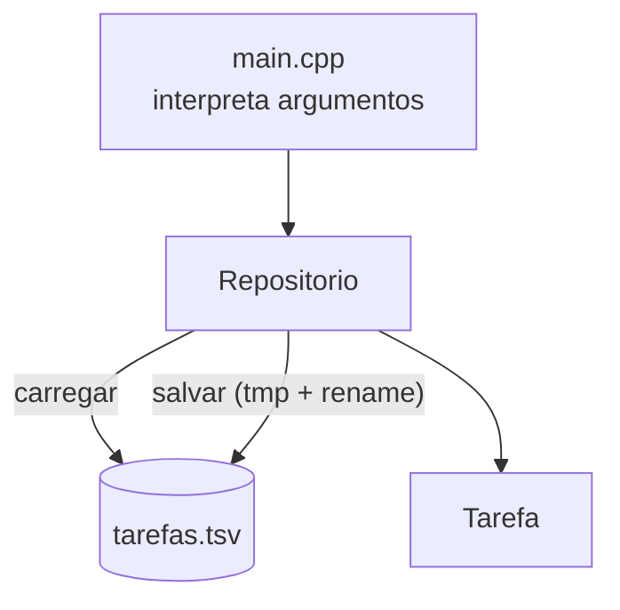

# Projeto 2 — Gerenciador de tarefas (CLI)

Um aplicativo de linha de comando para registrar tarefas com prioridade, marcá-las como concluídas e removê-las, com **persistência em arquivo** (`TSV`). Treina modelagem, I/O de arquivos e uma interface de linha de comando limpa.

## Objetivos

- Modelar o domínio (`Tarefa`) e isolar o armazenamento em uma classe `Repositorio`.
- Persistir dados com `fstream`, **escape** de caracteres especiais e **gravação atômica** (arquivo temporário + `rename`).
- Tratar argumentos de `main` e códigos de saída.
- Ordenar e filtrar com algoritmos da STL.

## Conceitos praticados

- [[Arquivos fstream]] e [[std filesystem]]
- [[Classes e Structs]] e [[Encapsulamento e friend]]
- [[Algoritmos da STL]] (`sort`, `remove_if`, `find_if`, `clamp`)
- [[optional]] para valores ausentes
- [[Streams e iostream]] (`istringstream`, `getline`)
- [[RAII]] (arquivo fechado ao sair do escopo)

## Estrutura de pastas

```text
tarefas/
├── CMakeLists.txt
├── src/
│   ├── tarefa.hpp      # Tarefa + Repositorio (header-only)
│   └── main.cpp        # CLI: add | list | done | rm
└── tests/
    └── test_tarefas.cpp
```

## Arquitetura



**Formato do arquivo** (uma tarefa por linha, campos separados por TAB):

```text
1	2	1	1761000000	estudar templates
id	prio	concluida	criada_em	titulo (com \t \n \\ escapados)
```

## `CMakeLists.txt`

```cmake
cmake_minimum_required(VERSION 3.20)
project(tarefas VERSION 1.0 LANGUAGES CXX)

set(CMAKE_CXX_STANDARD 20)
set(CMAKE_CXX_STANDARD_REQUIRED ON)
set(CMAKE_CXX_EXTENSIONS OFF)

add_library(tarefas_lib INTERFACE)
target_include_directories(tarefas_lib INTERFACE src)
target_compile_features(tarefas_lib INTERFACE cxx_std_20)

add_executable(tarefas src/main.cpp)
target_link_libraries(tarefas PRIVATE tarefas_lib)
target_compile_options(tarefas PRIVATE -Wall -Wextra -Wpedantic)

enable_testing()
add_executable(test_tarefas tests/test_tarefas.cpp)
target_link_libraries(test_tarefas PRIVATE tarefas_lib)
target_compile_options(test_tarefas PRIVATE -Wall -Wextra -Wpedantic)
add_test(NAME tarefas COMMAND test_tarefas)
```

## `src/tarefa.hpp`

O `Repositorio` não conhece a interface de linha de comando: isso permite **testá-lo** isoladamente e trocar o armazenamento depois (por SQLite, por exemplo). Note o `salvar()`: grava em `arquivo.tmp` e só então renomeia — se o programa cair no meio, o arquivo original continua íntegro.

```cpp
// arquivo: src/tarefa.hpp
// tarefa.hpp — modelo de domínio e repositório com persistência em arquivo de texto (TSV).
#pragma once

#include <algorithm>
#include <chrono>
#include <cstdint>
#include <filesystem>
#include <fstream>
#include <optional>
#include <sstream>
#include <stdexcept>
#include <string>
#include <tuple>
#include <vector>

namespace tarefas {

struct Tarefa {
    std::uint32_t id = 0;
    std::string titulo;
    int prioridade = 3;          // 1 (alta) .. 5 (baixa)
    bool concluida = false;
    std::int64_t criada_em = 0;  // segundos desde a época Unix
};

// Escapa \t, \n e \\ para que um título caiba em uma linha de TSV.
inline std::string escapar(const std::string& s) {
    std::string r;
    for (char c : s) {
        switch (c) {
            case '\\': r += "\\\\"; break;
            case '\t': r += "\\t"; break;
            case '\n': r += "\\n"; break;
            default: r += c;
        }
    }
    return r;
}

inline std::string desescapar(const std::string& s) {
    std::string r;
    for (std::size_t i = 0; i < s.size(); ++i) {
        if (s[i] == '\\' && i + 1 < s.size()) {
            ++i;
            r += (s[i] == 't') ? '\t' : (s[i] == 'n') ? '\n' : s[i];
        } else {
            r += s[i];
        }
    }
    return r;
}

class Repositorio {
public:
    explicit Repositorio(std::filesystem::path arquivo) : arquivo_{std::move(arquivo)} { carregar(); }

    std::uint32_t adicionar(std::string titulo, int prioridade) {
        const auto agora = std::chrono::system_clock::now().time_since_epoch();
        Tarefa t{proximo_id_++, std::move(titulo), std::clamp(prioridade, 1, 5), false,
                 std::chrono::duration_cast<std::chrono::seconds>(agora).count()};
        tarefas_.push_back(std::move(t));
        return tarefas_.back().id;
    }

    bool concluir(std::uint32_t id) {
        if (auto* t = buscar(id)) { t->concluida = true; return true; }
        return false;
    }

    bool remover(std::uint32_t id) {
        auto it = std::remove_if(tarefas_.begin(), tarefas_.end(), [id](const Tarefa& t) { return t.id == id; });
        const bool achou = it != tarefas_.end();
        tarefas_.erase(it, tarefas_.end());
        return achou;
    }

    // Lista ordenada por prioridade e id; por padrão só as pendentes.
    std::vector<Tarefa> listar(bool incluir_concluidas) const {
        std::vector<Tarefa> r;
        for (const auto& t : tarefas_) if (incluir_concluidas || !t.concluida) r.push_back(t);
        std::sort(r.begin(), r.end(), [](const Tarefa& a, const Tarefa& b) {
            return std::tie(a.prioridade, a.id) < std::tie(b.prioridade, b.id);
        });
        return r;
    }

    std::size_t total() const { return tarefas_.size(); }

    // Grava em arquivo temporário e renomeia: evita corromper o original se falhar no meio.
    void salvar() const {
        const auto tmp = std::filesystem::path{arquivo_}.concat(".tmp");
        {
            std::ofstream out{tmp, std::ios::trunc};
            if (!out) throw std::runtime_error{"não foi possível escrever " + tmp.string()};
            for (const auto& t : tarefas_)
                out << t.id << '\t' << t.prioridade << '\t' << t.concluida << '\t' << t.criada_em << '\t'
                    << escapar(t.titulo) << '\n';
            if (!out) throw std::runtime_error{"falha ao gravar dados"};
        }
        std::filesystem::rename(tmp, arquivo_);
    }

private:
    Tarefa* buscar(std::uint32_t id) {
        auto it = std::find_if(tarefas_.begin(), tarefas_.end(), [id](const Tarefa& t) { return t.id == id; });
        return it == tarefas_.end() ? nullptr : &*it;
    }

    void carregar() {
        std::ifstream in{arquivo_};
        if (!in) return;                                     // primeira execução: sem arquivo
        std::string linha;
        while (std::getline(in, linha)) {
            std::istringstream ss{linha};
            Tarefa t;
            int concl = 0;
            if (!(ss >> t.id >> t.prioridade >> concl >> t.criada_em)) continue;   // linha inválida: ignora
            ss.get();                                         // consome o TAB antes do título
            std::string titulo;
            std::getline(ss, titulo);
            t.titulo = desescapar(titulo);
            t.concluida = concl != 0;
            proximo_id_ = std::max(proximo_id_, t.id + 1);
            tarefas_.push_back(std::move(t));
        }
    }

    std::filesystem::path arquivo_;
    std::vector<Tarefa> tarefas_;
    std::uint32_t proximo_id_ = 1;
};

}  // namespace tarefas
```

## `src/main.cpp`

```cpp
// arquivo: src/main.cpp
// main.cpp — interface de linha de comando: add | list | done | rm
#include <cstdlib>
#include <ctime>
#include <iomanip>
#include <iostream>
#include <string>
#include <vector>

#include "tarefa.hpp"

namespace {

void uso() {
    std::cout << "uso:\n"
                 "  tarefas add \"título\" [-p 1..5]\n"
                 "  tarefas list [--todas]\n"
                 "  tarefas done ID\n"
                 "  tarefas rm ID\n"
                 "O arquivo padrão é ./tarefas.tsv (altere com a variável TAREFAS_ARQUIVO).\n";
}

std::optional<std::uint32_t> ler_id(const std::string& s) {
    try {
        const unsigned long v = std::stoul(s);
        return static_cast<std::uint32_t>(v);
    } catch (const std::exception&) {
        return std::nullopt;
    }
}

}  // namespace

int main(int argc, char** argv) {
    const std::vector<std::string> args(argv + 1, argv + argc);
    if (args.empty()) { uso(); return 1; }

    const char* env = std::getenv("TAREFAS_ARQUIVO");
    tarefas::Repositorio repo{env ? env : "tarefas.tsv"};

    const std::string& cmd = args[0];
    if (cmd == "add" && args.size() >= 2) {
        int prio = 3;
        if (args.size() >= 4 && args[2] == "-p") prio = std::atoi(args[3].c_str());
        const auto id = repo.adicionar(args[1], prio);
        repo.salvar();
        std::cout << "tarefa " << id << " criada\n";
    } else if (cmd == "list") {
        const bool todas = args.size() >= 2 && args[1] == "--todas";
        for (const auto& t : repo.listar(todas)) {
            std::cout << std::setw(3) << t.id << "  [" << (t.concluida ? 'x' : ' ') << "]  P" << t.prioridade
                      << "  " << t.titulo << '\n';
        }
    } else if ((cmd == "done" || cmd == "rm") && args.size() == 2) {
        const auto id = ler_id(args[1]);
        if (!id) { std::cerr << "ID inválido\n"; return 1; }
        const bool ok = cmd == "done" ? repo.concluir(*id) : repo.remover(*id);
        if (!ok) { std::cerr << "tarefa " << *id << " não encontrada\n"; return 1; }
        repo.salvar();
        std::cout << "ok\n";
    } else {
        uso();
        return 1;
    }
}
```

## `tests/test_tarefas.cpp`

```cpp
// arquivo: tests/test_tarefas.cpp
// test_tarefas.cpp — testes do repositório (ordenação, persistência, escape).
#include <cstdio>
#include <filesystem>
#include <iostream>

#include "tarefa.hpp"

namespace {
int falhas = 0;
void verifica(bool cond, const char* msg) {
    if (!cond) { std::cout << "FALHA: " << msg << '\n'; ++falhas; }
}
}  // namespace

int main() {
    const auto arq = std::filesystem::temp_directory_path() / "teste_tarefas.tsv";
    std::filesystem::remove(arq);

    {
        tarefas::Repositorio r{arq};
        r.adicionar("baixa prioridade", 5);
        r.adicionar("alta\tcom TAB e \\ barra", 1);
        const auto id3 = r.adicionar("média", 3);
        verifica(r.concluir(id3), "concluir existente");
        verifica(!r.concluir(999), "concluir inexistente");
        r.salvar();
    }
    {
        tarefas::Repositorio r{arq};                         // recarrega do disco
        verifica(r.total() == 3, "3 tarefas persistidas");
        const auto pendentes = r.listar(false);
        verifica(pendentes.size() == 2, "2 pendentes");
        verifica(pendentes[0].prioridade == 1, "ordenadas por prioridade");
        verifica(pendentes[0].titulo == "alta\tcom TAB e \\ barra", "escape/desescape preserva o título");
        verifica(r.remover(1), "remover existente");
        verifica(r.adicionar("nova", 2) == 4, "ids não são reutilizados");
    }
    std::filesystem::remove(arq);
    std::cout << (falhas == 0 ? "todos os testes passaram\n" : "há falhas\n");
    return falhas;
}
```

## Compilar, testar e executar

```bash
cmake -S . -B build -G Ninja && cmake --build build
ctest --test-dir build --output-on-failure

export TAREFAS_ARQUIVO=/tmp/tarefas.tsv
./build/tarefas add "estudar templates" -p 2
./build/tarefas add "ler sobre RAII"
./build/tarefas done 1
./build/tarefas list --todas
#   1  [x]  P2  estudar templates
#   2  [ ]  P3  ler sobre RAII
```

> [!success] Verificação
> Compilado com `g++ 13` (`-std=c++20 -Wall -Wextra -Wpedantic`); testes de persistência e escape passaram e a CLI foi exercitada manualmente.

## Pontos de atenção

> [!warning] Concorrência
> Duas instâncias do programa gravando ao mesmo tempo sobrescrevem uma à outra. Use *file locking* (`flock`) ou um banco de dados.

> [!warning] Codificação
> Títulos em UTF-8 funcionam porque tratamos bytes, mas `setw` conta bytes, não letras ([[Unicode e Codificações]]).

## Extensões sugeridas

1. Datas de vencimento com `std::chrono` e ordenação por urgência.
2. Etiquetas (tags) e busca (`tarefas find texto`).
3. Trocar o TSV por **SQLite** mantendo a interface do `Repositorio`.
4. Saída em **JSON** (`--json`) com uma biblioteca ([[nlohmann json e simdjson]]).
5. Subcomando `undo` com histórico de comandos (padrão Command).
6. Cores no terminal e `--help` gerado automaticamente.

## Veja também

- [[MOC - Projetos - Cpp]]
- [[Arquivos fstream]]
- [[std filesystem]]
- [[Projeto 1 - Calculadora de Expressões]]
- [[Serialização]]

## Exercício

1. Implemente `tarefas edit ID "novo título"`.
2. Adicione validação para impedir títulos vazios e escreva o teste.
3. Escreva um teste que simule um arquivo corrompido (linhas inválidas) e verifique que o programa não quebra.
