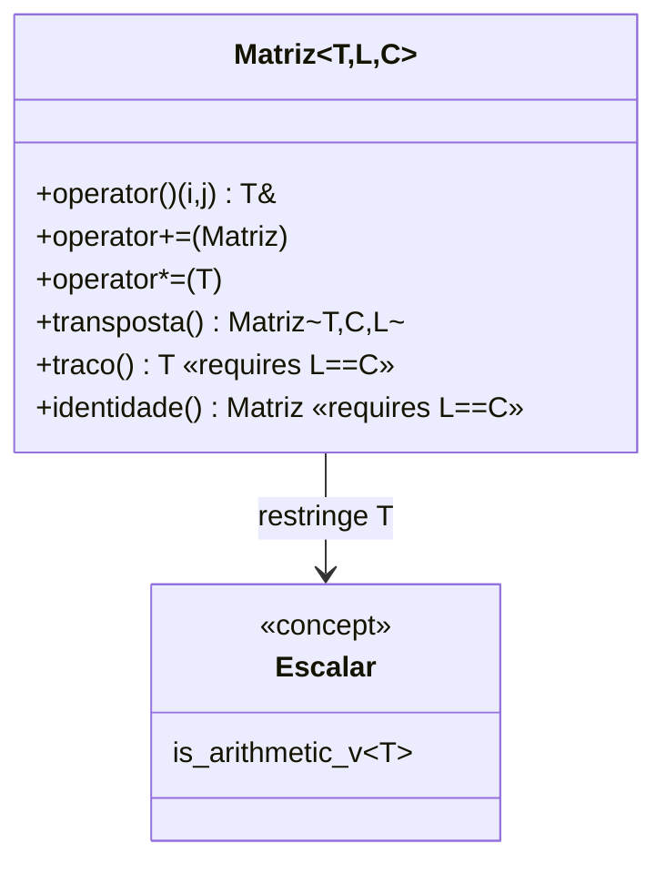

# Projeto 3 — Biblioteca de matrizes em tempo de compilação

Uma biblioteca *header-only* de matrizes `Matriz<T, L, C>` cujas **dimensões fazem parte do tipo**. Multiplicar matrizes incompatíveis é um **erro de compilação**, e boa parte dos testes roda com `static_assert`, em tempo de compilação.

## Objetivos

- Usar **parâmetros não-tipo** de template para codificar dimensões no tipo.
- Restringir templates com **concepts** (`Escalar`) e cláusulas `requires`.
- Escrever código `constexpr` e testá-lo com `static_assert`.
- Empacotar uma biblioteca *header-only* com **CMake moderno** (alvo `INTERFACE`, `ALIAS`, `install`).

## Conceitos praticados

- [[Parâmetros Não-Tipo]] e [[Templates de Classe]]
- [[Concepts e requires]]
- [[constexpr consteval constinit]]
- [[Sobrecarga de Operadores - Cpp]] (inclusive operadores amigos)
- [[static_assert e Type Traits]]
- [[Estrutura de Projetos]] (`include/matriz/`)

## Estrutura de pastas

```text
matrizes/
├── CMakeLists.txt
├── include/
│   └── matriz/
│       └── matriz.hpp      # a biblioteca
├── src/
│   └── main.cpp            # demonstração
└── tests/
    └── test_matriz.cpp     # static_assert + testes de execução
```

## Arquitetura



Pontos centrais:

- `operator*(Matriz<T,L,K>, Matriz<T,K,C>)` só **existe** quando as dimensões internas coincidem: `K` aparece nos dois parâmetros e o compilador o deduz.
- Funções como `traco()` e `identidade()` têm `requires (L == C)`: **não existem** para matrizes retangulares.
- `determinante` exige `std::floating_point` — com inteiros a eliminação gaussiana perderia precisão.

## `CMakeLists.txt`

```cmake
cmake_minimum_required(VERSION 3.20)
project(matriz VERSION 1.0 LANGUAGES CXX)

set(CMAKE_CXX_STANDARD 20)
set(CMAKE_CXX_STANDARD_REQUIRED ON)
set(CMAKE_CXX_EXTENSIONS OFF)

# Biblioteca header-only
add_library(matriz INTERFACE)
add_library(matriz::matriz ALIAS matriz)
target_include_directories(matriz INTERFACE
    $<BUILD_INTERFACE:${CMAKE_CURRENT_SOURCE_DIR}/include>
    $<INSTALL_INTERFACE:include>)
target_compile_features(matriz INTERFACE cxx_std_20)

add_executable(demo src/main.cpp)
target_link_libraries(demo PRIVATE matriz::matriz)
target_compile_options(demo PRIVATE -Wall -Wextra -Wpedantic)

enable_testing()
add_executable(test_matriz tests/test_matriz.cpp)   # se compilar, os static_assert passaram
target_link_libraries(test_matriz PRIVATE matriz::matriz)
target_compile_options(test_matriz PRIVATE -Wall -Wextra -Wpedantic)
add_test(NAME matriz COMMAND test_matriz)

install(DIRECTORY include/ DESTINATION include)
```

## `include/matriz/matriz.hpp`

```cpp
// arquivo: include/matriz/matriz.hpp
// matriz.hpp — matrizes de tamanho fixo em tempo de compilação, com concepts e constexpr.
#pragma once

#include <array>
#include <cmath>
#include <concepts>
#include <cstddef>
#include <initializer_list>
#include <iosfwd>
#include <optional>
#include <ostream>
#include <type_traits>

namespace matriz {

// Elementos precisam ser aritméticos (int, float, double...).
template <typename T>
concept Escalar = std::is_arithmetic_v<T>;

template <Escalar T, std::size_t L, std::size_t C>
class Matriz {
public:
    using valor_tipo = T;
    static constexpr std::size_t linhas = L;
    static constexpr std::size_t colunas = C;

    constexpr Matriz() = default;                              // zero-inicializada

    // Matriz<int,2,2> m{{1, 2}, {3, 4}};
    constexpr Matriz(std::initializer_list<std::initializer_list<T>> init) {
        std::size_t i = 0;
        for (const auto& linha : init) {
            std::size_t j = 0;
            for (const T& v : linha) {
                if (i < L && j < C) dados_[i * C + j] = v;
                ++j;
            }
            ++i;
        }
    }

    static constexpr Matriz identidade() requires (L == C) {  // só existe para matrizes quadradas
        Matriz m;
        for (std::size_t i = 0; i < L; ++i) m(i, i) = T{1};
        return m;
    }

    constexpr T& operator()(std::size_t i, std::size_t j) { return dados_[i * C + j]; }
    constexpr const T& operator()(std::size_t i, std::size_t j) const { return dados_[i * C + j]; }

    constexpr Matriz& operator+=(const Matriz& o) {
        for (std::size_t k = 0; k < L * C; ++k) dados_[k] += o.dados_[k];
        return *this;
    }
    constexpr Matriz& operator*=(T escalar) {
        for (auto& v : dados_) v *= escalar;
        return *this;
    }

    friend constexpr Matriz operator+(Matriz a, const Matriz& b) { return a += b; }
    friend constexpr Matriz operator*(Matriz a, T e) { return a *= e; }
    friend constexpr Matriz operator*(T e, Matriz a) { return a *= e; }
    friend constexpr bool operator==(const Matriz&, const Matriz&) = default;

    constexpr Matriz<T, C, L> transposta() const {
        Matriz<T, C, L> t;
        for (std::size_t i = 0; i < L; ++i)
            for (std::size_t j = 0; j < C; ++j) t(j, i) = (*this)(i, j);
        return t;
    }

    constexpr T traco() const requires (L == C) {
        T s{};
        for (std::size_t i = 0; i < L; ++i) s += (*this)(i, i);
        return s;
    }

private:
    std::array<T, L * C> dados_{};
};

// Produto matricial: (L×K) * (K×C) → (L×C). Dimensões incompatíveis NÃO compilam.
template <Escalar T, std::size_t L, std::size_t K, std::size_t C>
constexpr Matriz<T, L, C> operator*(const Matriz<T, L, K>& a, const Matriz<T, K, C>& b) {
    Matriz<T, L, C> r;
    for (std::size_t i = 0; i < L; ++i)
        for (std::size_t j = 0; j < C; ++j) {
            T s{};
            for (std::size_t k = 0; k < K; ++k) s += a(i, k) * b(k, j);
            r(i, j) = s;
        }
    return r;
}

// Determinante por eliminação (somente ponto flutuante, quadradas).
template <std::floating_point T, std::size_t N>
constexpr T determinante(Matriz<T, N, N> m) {
    T det{1};
    for (std::size_t c = 0; c < N; ++c) {
        std::size_t pivo = c;
        for (std::size_t i = c + 1; i < N; ++i)
            if (std::fabs(m(i, c)) > std::fabs(m(pivo, c))) pivo = i;
        if (m(pivo, c) == T{0}) return T{0};
        if (pivo != c) {
            for (std::size_t j = 0; j < N; ++j) { T tmp = m(c, j); m(c, j) = m(pivo, j); m(pivo, j) = tmp; }
            det = -det;
        }
        det *= m(c, c);
        for (std::size_t i = c + 1; i < N; ++i) {
            const T f = m(i, c) / m(c, c);
            for (std::size_t j = c; j < N; ++j) m(i, j) -= f * m(c, j);
        }
    }
    return det;
}

template <typename T, std::size_t L, std::size_t C>
std::ostream& operator<<(std::ostream& os, const Matriz<T, L, C>& m) {
    for (std::size_t i = 0; i < L; ++i) {
        os << (i == 0 ? "[" : " ");
        for (std::size_t j = 0; j < C; ++j) os << m(i, j) << (j + 1 < C ? ", " : "");
        os << (i + 1 < L ? "\n" : "]");
    }
    return os;
}

}  // namespace matriz
```

## `src/main.cpp`

```cpp
// arquivo: src/main.cpp
// main.cpp — demonstração da biblioteca de matrizes.
#include <iostream>

#include "matriz/matriz.hpp"

int main() {
    using namespace matriz;

    Matriz<double, 2, 3> a{{1, 2, 3}, {4, 5, 6}};
    Matriz<double, 3, 2> b{{7, 8}, {9, 10}, {11, 12}};

    auto c = a * b;                                       // (2×3)*(3×2) = 2×2
    std::cout << "a*b =\n" << c << '\n';
    std::cout << "det(a*b) = " << determinante(c) << '\n';
    std::cout << "transposta de a =\n" << a.transposta() << '\n';
    std::cout << "I2 + 2*I2 =\n" << (Matriz<int, 2, 2>::identidade() + 2 * Matriz<int, 2, 2>::identidade()) << '\n';

    // a * a;   // ERRO DE COMPILAÇÃO (intencional se descomentar): (2×3)*(2×3) é inválido
    //          // Correção: use a * a.transposta()
    std::cout << "a * a^T =\n" << a * a.transposta() << '\n';
}
```

## `tests/test_matriz.cpp`

Se este arquivo **compila**, os testes de compilação passaram. O `main` só confirma o que depende de ponto flutuante em execução.

```cpp
// arquivo: tests/test_matriz.cpp
// test_matriz.cpp — a maior parte dos testes roda em COMPILAÇÃO (static_assert).
#include <cmath>
#include <iostream>

#include "matriz/matriz.hpp"

using namespace matriz;

// ---- testes em tempo de compilação: se falharem, o código não compila ----
constexpr Matriz<int, 2, 2> A{{1, 2}, {3, 4}};
constexpr Matriz<int, 2, 2> B{{0, 1}, {1, 0}};

static_assert((A * B)(0, 0) == 2 && (A * B)(0, 1) == 1);          // multiplicação
static_assert(A.transposta()(0, 1) == 3);
static_assert(A.traco() == 5);
static_assert(Matriz<int, 3, 3>::identidade().traco() == 3);
static_assert(A + A == 2 * A);
static_assert(determinante(Matriz<double, 2, 2>{{1, 2}, {3, 4}}) == -2.0);
static_assert(std::is_same_v<decltype(Matriz<int, 2, 3>{} * Matriz<int, 3, 4>{}), Matriz<int, 2, 4>>);

// Concepts: restrições que NÃO devem ser satisfeitas
template <typename M>
concept TemTraco = requires(M m) { m.traco(); };
static_assert(TemTraco<Matriz<int, 2, 2>>);
static_assert(!TemTraco<Matriz<int, 2, 3>>);                       // traço só para quadradas

int main() {
    // testes em tempo de execução (precisão de ponto flutuante)
    Matriz<double, 3, 3> m{{2, 0, 0}, {0, 3, 0}, {0, 0, 4}};
    if (std::fabs(determinante(m) - 24.0) > 1e-12) { std::cout << "FALHA determinante\n"; return 1; }
    std::cout << "todos os testes passaram\n";
}
```

## Compilar, testar e executar

```bash
cmake -S . -B build -G Ninja
cmake --build build
ctest --test-dir build --output-on-failure
./build/demo
# a*b =
# [58, 64
#  139, 154]
# det(a*b) = 36
```

> [!success] Verificação
> Compilado com `g++ 13` (`-std=c++20 -Wall -Wextra -Wpedantic`); todos os `static_assert` passaram e a demonstração produziu as saídas indicadas.

## Pontos de atenção

> [!warning] Mensagens de erro
> Erros de template podem ser longos. Concepts melhoram muito: `requires` mostra a restrição violada em vez de uma pilha de instanciações.

> [!warning] Tamanho grande
> Matrizes grandes dentro do objeto (`std::array`) vivem na **pilha** e podem estourá-la. Para tamanhos grandes use `std::vector` ou `std::unique_ptr<T[]>`.

> [!warning] Desempenho
> O produto ingênuo é O(n³) e pouco amigável ao cache. Para uso real, use [[Eigen e Álgebra Linear]] ou BLAS.

## Extensões sugeridas

1. Matrizes de **tamanho dinâmico** (`MatrizDinamica<T>`) com o mesmo conceito de interface.
2. Inversa e resolução de sistemas lineares (eliminação de Gauss).
3. Multiplicação em **blocos** (tiling) e comparação de desempenho ([[Cache e Localidade de Dados]]).
4. Vetorização com `#pragma omp simd` ([[SIMD e Vetorização - Cpp]]).
5. Suporte a `std::complex` (alterar o concept `Escalar`).
6. Visões `std::mdspan` (C++23) sobre buffers externos.

## Veja também

- [[MOC - Projetos - Cpp]]
- [[Concepts e requires]]
- [[Parâmetros Não-Tipo]]
- [[Eigen e Álgebra Linear]]
- [[Projeto 4 - Thread Pool]]

## Exercício

1. Implemente `operator-` e `operator==` com tolerância para `double`.
2. Escreva um `static_assert` que prove que `Matriz<int,2,3> * Matriz<int,2,3>` **não** compila (use um *concept* `requires`).
3. Acrescente `Matriz::linha(i)` retornando `std::span<T>`.
