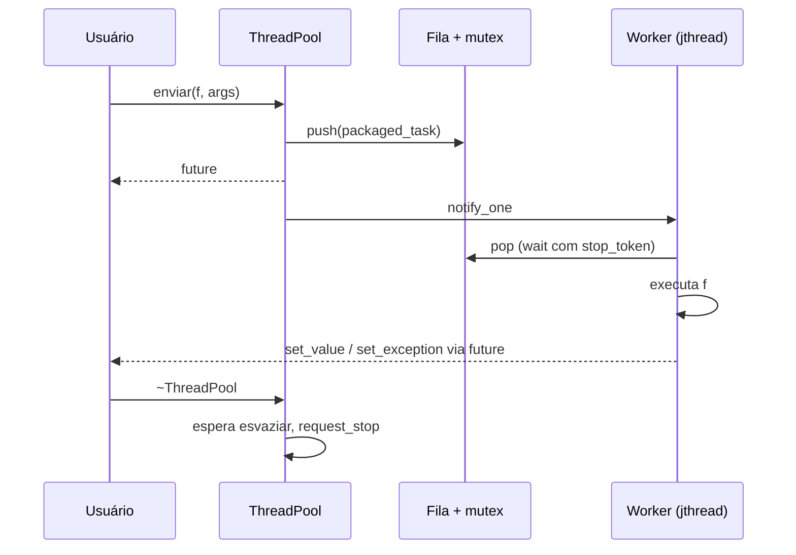

# Projeto 4 — Thread pool com futures

Um **pool de threads** reutilizável: você enfileira funções com `enviar(f, args...)` e recebe um `std::future` com o resultado (ou a exceção). Usa `std::jthread`, `std::stop_token` e `condition_variable_any` (C++20).

## Objetivos

- Implementar o padrão **produtor-consumidor** com fila protegida por mutex.
- Entregar resultados e **exceções** via `std::packaged_task`/`std::future`.
- Fazer o **desligamento cooperativo** com `std::stop_token`.
- Testar concorrência com testes de estresse e **ThreadSanitizer**.

## Conceitos praticados

- [[Threads e jthread]] e [[stop_token e Cancelamento]]
- [[Mutex e Locks]] e [[condition_variable]]
- [[future promise e async]] (`packaged_task`)
- [[Variadic Templates e Fold Expressions]] e [[std move e std forward]] (encaminhamento perfeito)
- [[Data Races e Deadlocks]]
- [[RAII]] (o destrutor garante o término limpo)

## Estrutura de pastas

```text
thread_pool/
├── CMakeLists.txt
├── include/
│   └── pool/
│       └── thread_pool.hpp
├── src/
│   └── main.cpp          # soma paralela de 50 milhões de números
└── tests/
    └── test_pool.cpp
```

## Arquitetura



**Decisões de projeto**

| Decisão | Motivo |
|---|---|
| `std::function<void()>` na fila | Apaga o tipo de retorno das tarefas ([[Type Erasure]]) |
| `packaged_task` em `shared_ptr` | `std::function` exige objeto **copiável** |
| `condition_variable_any::wait(lock, stop_token, pred)` | Acorda também quando há pedido de parada |
| `trabalhadores_` declarado por último | Destruído primeiro, antes dos membros que usa |
| Destrutor espera a fila esvaziar | Nenhuma tarefa enviada é perdida |

## `CMakeLists.txt`

```cmake
cmake_minimum_required(VERSION 3.20)
project(thread_pool VERSION 1.0 LANGUAGES CXX)

set(CMAKE_CXX_STANDARD 20)
set(CMAKE_CXX_STANDARD_REQUIRED ON)
set(CMAKE_CXX_EXTENSIONS OFF)

find_package(Threads REQUIRED)

add_library(pool INTERFACE)
target_include_directories(pool INTERFACE include)
target_link_libraries(pool INTERFACE Threads::Threads)
target_compile_features(pool INTERFACE cxx_std_20)

add_executable(soma_paralela src/main.cpp)
target_link_libraries(soma_paralela PRIVATE pool)
target_compile_options(soma_paralela PRIVATE -Wall -Wextra -Wpedantic)

enable_testing()
add_executable(test_pool tests/test_pool.cpp)
target_link_libraries(test_pool PRIVATE pool)
target_compile_options(test_pool PRIVATE -Wall -Wextra -Wpedantic)
add_test(NAME pool COMMAND test_pool)

# Opcional: configure com -DSANITIZE=thread (ou address) para rodar os testes com sanitizers
option(SANITIZE "sanitizer: thread|address|undefined" "")
if(SANITIZE)
  target_compile_options(test_pool PRIVATE -fsanitize=${SANITIZE} -g)
  target_link_options(test_pool PRIVATE -fsanitize=${SANITIZE})
endif()
```

## `include/pool/thread_pool.hpp`

```cpp
// arquivo: include/pool/thread_pool.hpp
// thread_pool.hpp — pool de threads com fila de tarefas, futures e desligamento cooperativo (C++20).
#pragma once

#include <condition_variable>
#include <cstddef>
#include <functional>
#include <future>
#include <memory>
#include <mutex>
#include <queue>
#include <stdexcept>
#include <stop_token>
#include <thread>
#include <tuple>
#include <type_traits>
#include <utility>
#include <vector>

namespace pool {

class ThreadPool {
public:
    explicit ThreadPool(std::size_t n = std::thread::hardware_concurrency()) {
        if (n == 0) n = 1;
        trabalhadores_.reserve(n);
        for (std::size_t i = 0; i < n; ++i)
            trabalhadores_.emplace_back([this](std::stop_token st) { laco(st); });   // jthread injeta o stop_token
    }

    // Cópia/movimento proibidos: as threads guardam 'this'.
    ThreadPool(const ThreadPool&) = delete;
    ThreadPool& operator=(const ThreadPool&) = delete;

    // Destrutor: o jthread chama request_stop() + join(). Antes, esperamos esvaziar a fila.
    ~ThreadPool() {
        {
            std::unique_lock lk{m_};
            encerrando_ = true;                             // novas submissões passam a ser recusadas
            drenado_.wait(lk, [this] { return fila_.empty() && ativas_ == 0; });
        }
        for (auto& t : trabalhadores_) t.request_stop();
        cv_.notify_all();                                   // acorda quem espera para ver o pedido de parada
    }

    // Enfileira f(args...) e devolve um future com o resultado (ou a exceção lançada).
    template <typename F, typename... Args>
    [[nodiscard]] auto enviar(F&& f, Args&&... args) -> std::future<std::invoke_result_t<F, Args...>> {
        using R = std::invoke_result_t<F, Args...>;
        auto tarefa = std::make_shared<std::packaged_task<R()>>(
            [fn = std::forward<F>(f), tup = std::make_tuple(std::forward<Args>(args)...)]() mutable -> R {
                return std::apply(std::move(fn), std::move(tup));
            });
        std::future<R> fut = tarefa->get_future();
        {
            std::lock_guard lk{m_};
            if (encerrando_) throw std::runtime_error{"pool encerrado"};
            fila_.emplace([tarefa] { (*tarefa)(); });
        }
        cv_.notify_one();
        return fut;
    }

    std::size_t threads() const { return trabalhadores_.size(); }

private:
    void laco(std::stop_token st) {
        for (;;) {
            std::function<void()> trabalho;
            {
                std::unique_lock lk{m_};
                // Espera: há tarefa OU pediram parada. condition_variable_any aceita stop_token.
                if (!cv_.wait(lk, st, [this] { return !fila_.empty(); })) return;   // false = parada pedida e fila vazia
                trabalho = std::move(fila_.front());
                fila_.pop();
                ++ativas_;
            }
            trabalho();                                     // exceções ficam presas no future (packaged_task)
            {
                std::lock_guard lk{m_};
                --ativas_;
            }
            drenado_.notify_all();
        }
    }

    std::mutex m_;
    std::condition_variable_any cv_;                         // _any: wait(lock, stop_token, pred)
    std::condition_variable_any drenado_;
    std::queue<std::function<void()>> fila_;
    std::size_t ativas_ = 0;
    bool encerrando_ = false;
    std::vector<std::jthread> trabalhadores_;               // declarado por último: destruído primeiro
};

}  // namespace pool
```

## `src/main.cpp`

```cpp
// arquivo: src/main.cpp
// main.cpp — soma paralela de um vetor grande com o ThreadPool.
#include <chrono>
#include <iostream>
#include <numeric>
#include <vector>

#include "pool/thread_pool.hpp"

int main() {
    std::vector<long> dados(50'000'000);
    std::iota(dados.begin(), dados.end(), 1L);                 // 1..N

    pool::ThreadPool pool{4};
    const std::size_t pedacos = 16;
    const std::size_t tam = dados.size() / pedacos;

    const auto t0 = std::chrono::steady_clock::now();
    std::vector<std::future<long>> parciais;
    for (std::size_t p = 0; p < pedacos; ++p) {
        auto ini = dados.begin() + static_cast<long>(p * tam);
        auto fim = p + 1 == pedacos ? dados.end() : ini + static_cast<long>(tam);
        parciais.push_back(pool.enviar([ini, fim] { return std::accumulate(ini, fim, 0L); }));
    }

    long total = 0;
    for (auto& f : parciais) total += f.get();                 // get() bloqueia até a tarefa terminar
    const auto ms = std::chrono::duration<double, std::milli>(std::chrono::steady_clock::now() - t0).count();

    std::cout << "soma = " << total << " (esperado " << 50'000'000L * 50'000'001L / 2 << ")\n";
    std::cout << pool.threads() << " threads, " << ms << " ms\n";
}
```

## `tests/test_pool.cpp`

Três tipos de teste: resultado correto, propagação de exceção e **estresse** (10 000 tarefas) para garantir que o destrutor drena a fila.

```cpp
// arquivo: tests/test_pool.cpp
// test_pool.cpp — testes funcionais e de estresse do ThreadPool.
#include <atomic>
#include <iostream>
#include <stdexcept>
#include <string>
#include <vector>

#include "pool/thread_pool.hpp"

namespace {
int falhas = 0;
void verifica(bool cond, const char* msg) {
    if (!cond) { std::cout << "FALHA: " << msg << '\n'; ++falhas; }
}
}  // namespace

int main() {
    {   // resultados e argumentos
        pool::ThreadPool p{3};
        auto f = p.enviar([](int a, int b) { return a + b; }, 20, 22);
        auto s = p.enviar([](std::string x) { return x + "!"; }, std::string{"oi"});
        verifica(f.get() == 42, "soma");
        verifica(s.get() == "oi!", "string");
    }
    {   // exceções atravessam o future
        pool::ThreadPool p{2};
        auto f = p.enviar([]() -> int { throw std::runtime_error{"boom"}; });
        bool capturou = false;
        try { f.get(); } catch (const std::runtime_error& e) { capturou = std::string{e.what()} == "boom"; }
        verifica(capturou, "exceção propagada");
    }
    {   // estresse: muitas tarefas, contador atômico; o destrutor deve esperar todas
        std::atomic<int> contador{0};
        {
            pool::ThreadPool p{4};
            for (int i = 0; i < 10000; ++i) (void)p.enviar([&contador] { contador.fetch_add(1); });
        }
        verifica(contador.load() == 10000, "destrutor drena a fila");
    }
    {   // pool com 0 vira 1 thread
        pool::ThreadPool p{0};
        verifica(p.threads() == 1, "n=0 → 1 thread");
    }
    std::cout << (falhas == 0 ? "todos os testes passaram\n" : "há falhas\n");
    return falhas;
}
```

## Compilar, testar e executar

```bash
cmake -S . -B build -G Ninja && cmake --build build
ctest --test-dir build --output-on-failure
./build/soma_paralela
# soma = 1250000025000000 (esperado 1250000025000000)

# Rodar os testes com ThreadSanitizer
cmake -S . -B build-tsan -G Ninja -DSANITIZE=thread && cmake --build build-tsan
./build-tsan/test_pool
```

> [!success] Verificação
> Compilado com `g++ 13` (`-std=c++20 -Wall -Wextra -Wpedantic`); `ctest` passou e o executável `test_pool` rodou **sem relatórios** do ThreadSanitizer.

## Pontos de atenção

> [!warning] Deadlock por tarefas dependentes
> Se uma tarefa do pool espera (`get()`) o resultado de outra tarefa do **mesmo** pool e todas as threads estão ocupadas, o programa trava. Evite ou use pools separados.

> [!warning] Exceções
> Exceções ficam presas no `future`; se ninguém chamar `get()`, elas são perdidas silenciosamente.

> [!warning] Tarefas muito pequenas
> O custo de enfileirar e acordar threads pode superar o ganho. Agrupe o trabalho em pedaços (como no `main`).

## Extensões sugeridas

1. **Prioridades** de tarefas (`std::priority_queue`).
2. *Work stealing*: uma fila por thread e roubo quando ociosa.
3. `std::move_only_function` (C++23) no lugar de `std::function`+`shared_ptr`.
4. Fila **limitada** com *backpressure*.
5. Método `parallel_for(inicio, fim, f)` construído sobre o pool.
6. Comparar com `std::async`, TBB e `std::execution::par` ([[Algoritmos Paralelos]]).

## Veja também

- [[MOC - Projetos - Cpp]]
- [[Threads e jthread]]
- [[condition_variable]]
- [[Algoritmos Paralelos]]
- [[Projeto 3 - Biblioteca de Matrizes]]

## Exercício

1. Adicione `esperar_todas()` que bloqueia até a fila esvaziar sem destruir o pool.
2. Implemente `enviar` com prioridade e escreva um teste que prove a ordem.
3. Meça o *speedup* de 1, 2, 4 e 8 threads no `soma_paralela` e explique o resultado.
