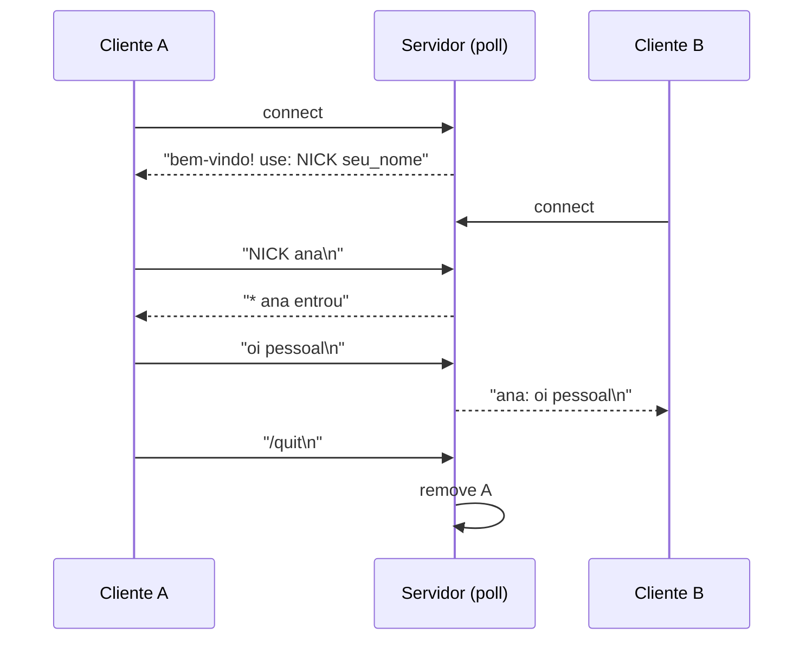

# Projeto 5 — Servidor de chat TCP

Um servidor de chat em **sockets POSIX** com um único laço `poll()`: vários clientes conectam, escolhem um apelido (`NICK nome`) e suas mensagens são retransmitidas aos demais. Sem threads e sem locks no servidor — a concorrência vem da **multiplexação de I/O**. Funciona em Linux e macOS.

## Objetivos

- Entender o modelo cliente/servidor TCP: `socket`, `bind`, `listen`, `accept`, `recv`, `send`.
- Multiplexar muitas conexões em uma thread com `poll()`.
- Tratar o **enquadramento**: TCP é um *fluxo de bytes*, não de mensagens; o protocolo usa uma linha por mensagem.
- Embrulhar descritores em **RAII** (`Fd`) e tratar erros do SO com `std::system_error`.
- Testar rede de forma determinística em `127.0.0.1` com porta escolhida pelo SO.

## Conceitos praticados

- [[RAII]] e [[Semântica de Movimento]] (a classe `Fd` é *move-only*)
- [[Cpp em Sistemas Operacionais e Infraestrutura]] e [[Códigos de Erro e error_code]]
- [[stop_token e Cancelamento]] (parada cooperativa do laço)
- [[Threads e jthread]] (o servidor roda em uma `jthread` no teste)
- [[std string em Profundidade]] (buffer de entrada por cliente)
- [[Asio e Rede]] (a alternativa portátil)

## Estrutura de pastas

```text
chat/
├── CMakeLists.txt
├── include/
│   └── chat/
│       ├── rede.hpp          # Fd (RAII) + escutar/conectar/enviar_tudo
│       └── servidor.hpp      # Servidor (poll)
├── src/
│   ├── servidor_main.cpp     # executa o servidor (Ctrl+C encerra)
│   └── cliente_main.cpp      # cliente de terminal (jthread lê o socket)
└── tests/
    └── test_chat.cpp         # servidor em thread + clientes reais
```

## Arquitetura



**Protocolo** (texto, uma linha por mensagem):

| Linha | Efeito |
|---|---|
| `NICK NOME` | Define o apelido (até 20 caracteres, único) |
| `/quit` | Desconecta |
| qualquer outra | Enviada a **todos os outros** como `nick: texto` |

**Laço principal:** monte o vetor de `pollfd` (socket de escuta + clientes) → `poll()` → aceite novas conexões → leia dos prontos → acumule no buffer do cliente → extraia as **linhas completas** → processe.

## `CMakeLists.txt`

```cmake
cmake_minimum_required(VERSION 3.20)
project(chat_tcp VERSION 1.0 LANGUAGES CXX)

if(NOT UNIX)
  message(FATAL_ERROR "Este projeto usa sockets POSIX (Linux/macOS). No Windows, use Winsock ou Asio.")
endif()

set(CMAKE_CXX_STANDARD 20)
set(CMAKE_CXX_STANDARD_REQUIRED ON)
set(CMAKE_CXX_EXTENSIONS OFF)

find_package(Threads REQUIRED)

add_library(chat INTERFACE)
target_include_directories(chat INTERFACE include)
target_link_libraries(chat INTERFACE Threads::Threads)
target_compile_features(chat INTERFACE cxx_std_20)

add_executable(servidor src/servidor_main.cpp)
add_executable(cliente  src/cliente_main.cpp)
foreach(alvo servidor cliente)
  target_link_libraries(${alvo} PRIVATE chat)
  target_compile_options(${alvo} PRIVATE -Wall -Wextra -Wpedantic)
endforeach()

enable_testing()
add_executable(test_chat tests/test_chat.cpp)
target_link_libraries(test_chat PRIVATE chat)
target_compile_options(test_chat PRIVATE -Wall -Wextra -Wpedantic)
add_test(NAME chat COMMAND test_chat)
set_tests_properties(chat PROPERTIES TIMEOUT 30)
```

## `include/chat/rede.hpp`

A camada de sistema fica isolada aqui. `Fd` é o padrão **RAII** para recursos do SO ([[Deleters Customizados]] mostra a alternativa com `unique_ptr`): movível, não copiável, fecha no destrutor. `enviar_tudo` trata *envios parciais* e usa `MSG_NOSIGNAL` para não receber `SIGPIPE`.

```cpp
// arquivo: include/chat/rede.hpp
// rede.hpp — utilitários POSIX com RAII: descritor de arquivo e funções de socket TCP (IPv4).
#pragma once

#include <arpa/inet.h>
#include <netinet/in.h>
#include <sys/socket.h>
#include <unistd.h>

#include <cerrno>
#include <cstdint>
#include <string>
#include <string_view>
#include <system_error>
#include <utility>

namespace chat {

// Dono de um descritor: fecha no destrutor, não copiável, movível.
class Fd {
public:
    Fd() noexcept = default;
    explicit Fd(int fd) noexcept : fd_{fd} {}
    ~Fd() { reset(); }
    Fd(const Fd&) = delete;
    Fd& operator=(const Fd&) = delete;
    Fd(Fd&& o) noexcept : fd_{std::exchange(o.fd_, -1)} {}
    Fd& operator=(Fd&& o) noexcept {
        if (this != &o) { reset(); fd_ = std::exchange(o.fd_, -1); }
        return *this;
    }
    int get() const noexcept { return fd_; }
    explicit operator bool() const noexcept { return fd_ >= 0; }
    void reset() noexcept { if (fd_ >= 0) { ::close(fd_); fd_ = -1; } }

private:
    int fd_ = -1;
};

[[noreturn]] inline void falha(const char* oque) {
    throw std::system_error{errno, std::generic_category(), oque};
}

// Cria um socket de escuta em 127.0.0.1:porta (porta 0 = o SO escolhe uma livre).
inline Fd escutar(std::uint16_t porta, std::uint16_t& porta_real) {
    Fd s{::socket(AF_INET, SOCK_STREAM, 0)};
    if (!s) falha("socket");
    int sim = 1;
    ::setsockopt(s.get(), SOL_SOCKET, SO_REUSEADDR, &sim, sizeof sim);

    sockaddr_in addr{};
    addr.sin_family = AF_INET;
    addr.sin_addr.s_addr = htonl(INADDR_LOOPBACK);          // só local: seguro para estudo
    addr.sin_port = htons(porta);
    if (::bind(s.get(), reinterpret_cast<sockaddr*>(&addr), sizeof addr) != 0) falha("bind");
    if (::listen(s.get(), 16) != 0) falha("listen");

    socklen_t len = sizeof addr;
    ::getsockname(s.get(), reinterpret_cast<sockaddr*>(&addr), &len);
    porta_real = ntohs(addr.sin_port);
    return s;
}

inline Fd conectar(std::uint16_t porta) {
    Fd s{::socket(AF_INET, SOCK_STREAM, 0)};
    if (!s) falha("socket");
    sockaddr_in addr{};
    addr.sin_family = AF_INET;
    addr.sin_addr.s_addr = htonl(INADDR_LOOPBACK);
    addr.sin_port = htons(porta);
    if (::connect(s.get(), reinterpret_cast<sockaddr*>(&addr), sizeof addr) != 0) falha("connect");
    return s;
}

// Envia tudo (trata envios parciais e EINTR). Retorna false se a conexão caiu.
inline bool enviar_tudo(int fd, std::string_view dados) {
    while (!dados.empty()) {
        const ssize_t n = ::send(fd, dados.data(), dados.size(), MSG_NOSIGNAL);   // NOSIGNAL: sem SIGPIPE
        if (n < 0) {
            if (errno == EINTR) continue;
            return false;
        }
        dados.remove_prefix(static_cast<std::size_t>(n));
    }
    return true;
}

}  // namespace chat
```

## `include/chat/servidor.hpp`

Repare em `Cliente::entrada`: um `recv` pode devolver meia linha, ou duas linhas e meia. O servidor **só processa o que termina em `\n`** e guarda o resto. Esse é o bug mais comum em primeiros programas de rede. Observe também a **ordem de declaração** dos membros: `porta_` vem antes de `escuta_` porque o construtor de `escuta_` preenche `porta_`.

```cpp
// arquivo: include/chat/servidor.hpp
// servidor.hpp — servidor de chat de UMA thread, multiplexando conexões com poll().
#pragma once

#include <poll.h>

#include <algorithm>
#include <cstddef>
#include <map>
#include <stop_token>
#include <string>
#include <vector>

#include "chat/rede.hpp"

namespace chat {

class Servidor {
public:
    explicit Servidor(std::uint16_t porta = 0) : escuta_{escutar(porta, porta_)} {}

    std::uint16_t porta() const { return porta_; }

    // Laço principal. Retorna quando houver pedido de parada (stop_token).
    void executar(std::stop_token parar) {
        while (!parar.stop_requested()) {
            std::vector<pollfd> fds;
            fds.push_back({escuta_.get(), POLLIN, 0});
            for (const auto& [fd, _] : clientes_) fds.push_back({fd, POLLIN, 0});

            const int prontos = ::poll(fds.data(), static_cast<nfds_t>(fds.size()), 100);   // acorda a cada 100 ms
            if (prontos < 0) { if (errno == EINTR) continue; falha("poll"); }
            if (prontos == 0) continue;

            if (fds[0].revents & POLLIN) aceitar();

            std::vector<int> fechar;
            for (std::size_t i = 1; i < fds.size(); ++i)
                if (fds[i].revents & (POLLIN | POLLHUP | POLLERR))
                    if (!ler(fds[i].fd)) fechar.push_back(fds[i].fd);
            for (int fd : fechar) remover(fd);
        }
    }

private:
    struct Cliente {
        Fd fd;
        std::string nome;
        std::string entrada;        // bytes recebidos que ainda não formam uma linha completa
    };

    void aceitar() {
        Fd novo{::accept(escuta_.get(), nullptr, nullptr)};
        if (!novo) return;
        const int fd = novo.get();
        clientes_[fd] = Cliente{std::move(novo), "", ""};
        enviar_tudo(fd, "bem-vindo! use: NICK seu_nome\n");
    }

    // Lê o que estiver disponível e processa as linhas completas. false = fechar a conexão.
    bool ler(int fd) {
        char buf[1024];
        const ssize_t n = ::recv(fd, buf, sizeof buf, 0);
        if (n == 0) return false;                              // cliente fechou
        if (n < 0) return errno == EINTR || errno == EAGAIN;

        Cliente& c = clientes_.at(fd);
        c.entrada.append(buf, static_cast<std::size_t>(n));
        if (c.entrada.size() > 4096) return false;             // proteção: linha absurdamente longa

        for (std::size_t pos; (pos = c.entrada.find('\n')) != std::string::npos;) {
            std::string linha = c.entrada.substr(0, pos);
            c.entrada.erase(0, pos + 1);
            if (!linha.empty() && linha.back() == '\r') linha.pop_back();
            if (!processar(fd, c, linha)) return false;
        }
        return true;
    }

    bool processar(int fd, Cliente& c, const std::string& linha) {
        if (linha.rfind("NICK ", 0) == 0) {                    // começa com "NICK "
            std::string nome = linha.substr(5);
            const bool em_uso = std::any_of(clientes_.begin(), clientes_.end(),
                                            [&](const auto& kv) { return kv.second.nome == nome; });
            if (nome.empty() || nome.size() > 20 || em_uso) {
                enviar_tudo(fd, "erro: nome inválido ou em uso\n");
                return true;
            }
            c.nome = std::move(nome);
            transmitir("* " + c.nome + " entrou\n", -1);
            return true;
        }
        if (linha == "/quit") return false;
        if (c.nome.empty()) { enviar_tudo(fd, "defina um nome com NICK primeiro\n"); return true; }
        if (!linha.empty()) transmitir(c.nome + ": " + linha + "\n", fd);
        return true;
    }

    // Envia para todos os identificados (exceto 'exceto').
    void transmitir(const std::string& msg, int exceto) {
        for (auto& [fd, c] : clientes_)
            if (fd != exceto && !c.nome.empty()) enviar_tudo(fd, msg);
    }

    void remover(int fd) {
        const std::string nome = clientes_.at(fd).nome;
        clientes_.erase(fd);                                    // ~Fd fecha o socket
        if (!nome.empty()) transmitir("* " + nome + " saiu\n", -1);
    }

    std::uint16_t porta_ = 0;
    Fd escuta_;                                                 // inicializado depois de porta_ (ordem de declaração!)
    std::map<int, Cliente> clientes_;
};

}  // namespace chat
```

## `src/servidor_main.cpp`

```cpp
// arquivo: src/servidor_main.cpp
// servidor_main.cpp — executável do servidor. Ctrl+C encerra com limpeza.
#include <csignal>
#include <cstdlib>
#include <iostream>
#include <stop_token>
#include <thread>

#include "chat/servidor.hpp"

namespace {
std::stop_source g_parar;                       // acessado pelo manipulador de sinal
extern "C" void ao_receber_sinal(int) { g_parar.request_stop(); }   // request_stop é lock-free
}  // namespace

int main(int argc, char** argv) {
    const auto porta = static_cast<std::uint16_t>(argc > 1 ? std::atoi(argv[1]) : 5555);
    std::signal(SIGINT, ao_receber_sinal);
    std::signal(SIGTERM, ao_receber_sinal);
    try {
        chat::Servidor servidor{porta};
        std::cout << "chat escutando em 127.0.0.1:" << servidor.porta() << " (Ctrl+C para sair)\n";
        servidor.executar(g_parar.get_token());
        std::cout << "encerrado\n";
    } catch (const std::system_error& e) {
        std::cerr << "erro: " << e.what() << '\n';
        return 1;
    }
}
```

## `src/cliente_main.cpp`

```cpp
// arquivo: src/cliente_main.cpp
// cliente_main.cpp — cliente de terminal: uma thread lê o teclado, outra exibe o que chega.
#include <poll.h>

#include <cstdlib>
#include <iostream>
#include <string>
#include <thread>

#include "chat/rede.hpp"

int main(int argc, char** argv) {
    const auto porta = static_cast<std::uint16_t>(argc > 1 ? std::atoi(argv[1]) : 5555);
    try {
        chat::Fd sock = chat::conectar(porta);

        std::jthread receptor{[&sock](std::stop_token parar) {
            char buf[1024];
            while (!parar.stop_requested()) {
                pollfd p{sock.get(), POLLIN, 0};
                if (::poll(&p, 1, 100) <= 0) continue;
                const ssize_t n = ::recv(sock.get(), buf, sizeof buf, 0);
                if (n <= 0) { std::cout << "[conexão encerrada]\n"; std::exit(0); }
                std::cout.write(buf, n).flush();
            }
        }};

        std::string linha;
        while (std::getline(std::cin, linha)) {
            if (!chat::enviar_tudo(sock.get(), linha + "\n")) break;
            if (linha == "/quit") break;
        }
    } catch (const std::system_error& e) {
        std::cerr << "erro: " << e.what() << '\n';
        return 1;
    }
}
```

## `tests/test_chat.cpp`

O teste usa `Servidor{0}` (o SO escolhe a porta) e `espera_texto` com *timeout*, para nunca travar a suíte. Inclui o caso de **mensagem partida em dois envios**.

```cpp
// arquivo: tests/test_chat.cpp
// test_chat.cpp — sobe o servidor em uma thread, conecta clientes reais via loopback e verifica o protocolo.
#include <sys/time.h>

#include <chrono>
#include <iostream>
#include <string>
#include <thread>

#include "chat/servidor.hpp"

namespace {
int falhas = 0;
void verifica(bool cond, const char* msg) {
    if (!cond) { std::cout << "FALHA: " << msg << '\n'; ++falhas; }
}

// Lê do socket até o texto conter 'procurado' ou estourar o tempo (2 s).
bool espera_texto(chat::Fd& s, const std::string& procurado, std::string& acumulado) {
    timeval tv{2, 0};
    ::setsockopt(s.get(), SOL_SOCKET, SO_RCVTIMEO, &tv, sizeof tv);
    char buf[512];
    while (acumulado.find(procurado) == std::string::npos) {
        const ssize_t n = ::recv(s.get(), buf, sizeof buf, 0);
        if (n <= 0) return false;
        acumulado.append(buf, static_cast<std::size_t>(n));
    }
    return true;
}
}  // namespace

int main() {
    chat::Servidor servidor{0};                                 // porta 0: o SO escolhe uma livre
    const auto porta = servidor.porta();
    std::jthread th{[&servidor](std::stop_token st) { servidor.executar(st); }};

    chat::Fd a = chat::conectar(porta);
    chat::Fd b = chat::conectar(porta);
    std::string sa, sb;

    verifica(espera_texto(a, "bem-vindo", sa), "a recebe boas-vindas");
    verifica(espera_texto(b, "bem-vindo", sb), "b recebe boas-vindas");

    chat::enviar_tudo(a.get(), "NICK ana\n");
    chat::enviar_tudo(b.get(), "NICK beto\n");
    verifica(espera_texto(a, "beto entrou", sa), "a vê que beto entrou");

    chat::enviar_tudo(a.get(), "oi pessoal\n");
    verifica(espera_texto(b, "ana: oi pessoal", sb), "b recebe mensagem de ana");

    chat::enviar_tudo(b.get(), "NICK ana\n");                   // nome em uso
    verifica(espera_texto(b, "erro: nome", sb), "nome duplicado é recusado");

    chat::enviar_tudo(b.get(), "mensagem ");                    // pedaço sem '\n'
    std::this_thread::sleep_for(std::chrono::milliseconds(150));
    chat::enviar_tudo(b.get(), "completa\n");                   // a linha só fecha aqui
    verifica(espera_texto(a, "beto: mensagem completa", sa), "linhas fragmentadas são remontadas");

    chat::enviar_tudo(b.get(), "/quit\n");
    verifica(espera_texto(a, "beto saiu", sa), "a vê que beto saiu");

    th.request_stop();
    th.join();
    std::cout << (falhas == 0 ? "todos os testes passaram\n" : "há falhas\n");
    return falhas;
}
```

## Compilar, testar e executar

```bash
cmake -S . -B build -G Ninja && cmake --build build
ctest --test-dir build --output-on-failure

# Três terminais:
./build/servidor 5555            # terminal 1
./build/cliente 5555             # terminal 2:  NICK ana   depois: oi!
./build/cliente 5555             # terminal 3:  NICK bob   (recebe "ana: oi!")

# Alternativa sem o cliente: netcat
nc 127.0.0.1 5555
```

> [!success] Verificação
> Compilado com `g++ 13` (`-std=c++20 -Wall -Wextra -Wpedantic`); `ctest` passou (servidor em thread + dois clientes reais em `127.0.0.1`).

## Pontos de atenção

> [!warning] Escritas parciais
> `send` pode enviar menos bytes do que o pedido, ou bloquear com um cliente lento. Em produção, mantenha um **buffer de saída por cliente** e use `POLLOUT`.

> [!warning] SIGPIPE
> Escrever em um socket fechado gera `SIGPIPE` e mata o processo. O código usa `MSG_NOSIGNAL`.

> [!warning] Sem criptografia nem autenticação
> Escuta apenas em `127.0.0.1`. Para expor na rede, use TLS e valide todas as entradas ([[Segurança e Hardening]]).

> [!warning] Portabilidade
> `poll` e sockets BSD são POSIX. No Windows use `WSAPoll`/Winsock ou, melhor, [[Asio e Rede]].

## Extensões sugeridas

1. **Salas** (`/join sala`) e mensagens privadas (`/msg bob oi`).
2. Buffers de saída com `POLLOUT` para clientes lentos.
3. Trocar `poll` por `epoll` (Linux) e medir com milhares de conexões.
4. Reescrever com **Asio e corrotinas** ([[Corrotinas Cpp20]]).
5. TLS com OpenSSL ou Boost.Asio SSL.
6. Histórico persistente das últimas N mensagens ao entrar na sala.

## Veja também

- [[MOC - Projetos - Cpp]]
- [[Asio e Rede]]
- [[Cpp em Sistemas Operacionais e Infraestrutura]]
- [[Projeto 4 - Thread Pool]]
- [[Segurança e Hardening]]

## Exercício

1. Limite o número de clientes simultâneos e recuse novos com uma mensagem.
2. Escreva um teste que envia 100 mensagens rápidas e verifica a ordem de chegada.
3. Implemente o comando `/quem` listando os apelidos conectados.
