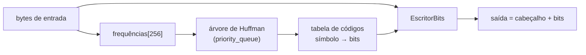

# Projeto 6 — Compressor de Huffman

Um compressor/descompressor de arquivos sem perdas baseado no **código de Huffman**: símbolos frequentes recebem códigos curtos e símbolos raros, códigos longos. Cobre `priority_queue`, manipulação de bits, validação de entrada não confiável e testes de *round-trip*.

## Objetivos

- Construir a árvore de Huffman com `std::priority_queue` (ordenação **determinística**).
- Escrever e ler um **fluxo de bits** sobre `std::vector<uint8_t>`.
- Definir um **formato binário** com cabeçalho, magia e serialização manual (portátil entre máquinas).
- Validar dados corrompidos e lançar exceções em vez de ler fora dos limites.
- Medir a razão de compressão.

## Conceitos praticados

- [[Adaptadores de Contêiner]] (`priority_queue`)
- [[span]] como parâmetro (sem cópias)
- [[Serialização]] (little endian manual)
- [[Operadores - Cpp]] bit a bit (`<<`, `>>`, `&`, `|`)
- [[Exceções try catch throw]] para dados inválidos
- [[Structured Bindings]] (`auto [i, pref] = ...`)

## Estrutura de pastas

```text
huffman/
├── CMakeLists.txt
├── include/
│   └── huffman/
│       └── huffman.hpp      # árvore, códigos, bits, comprimir/descomprimir
├── src/
│   └── main.cpp             # CLI: huff c|d ENTRADA SAIDA
└── tests/
    └── test_huffman.cpp
```

## Arquitetura



**Formato do arquivo comprimido**

| Offset | Tamanho | Conteúdo |
|---|---|---|
| 0 | 4 | Magia `HUF1` |
| 4 | 8 | Tamanho original (uint64, little endian) |
| 12 | 256 × 4 | Frequência de cada byte (uint32, little endian) |
| 1036 | resto | Fluxo de bits (MSB primeiro) |

Guardar as 256 frequências torna a **descompressão idêntica à compressão** (reconstrói a mesma árvore). O custo fixo de 1 KiB de cabeçalho é aceitável aqui; compressores reais armazenam apenas os comprimentos dos códigos (*canonical Huffman*).

**Casos especiais:** entrada vazia (só cabeçalho) e **um único símbolo distinto** (a árvore ganha um pai artificial para que o código tenha 1 bit).

## `CMakeLists.txt`

```cmake
cmake_minimum_required(VERSION 3.20)
project(huffman VERSION 1.0 LANGUAGES CXX)

set(CMAKE_CXX_STANDARD 20)
set(CMAKE_CXX_STANDARD_REQUIRED ON)
set(CMAKE_CXX_EXTENSIONS OFF)

add_library(huffman INTERFACE)
target_include_directories(huffman INTERFACE include)
target_compile_features(huffman INTERFACE cxx_std_20)

add_executable(huff src/main.cpp)
target_link_libraries(huff PRIVATE huffman)
target_compile_options(huff PRIVATE -Wall -Wextra -Wpedantic)

enable_testing()
add_executable(test_huffman tests/test_huffman.cpp)
target_link_libraries(test_huffman PRIVATE huffman)
target_compile_options(test_huffman PRIVATE -Wall -Wextra -Wpedantic)
add_test(NAME huffman COMMAND test_huffman)
```

## `include/huffman/huffman.hpp`

```cpp
// arquivo: include/huffman/huffman.hpp
// huffman.hpp — compressão de Huffman: contagem de frequências, árvore, códigos e fluxo de bits.
#pragma once

#include <array>
#include <cstddef>
#include <cstdint>
#include <queue>
#include <span>
#include <stdexcept>
#include <string>
#include <vector>

namespace huffman {

using Bytes = std::vector<std::uint8_t>;

struct ErroFormato : std::runtime_error {
    using std::runtime_error::runtime_error;
};

namespace detalhe {

// Nó da árvore guardado em um vetor (índices em vez de ponteiros: simples e amigável ao cache).
struct No {
    std::uint64_t peso = 0;
    int esq = -1, dir = -1;      // -1 em folhas
    int simbolo = -1;            // 0..255 em folhas
    bool folha() const { return simbolo >= 0; }
};

using Frequencias = std::array<std::uint32_t, 256>;

inline std::vector<No> construir_arvore(const Frequencias& freq) {
    std::vector<No> nos;
    // Fila de prioridade de índices: menor peso primeiro; empate resolvido pelo índice → resultado determinístico
    auto maior = [&nos](int a, int b) {
        return nos[a].peso != nos[b].peso ? nos[a].peso > nos[b].peso : a > b;
    };
    std::priority_queue<int, std::vector<int>, decltype(maior)> fila{maior};

    for (int s = 0; s < 256; ++s) {
        if (freq[s] == 0) continue;
        nos.push_back({freq[s], -1, -1, s});
        fila.push(static_cast<int>(nos.size()) - 1);
    }
    if (nos.empty()) return nos;
    if (nos.size() == 1) {                                    // um único símbolo: cria um pai para que o código tenha 1 bit
        nos.push_back({nos[0].peso, 0, 0, -1});
        return nos;                                            // raiz = último nó
    }
    while (fila.size() > 1) {
        const int a = fila.top(); fila.pop();
        const int b = fila.top(); fila.pop();
        nos.push_back({nos[a].peso + nos[b].peso, a, b, -1});
        fila.push(static_cast<int>(nos.size()) - 1);
    }
    return nos;                                                // raiz = último nó
}

// Gera o código (sequência de '0'/'1') de cada símbolo percorrendo a árvore.
inline std::array<std::string, 256> gerar_codigos(const std::vector<No>& nos) {
    std::array<std::string, 256> codigos;
    if (nos.empty()) return codigos;
    struct Item { int no; std::string prefixo; };
    std::vector<Item> pilha{{static_cast<int>(nos.size()) - 1, ""}};
    while (!pilha.empty()) {
        auto [i, pref] = std::move(pilha.back());
        pilha.pop_back();
        const No& n = nos[static_cast<std::size_t>(i)];
        if (n.folha()) { codigos[static_cast<std::size_t>(n.simbolo)] = pref.empty() ? "0" : pref; continue; }
        pilha.push_back({n.esq, pref + '0'});
        if (n.dir != n.esq) pilha.push_back({n.dir, pref + '1'});
    }
    return codigos;
}

class EscritorBits {
public:
    void bit(bool b) {
        if (usados_ == 0) bytes_.push_back(0);
        if (b) bytes_.back() = static_cast<std::uint8_t>(bytes_.back() | (1u << (7 - usados_)));
        usados_ = (usados_ + 1) % 8;
    }
    Bytes&& finalizar() { return std::move(bytes_); }
private:
    Bytes bytes_;
    int usados_ = 0;             // bits já usados no último byte (0 = precisa abrir novo byte)
};

constexpr std::array<std::uint8_t, 4> kMagia{'H', 'U', 'F', '1'};
constexpr std::size_t kCabecalho = 4 + 8 + 256 * 4;           // magia + tamanho original + frequências

inline void escrever_u32(Bytes& b, std::uint32_t v) { for (int i = 0; i < 4; ++i) b.push_back(static_cast<std::uint8_t>(v >> (8 * i))); }
inline void escrever_u64(Bytes& b, std::uint64_t v) { for (int i = 0; i < 8; ++i) b.push_back(static_cast<std::uint8_t>(v >> (8 * i))); }
inline std::uint32_t ler_u32(const std::uint8_t* p) { std::uint32_t v = 0; for (int i = 3; i >= 0; --i) v = (v << 8) | p[i]; return v; }
inline std::uint64_t ler_u64(const std::uint8_t* p) { std::uint64_t v = 0; for (int i = 7; i >= 0; --i) v = (v << 8) | p[i]; return v; }

}  // namespace detalhe

inline Bytes comprimir(std::span<const std::uint8_t> entrada) {
    using namespace detalhe;
    Frequencias freq{};
    for (auto b : entrada) {
        if (++freq[b] == 0) throw std::length_error{"entrada grande demais para o formato (contador de 32 bits)"};
    }

    Bytes saida(kMagia.begin(), kMagia.end());
    escrever_u64(saida, entrada.size());
    for (auto f : freq) escrever_u32(saida, f);

    const auto nos = construir_arvore(freq);
    const auto codigos = gerar_codigos(nos);
    EscritorBits bits;
    for (auto b : entrada)
        for (char c : codigos[b]) bits.bit(c == '1');
    Bytes corpo = bits.finalizar();
    saida.insert(saida.end(), corpo.begin(), corpo.end());
    return saida;
}

inline Bytes descomprimir(std::span<const std::uint8_t> dados) {
    using namespace detalhe;
    if (dados.size() < kCabecalho || !std::equal(kMagia.begin(), kMagia.end(), dados.begin()))
        throw ErroFormato{"cabeçalho inválido"};

    const std::uint64_t tamanho = ler_u64(dados.data() + 4);
    Frequencias freq{};
    std::uint64_t soma = 0;
    for (std::size_t i = 0; i < 256; ++i) { freq[i] = ler_u32(dados.data() + 12 + 4 * i); soma += freq[i]; }
    if (soma != tamanho) throw ErroFormato{"frequências inconsistentes"};      // validação de dados externos

    Bytes saida;
    if (tamanho == 0) return saida;
    saida.reserve(static_cast<std::size_t>(tamanho));

    const auto nos = construir_arvore(freq);
    const int raiz = static_cast<int>(nos.size()) - 1;
    int atual = raiz;
    const auto corpo = dados.subspan(kCabecalho);
    for (std::size_t i = 0; i < corpo.size() * 8 && saida.size() < tamanho; ++i) {
        const bool bit = (corpo[i / 8] >> (7 - i % 8)) & 1u;
        const No& n = nos[static_cast<std::size_t>(atual)];
        atual = bit ? n.dir : n.esq;
        const No& prox = nos[static_cast<std::size_t>(atual)];
        if (prox.folha()) { saida.push_back(static_cast<std::uint8_t>(prox.simbolo)); atual = raiz; }
    }
    if (saida.size() != tamanho) throw ErroFormato{"fluxo de bits truncado"};
    return saida;
}

}  // namespace huffman
```

## `src/main.cpp`

```cpp
// arquivo: src/main.cpp
// main.cpp — uso: huff c ENTRADA SAIDA   |   huff d ENTRADA SAIDA
#include <fstream>
#include <iostream>
#include <iterator>
#include <string>

#include "huffman/huffman.hpp"

namespace {

huffman::Bytes ler_arquivo(const std::string& caminho) {
    std::ifstream in{caminho, std::ios::binary};
    if (!in) throw std::runtime_error{"não foi possível abrir " + caminho};
    return huffman::Bytes{std::istreambuf_iterator<char>{in}, std::istreambuf_iterator<char>{}};
}

void gravar_arquivo(const std::string& caminho, const huffman::Bytes& dados) {
    std::ofstream out{caminho, std::ios::binary | std::ios::trunc};
    if (!out) throw std::runtime_error{"não foi possível criar " + caminho};
    out.write(reinterpret_cast<const char*>(dados.data()), static_cast<std::streamsize>(dados.size()));
    if (!out) throw std::runtime_error{"falha ao gravar " + caminho};
}

}  // namespace

int main(int argc, char** argv) {
    if (argc != 4 || (std::string{argv[1]} != "c" && std::string{argv[1]} != "d")) {
        std::cerr << "uso: " << argv[0] << " c|d ENTRADA SAIDA\n";
        return 2;
    }
    try {
        const auto entrada = ler_arquivo(argv[2]);
        const bool comprimir = std::string{argv[1]} == "c";
        const auto saida = comprimir ? huffman::comprimir(entrada) : huffman::descomprimir(entrada);
        gravar_arquivo(argv[3], saida);
        std::cout << entrada.size() << " -> " << saida.size() << " bytes";
        if (comprimir && !entrada.empty())
            std::cout << " (" << 100.0 * static_cast<double>(saida.size()) / static_cast<double>(entrada.size()) << "%)";
        std::cout << '\n';
    } catch (const std::exception& e) {
        std::cerr << "erro: " << e.what() << '\n';
        return 1;
    }
}
```

## `tests/test_huffman.cpp`

Observe a lista de casos de borda: vazio, um byte, um símbolo repetido, os 256 valores de byte (árvore profunda) e dados corrompidos.

```cpp
// arquivo: tests/test_huffman.cpp
// test_huffman.cpp — ida e volta (round-trip), casos de borda e dados corrompidos.
#include <iostream>
#include <random>
#include <string>

#include "huffman/huffman.hpp"

namespace {
int falhas = 0;
void verifica(bool cond, const std::string& msg) {
    if (!cond) { std::cout << "FALHA: " << msg << '\n'; ++falhas; }
}

huffman::Bytes bytes_de(const std::string& s) { return huffman::Bytes(s.begin(), s.end()); }

void round_trip(const std::string& nome, const huffman::Bytes& original) {
    const auto comp = huffman::comprimir(original);
    const auto volta = huffman::descomprimir(comp);
    verifica(volta == original, "round-trip: " + nome);
}
}  // namespace

int main() {
    round_trip("vazio", {});
    round_trip("um símbolo", bytes_de("aaaaaaaaaa"));
    round_trip("um byte", bytes_de("x"));
    round_trip("texto", bytes_de("abracadabra alakazam, o rato roeu a roupa do rei de roma"));

    // Todos os 256 valores de byte, repetidos com frequências diferentes (árvore profunda)
    huffman::Bytes todos;
    for (int v = 0; v < 256; ++v) for (int k = 0; k < 1 + v % 7; ++k) todos.push_back(static_cast<std::uint8_t>(v));
    round_trip("256 símbolos", todos);

    // Dados aleatórios grandes
    std::mt19937 rng{123};
    huffman::Bytes aleatorio(100000);
    for (auto& b : aleatorio) b = static_cast<std::uint8_t>(rng() % 20);   // alfabeto pequeno: comprime bem
    round_trip("aleatório 100k", aleatorio);
    verifica(huffman::comprimir(aleatorio).size() < aleatorio.size() * 6 / 10, "comprime alfabeto pequeno abaixo de 60%");

    // Entrada corrompida deve lançar ErroFormato, não travar nem ler fora dos limites
    auto ruim = huffman::comprimir(bytes_de("texto de teste para corromper"));
    ruim.resize(ruim.size() - 3);                                           // trunca o fluxo
    bool lancou = false;
    try { huffman::descomprimir(ruim); } catch (const huffman::ErroFormato&) { lancou = true; }
    verifica(lancou, "truncado lança ErroFormato");

    lancou = false;
    try { huffman::descomprimir(bytes_de("lixo")); } catch (const huffman::ErroFormato&) { lancou = true; }
    verifica(lancou, "cabeçalho inválido lança ErroFormato");

    std::cout << (falhas == 0 ? "todos os testes passaram\n" : "há falhas\n");
    return falhas;
}
```

## Compilar, testar e executar

```bash
cmake -S . -B build -G Ninja && cmake --build build
ctest --test-dir build --output-on-failure

seq 1 20000 > numeros.txt
./build/huff c numeros.txt numeros.huf     # 108894 -> 47233 bytes (43.3752%)
./build/huff d numeros.huf volta.txt
cmp numeros.txt volta.txt && echo IGUAIS
```

> [!success] Verificação
> Compilado com `g++ 13` (`-std=c++20 -Wall -Wextra -Wpedantic`); `ctest` passou, o teste também rodou com **AddressSanitizer + UBSan** sem erros e o *round-trip* de arquivo na CLI conferiu com `cmp`.

## Pontos de atenção

> [!warning] Profundidade da árvore
> Com frequências muito desiguais a árvore pode ter até 255 níveis; por isso os códigos são `std::string` de `'0'/'1'` e não um inteiro de 64 bits. Uma versão otimizada limita o comprimento (*length-limited Huffman*).

> [!warning] Desempenho
> Codificar bit a bit com `std::string` é didático, mas lento. Veja as extensões para uma versão com tabelas e *buffer* de 64 bits.

> [!warning] Arquivos enormes
> O contador de frequência é de 32 bits (limite de ~4 GiB por símbolo); o código lança `std::length_error` se estourar.

## Extensões sugeridas

1. **Canonical Huffman**: guarde apenas os comprimentos dos códigos (reduz o cabeçalho para ~256 bytes).
2. Decodificação com **tabela de consulta** de 8–12 bits em vez de percorrer a árvore bit a bit.
3. Compressão em **blocos** com `std::span` e paralelismo ([[Projeto 4 - Thread Pool]]).
4. Combinar com **LZ77** (a ideia do DEFLATE/gzip).
5. Verificação de integridade com **CRC32**.
6. Streaming: não carregar o arquivo inteiro na memória.

## Veja também

- [[MOC - Projetos - Cpp]]
- [[Adaptadores de Contêiner]]
- [[Serialização]]
- [[Projeto 7 - Máquina Virtual de Bytecode]]
- [[Fuzzing]]

## Exercício

1. Imprima a tabela de códigos de uma string e confira que nenhum código é prefixo de outro.
2. Calcule a **entropia** de Shannon do arquivo e compare com o resultado do compressor.
3. Escreva um alvo de *fuzzing* para `descomprimir` ([[Fuzzing]]).
