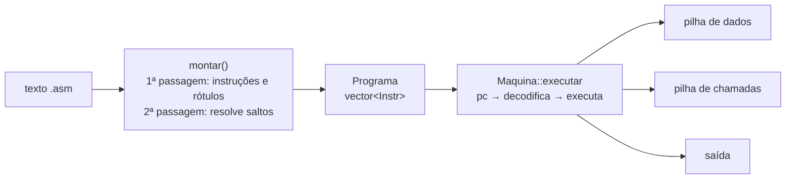

# Projeto 7 — Máquina virtual de bytecode

Uma **máquina virtual de pilha** (como a JVM ou o interpretador do Python, em miniatura) com um **montador** que converte texto assembly em bytecode. Programas têm variáveis, saltos condicionais, rótulos e sub-rotinas (`call`/`ret`). É o núcleo de qualquer linguagem interpretada.

## Objetivos

- Projetar um **conjunto de instruções** e um laço de busca-decodificação-execução.
- Implementar um **montador de duas passagens** (rótulos e referências futuras).
- Tornar a VM **segura** contra programas malformados: pilha vazia, divisão por zero, saltos inválidos, recursão e laços infinitos.
- Usar `enum class`, `switch` completo e *lambdas* genéricas.

## Conceitos praticados

- [[Controle de Fluxo]] e `enum class` ([[Tipos Fundamentais]])
- [[vector]] como pilha e [[map e set]] para rótulos
- [[Lambdas e Captura]] (operações binárias)
- [[Exceções try catch throw]] para erros da máquina
- [[std string em Profundidade]] e [[Streams e iostream]] (análise do texto)
- [[Segurança e Hardening]]: tratar bytecode como entrada **não confiável**

## Estrutura de pastas

```text
vm/
├── CMakeLists.txt
├── include/
│   └── vm/
│       └── vm.hpp          # Op, montar(), Maquina
├── exemplos/
│   ├── fatorial.asm
│   └── fibonacci.asm
├── src/
│   └── main.cpp            # vmrun programa.asm
└── tests/
    └── test_vm.cpp
```

## Arquitetura



**Instruções**

| Grupo | Instruções |
|---|---|
| Pilha | `push N`, `pop`, `dup`, `swap` |
| Aritmética | `add`, `sub`, `mul`, `div`, `mod` |
| Comparação | `eq`, `lt`, `gt` (empilham 1 ou 0) |
| Variáveis | `load i`, `store i` (16 variáveis) |
| Fluxo | `jmp R`, `jz R`, `call R`, `ret`, `halt` |
| E/S | `print` |

Cada instrução tem **um** argumento opcional (`Instr{op, arg}`): fácil de decodificar. Um `jz` consome o topo da pilha e salta se for zero.

## `CMakeLists.txt`

```cmake
cmake_minimum_required(VERSION 3.20)
project(maquina_virtual VERSION 1.0 LANGUAGES CXX)

set(CMAKE_CXX_STANDARD 20)
set(CMAKE_CXX_STANDARD_REQUIRED ON)
set(CMAKE_CXX_EXTENSIONS OFF)

add_library(vm INTERFACE)
target_include_directories(vm INTERFACE include)
target_compile_features(vm INTERFACE cxx_std_20)

add_executable(vmrun src/main.cpp)
target_link_libraries(vmrun PRIVATE vm)
target_compile_options(vmrun PRIVATE -Wall -Wextra -Wpedantic)

enable_testing()
add_executable(test_vm tests/test_vm.cpp)
target_link_libraries(test_vm PRIVATE vm)
target_compile_options(test_vm PRIVATE -Wall -Wextra -Wpedantic)
add_test(NAME vm COMMAND test_vm)

# Executa os exemplos como testes de integração
add_test(NAME fatorial COMMAND vmrun ${CMAKE_SOURCE_DIR}/exemplos/fatorial.asm)
set_tests_properties(fatorial PROPERTIES PASS_REGULAR_EXPRESSION "3628800")
```

## `include/vm/vm.hpp`

Duas decisões a notar: (1) **todo acesso** à pilha, às variáveis e ao contador de programa é verificado, porque o bytecode é entrada externa; (2) `limite_passos` impede que um laço infinito trave o hospedeiro (*fuel*).

```cpp
// arquivo: include/vm/vm.hpp
// vm.hpp — máquina virtual de pilha + montador (assembler) de texto para bytecode.
#pragma once

#include <array>
#include <cstddef>
#include <cstdint>
#include <map>
#include <ostream>
#include <sstream>
#include <stdexcept>
#include <string>
#include <string_view>
#include <vector>

namespace vm {

struct Erro : std::runtime_error {
    using std::runtime_error::runtime_error;
};

// Conjunto de instruções. 'enum class' impede conversões implícitas acidentais.
enum class Op : std::uint8_t {
    Push,    // push N          empilha o literal N
    Pop,     // pop             descarta o topo
    Dup,     // dup             duplica o topo
    Swap,    // swap            troca os dois do topo
    Add, Sub, Mul, Div, Mod,    // a b -> (a op b)
    Eq, Lt, Gt,                 // a b -> 1 ou 0
    Load,    // load i          empilha variável i
    Store,   // store i         desempilha para a variável i
    Jmp,     // jmp ROTULO
    Jz,      // jz ROTULO       salta se o topo (desempilhado) for 0
    Call,    // call ROTULO     empilha endereço de retorno e salta
    Ret,     // ret
    Print,   // print           desempilha e imprime
    Halt
};

struct Instr {
    Op op;
    std::int64_t arg = 0;
};

using Programa = std::vector<Instr>;

namespace detalhe {

inline const std::map<std::string, Op, std::less<>>& tabela_mnemonicos() {
    static const std::map<std::string, Op, std::less<>> t{
        {"push", Op::Push}, {"pop", Op::Pop}, {"dup", Op::Dup}, {"swap", Op::Swap},
        {"add", Op::Add}, {"sub", Op::Sub}, {"mul", Op::Mul}, {"div", Op::Div}, {"mod", Op::Mod},
        {"eq", Op::Eq}, {"lt", Op::Lt}, {"gt", Op::Gt}, {"load", Op::Load}, {"store", Op::Store},
        {"jmp", Op::Jmp}, {"jz", Op::Jz}, {"call", Op::Call}, {"ret", Op::Ret},
        {"print", Op::Print}, {"halt", Op::Halt}};
    return t;
}

inline bool tem_argumento(Op op) {
    switch (op) {
        case Op::Push: case Op::Load: case Op::Store: case Op::Jmp: case Op::Jz: case Op::Call: return true;
        default: return false;
    }
}
inline bool eh_salto(Op op) { return op == Op::Jmp || op == Op::Jz || op == Op::Call; }

}  // namespace detalhe

// Montador de duas passagens: 1) coleta rótulos e instruções; 2) resolve rótulos em endereços.
// Sintaxe:  "rotulo:"  |  "mnemonico [argumento]"  |  comentários com '#'
inline Programa montar(std::string_view fonte) {
    struct Pendente { std::string rotulo; std::size_t linha; };
    Programa prog;
    std::map<std::string, std::size_t> rotulos;
    std::map<std::size_t, Pendente> referencias;      // índice da instrução → rótulo a resolver

    std::istringstream ss{std::string{fonte}};
    std::string linha;
    std::size_t n_linha = 0;
    while (std::getline(ss, linha)) {
        ++n_linha;
        if (const auto c = linha.find('#'); c != std::string::npos) linha.erase(c);
        std::istringstream ls{linha};
        std::string tok;
        if (!(ls >> tok)) continue;                       // linha vazia

        if (tok.back() == ':') {                          // definição de rótulo
            tok.pop_back();
            if (!rotulos.emplace(tok, prog.size()).second)
                throw Erro{"linha " + std::to_string(n_linha) + ": rótulo duplicado '" + tok + "'"};
            if (!(ls >> tok)) continue;                   // rótulo sozinho na linha
        }

        const auto it = detalhe::tabela_mnemonicos().find(tok);
        if (it == detalhe::tabela_mnemonicos().end())
            throw Erro{"linha " + std::to_string(n_linha) + ": instrução desconhecida '" + tok + "'"};

        Instr ins{it->second};
        if (detalhe::tem_argumento(ins.op)) {
            std::string arg;
            if (!(ls >> arg)) throw Erro{"linha " + std::to_string(n_linha) + ": falta o argumento de '" + tok + "'"};
            if (detalhe::eh_salto(ins.op)) {
                referencias[prog.size()] = {arg, n_linha};
            } else {
                try { ins.arg = std::stoll(arg); }
                catch (const std::exception&) { throw Erro{"linha " + std::to_string(n_linha) + ": número inválido '" + arg + "'"}; }
            }
        }
        prog.push_back(ins);
    }

    for (const auto& [idx, ref] : referencias) {
        const auto r = rotulos.find(ref.rotulo);
        if (r == rotulos.end()) throw Erro{"linha " + std::to_string(ref.linha) + ": rótulo indefinido '" + ref.rotulo + "'"};
        prog[idx].arg = static_cast<std::int64_t>(r->second);
    }
    return prog;
}

class Maquina {
public:
    static constexpr std::size_t kVariaveis = 16;
    static constexpr std::size_t kPilhaMax = 1024;

    // Executa até Halt ou fim do programa. 'limite_passos' protege contra laços infinitos.
    void executar(const Programa& prog, std::ostream& saida, std::uint64_t limite_passos = 10'000'000) {
        pilha_.clear();
        chamadas_.clear();
        vars_.fill(0);
        std::size_t pc = 0;

        for (std::uint64_t passos = 0; pc < prog.size(); ++passos) {
            if (passos >= limite_passos) throw Erro{"limite de passos excedido (laço infinito?)"};
            const Instr& i = prog[pc++];
            switch (i.op) {
                case Op::Push:  empilhar(i.arg); break;
                case Op::Pop:   desempilhar(); break;
                case Op::Dup:   { auto v = desempilhar(); empilhar(v); empilhar(v); break; }
                case Op::Swap:  { auto b = desempilhar(), a = desempilhar(); empilhar(b); empilhar(a); break; }
                case Op::Add:   binaria([](auto a, auto b) { return a + b; }); break;
                case Op::Sub:   binaria([](auto a, auto b) { return a - b; }); break;
                case Op::Mul:   binaria([](auto a, auto b) { return a * b; }); break;
                case Op::Div:   { auto b = desempilhar(), a = desempilhar(); if (b == 0) throw Erro{"divisão por zero"}; empilhar(a / b); break; }
                case Op::Mod:   { auto b = desempilhar(), a = desempilhar(); if (b == 0) throw Erro{"módulo por zero"}; empilhar(a % b); break; }
                case Op::Eq:    binaria([](auto a, auto b) { return static_cast<std::int64_t>(a == b); }); break;
                case Op::Lt:    binaria([](auto a, auto b) { return static_cast<std::int64_t>(a < b); }); break;
                case Op::Gt:    binaria([](auto a, auto b) { return static_cast<std::int64_t>(a > b); }); break;
                case Op::Load:  empilhar(vars_.at(indice(i.arg))); break;
                case Op::Store: vars_.at(indice(i.arg)) = desempilhar(); break;
                case Op::Jmp:   pc = destino(i.arg, prog); break;
                case Op::Jz:    if (desempilhar() == 0) pc = destino(i.arg, prog); break;
                case Op::Call:
                    if (chamadas_.size() >= kPilhaMax) throw Erro{"estouro da pilha de chamadas"};
                    chamadas_.push_back(pc);
                    pc = destino(i.arg, prog);
                    break;
                case Op::Ret:
                    if (chamadas_.empty()) throw Erro{"ret sem call"};
                    pc = chamadas_.back();
                    chamadas_.pop_back();
                    break;
                case Op::Print: saida << desempilhar() << '\n'; break;
                case Op::Halt:  return;
            }
        }
    }

    const std::vector<std::int64_t>& pilha() const noexcept { return pilha_; }

private:
    void empilhar(std::int64_t v) {
        if (pilha_.size() >= kPilhaMax) throw Erro{"estouro da pilha de dados"};
        pilha_.push_back(v);
    }
    std::int64_t desempilhar() {
        if (pilha_.empty()) throw Erro{"pilha vazia"};
        const auto v = pilha_.back();
        pilha_.pop_back();
        return v;
    }
    template <typename F>
    void binaria(F f) { const auto b = desempilhar(), a = desempilhar(); empilhar(f(a, b)); }

    static std::size_t indice(std::int64_t i) {
        if (i < 0 || static_cast<std::size_t>(i) >= kVariaveis) throw Erro{"variável fora do intervalo"};
        return static_cast<std::size_t>(i);
    }
    static std::size_t destino(std::int64_t d, const Programa& p) {
        if (d < 0 || static_cast<std::size_t>(d) > p.size()) throw Erro{"salto para endereço inválido"};
        return static_cast<std::size_t>(d);
    }

    std::vector<std::int64_t> pilha_;
    std::vector<std::size_t> chamadas_;
    std::array<std::int64_t, kVariaveis> vars_{};
};

}  // namespace vm
```

## `exemplos/fatorial.asm`

```text
# Fatorial de 10 com laço. Variáveis: 0 = n, 1 = acumulador
        push 10
        store 0
        push 1
        store 1
laco:   load 0
        jz fim            # se n == 0 termina
        load 1
        load 0
        mul
        store 1           # acc = acc * n
        load 0
        push 1
        sub
        store 0           # n = n - 1
        jmp laco
fim:    load 1
        print             # 3628800
        halt
```

## `exemplos/fibonacci.asm`

```text
# Imprime os 10 primeiros números de Fibonacci usando uma sub-rotina.
# Variáveis: 0 = a, 1 = b, 2 = contador
        push 0
        store 0
        push 1
        store 1
        push 10
        store 2
proximo: load 2
        jz fim
        call passo
        load 2
        push 1
        sub
        store 2
        jmp proximo
fim:    halt

passo:  load 0
        print             # imprime a
        load 0
        load 1
        add               # a + b
        load 1
        store 0           # a = b
        store 1           # b = a + b
        ret
```

## `src/main.cpp`

```cpp
// arquivo: src/main.cpp
// main.cpp — uso: vm programa.asm   (monta e executa)
#include <fstream>
#include <iostream>
#include <sstream>

#include "vm/vm.hpp"

int main(int argc, char** argv) {
    if (argc != 2) { std::cerr << "uso: " << argv[0] << " programa.asm\n"; return 2; }
    std::ifstream in{argv[1]};
    if (!in) { std::cerr << "não foi possível abrir " << argv[1] << '\n'; return 1; }
    std::stringstream buf;
    buf << in.rdbuf();

    try {
        const vm::Programa prog = vm::montar(buf.str());
        std::cerr << "[" << prog.size() << " instruções]\n";
        vm::Maquina m;
        m.executar(prog, std::cout);
    } catch (const vm::Erro& e) {
        std::cerr << "erro: " << e.what() << '\n';
        return 1;
    }
}
```

## `tests/test_vm.cpp`

```cpp
// arquivo: tests/test_vm.cpp
// test_vm.cpp — executa programas em assembly e compara a saída.
#include <iostream>
#include <sstream>
#include <string>

#include "vm/vm.hpp"

namespace {
int falhas = 0;

std::string rodar(const std::string& fonte, std::uint64_t limite = 1'000'000) {
    std::ostringstream out;
    vm::Maquina m;
    m.executar(vm::montar(fonte), out, limite);
    return out.str();
}

void espera(const std::string& nome, const std::string& fonte, const std::string& saida) {
    try {
        const auto r = rodar(fonte);
        if (r != saida) { std::cout << "FALHA: " << nome << " obteve '" << r << "'\n"; ++falhas; }
    } catch (const std::exception& e) {
        std::cout << "FALHA: " << nome << " lançou: " << e.what() << '\n';
        ++falhas;
    }
}

void espera_erro(const std::string& nome, const std::string& fonte) {
    try { rodar(fonte, 1000); std::cout << "FALHA: " << nome << " deveria falhar\n"; ++falhas; }
    catch (const vm::Erro&) {}
}
}  // namespace

int main() {
    espera("aritmética", "push 6\npush 7\nmul\nprint\nhalt", "42\n");
    espera("comparação", "push 3\npush 5\nlt\nprint", "1\n");
    espera("dup/swap", "push 1\npush 2\nswap\nsub\nprint", "1\n");
    espera("rótulo na mesma linha", "ini: push 9\nprint", "9\n");
    espera("laço com contador", "push 3\nstore 0\nl: load 0\njz f\nload 0\nprint\nload 0\npush 1\nsub\nstore 0\njmp l\nf: halt",
           "3\n2\n1\n");
    espera("call/ret", "call f\npush 2\nprint\nhalt\nf: push 1\nprint\nret", "1\n2\n");

    espera_erro("pilha vazia", "add");
    espera_erro("divisão por zero", "push 1\npush 0\ndiv");
    espera_erro("laço infinito", "l: jmp l");
    espera_erro("rótulo indefinido", "jmp nada");
    espera_erro("instrução desconhecida", "foo 1");
    espera_erro("rótulo duplicado", "a: push 1\na: push 2");
    espera_erro("variável inválida", "push 1\nstore 99");
    espera_erro("recursão infinita", "f: call f");
    espera_erro("ret sem call", "ret");

    std::cout << (falhas == 0 ? "todos os testes passaram\n" : "há falhas\n");
    return falhas;
}
```

## Compilar, testar e executar

```bash
cmake -S . -B build -G Ninja && cmake --build build
ctest --test-dir build --output-on-failure

./build/vmrun exemplos/fatorial.asm      # 3628800
./build/vmrun exemplos/fibonacci.asm     # 0 1 1 2 3 5 8 13 21 34
```

> [!success] Verificação
> Compilado com `g++ 13` (`-std=c++20 -Wall -Wextra -Wpedantic`); `ctest` passou (unidade + exemplo de fatorial) e os testes rodaram com **AddressSanitizer + UBSan** sem erros.

## Pontos de atenção

> [!warning] `switch` e `-Wswitch`
> Sem `default`, o compilador avisa se esquecer uma instrução nova. Mantenha assim: é uma rede de segurança.

> [!warning] Overflow de inteiros
> `int64_t` com sinal estoura em `mul`/`add` (UB). Em uma VM real, defina a semântica (arredondamento ou *trap*) usando `__builtin_mul_overflow` ou aritmética sem sinal.

> [!warning] Desempenho
> `switch` em laço é razoável; VMs de alto desempenho usam *computed goto* e instruções de largura variável.

## Extensões sugeridas

1. Instruções `lt/gt` com `jlt/jgt` fundidas (super-instruções) e medição.
2. **Pilha de quadros** com variáveis locais por chamada (recursão real).
3. Serializar o bytecode em formato binário (cabeçalho + instruções) e carregar sem o montador.
4. Um **compilador** da calculadora ([[Projeto 1 - Calculadora de Expressões]]) para este bytecode.
5. Segurança: validar o bytecode **antes** de executar (verificador, como o da JVM).
6. Coletor de lixo e objetos (heap) simples.

## Veja também

- [[MOC - Projetos - Cpp]]
- [[Projeto 1 - Calculadora de Expressões]]
- [[Controle de Fluxo]]
- [[Exceções try catch throw]]
- [[Segurança e Hardening]]

## Exercício

1. Escreva em assembly um programa que imprima os números primos até 50.
2. Adicione as instruções `and`, `or`, `not`.
3. Implemente `disassemble(Programa)` que imprime o bytecode legível.
